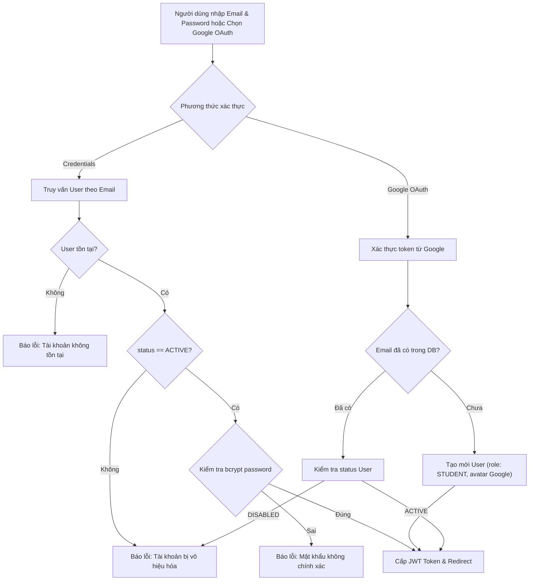

# Đặc Tả Tính Năng: Đăng Nhập & Google OAuth 2.0

> **Mã tính năng:** `FR-AUTH-02`, `FR-AUTH-03`  
> **Thuộc cụm:** `01_AUTHENTICATION`  
> **Tác nhân thực hiện:** Khách vãng lai (Visitor), Sinh viên (Student), Quản trị viên (Admin)  
> **Mức độ ưu tiên:** Bắt buộc (P0 - MVP)  
> **Trạng thái:** Confirmed  

---

## 1. Mục Tiêu & Nghiệp Vụ

Cung cấp cơ chế xác thực an toàn cho người dùng đã có tài khoản để truy cập vào các tính năng bảo vệ của hệ thống:
1. **Đăng nhập truyền thống (Credentials):** Người dùng nhập Email và Mật khẩu. Hệ thống so khớp mật khẩu qua `bcrypt.compare`.
2. **Đăng nhập Google OAuth 2.0:** Cho phép người dùng liên kết tài khoản Google để đăng nhập một chạm nhanh chóng.
   - Nếu tài khoản Google có email chưa tồn tại: Tự động khởi tạo tài khoản `STUDENT` mới với trạng thái `ACTIVE` và ảnh đại diện lấy từ Google Profile.
   - Nếu tài khoản Google có email đã tồn tại: Cập nhật thông tin phiên và cấp quyền tương ứng.
3. **Kiểm tra trạng thái tài khoản trước khi cấp quyền:**
   - Nếu tài khoản có `status: "DISABLED"`, hệ thống từ chối đăng nhập ngay lập tức với thông báo: *"Tài khoản của bạn đã bị vô hiệu hóa. Vui lòng liên hệ ban quản trị."*
4. **Phát hành Token phiên:** Cấp JSON Web Token (JWT) an toàn, thời hạn 30 ngày, lưu trong HTTP-only Cookie nhằm chống tấn công XSS.

---

## 2. Luồng Xử Lý Chi Tiết (Flow Chart)



---

## 3. Đặc Tả Kỹ Thuật (NextAuth Configuration)

File cấu hình chính: [`src/lib/auth.ts`](file:///c:/Users/AD/OneDrive/Desktop/Project/ULIS_DMST_2026/src/lib/auth.ts):

### 3.1 Dữ liệu chứa trong JWT Token & Session
```typescript
interface SessionUser {
  id: string;        // ID người dùng (MongoDB ObjectId)
  name: string;      // Họ tên
  email: string;     // Email
  role: "STUDENT" | "ADMIN"; // Vai trò để phân quyền route
  image?: string;    // Avatar URL
}
```

### 3.2 Hành vi Điều hướng sau Đăng nhập (Role-based Redirect)
- Nếu người dùng có vai trò `ADMIN`: Tự động chuyển hướng về Trang tổng quan quản trị (`/admin/dashboard`).
- Nếu người dùng có vai trò `STUDENT`: Chuyển hướng về Trang khám phá cơ hội (`/explore`) hoặc trang họ vừa xem trước đó (thông qua query parameter `callbackUrl`).

---

## 4. Tiêu Chí Chấp Thuận & Ca Kiểm Thử

### Kịch bản 1: Đăng nhập thành công với tài khoản hợp lệ
- **Given:** Người dùng nhập email `student@unera.edu.vn` và mật khẩu `Student@123456`.
- **When:** Hệ thống kiểm tra thông tin.
- **Then:** Mật khẩu khớp, trạng thái `ACTIVE`.
- **And:** Cookie phiên `authjs.session-token` được thiết lập với cờ `HttpOnly`, `SameSite=Lax`, `Secure`.
- **And:** Chuyển hướng thành công về trang chủ.

### Kịch bản 2: Chặn tài khoản bị vô hiệu hóa (DISABLED)
- **Given:** Tài khoản `bi_khoa@unera.edu.vn` có trạng thái `DISABLED`.
- **When:** Người dùng nhập đúng mật khẩu và gửi form đăng nhập.
- **Then:** Hệ thống từ chối cấp phiên.
- **And:** Hiển thị thông báo yêu cầu liên hệ ban quản trị.

### Kịch bản 3: Đăng nhập bằng Google tạo mới tài khoản
- **Given:** Sinh viên dùng tài khoản Google `nguyenvana@gmail.com` lần đầu đăng nhập.
- **When:** Google xác thực thành công và trả về thông tin profile.
- **Then:** Hệ thống tự động tạo User mới với vai trò `STUDENT` và tạo bản ghi `StudentProfile` tương ứng.
- **And:** Đăng nhập thành công.
