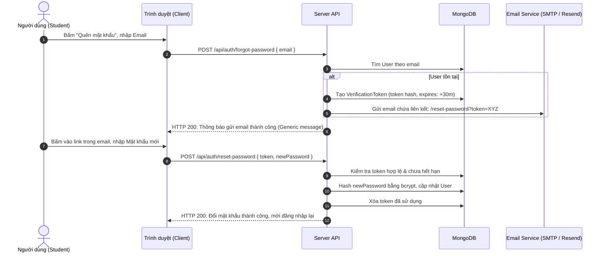

# Đặc Tả Tính Năng: Khôi Phục Mật Khẩu & Xác Thực Email

> **Mã tính năng:** `FR-AUTH-05`, `FR-AUTH-06`  
> **Thuộc cụm:** `01_AUTHENTICATION`  
> **Tác nhân thực hiện:** Khách vãng lai (Visitor), Sinh viên (Student)  
> **Mức độ ưu tiên:** Quan trọng (P1)  
> **Trạng thái:** Confirmed (Quy trình) & TBD (Chính sách bắt buộc xác thực)  

---

## 1. Mục Tiêu & Nghiệp Vụ

1. **Khôi phục mật khẩu (Password Recovery - FR-AUTH-05):**
   - Cho phép người dùng quên mật khẩu yêu cầu liên kết đặt lại mật khẩu gửi về địa chỉ email đã đăng ký.
   - Token đặt lại mật khẩu phải là chuỗi ngẫu nhiên bảo mật cao (cryptographically secure), có thời gian hết hạn nghiêm ngặt (tối đa 15–30 phút) và chỉ được sử dụng duy nhất một lần (single-use).
   - Cơ chế chống quét thông tin (User Enumeration Protection): Khi người dùng nhập email vào form quên mật khẩu, hệ thống luôn trả về thông báo chung: *"Nếu email tồn tại trong hệ thống, chúng tôi đã gửi hướng dẫn đặt lại mật khẩu"*, không tiết lộ việc email đó có tồn tại hay không.
2. **Xác thực Email (Email Verification - FR-AUTH-06):**
   - Hỗ trợ gửi email kèm liên kết xác thực khi người dùng đăng ký mới.
   - **Lưu ý quyết định nghiệp vụ:** Việc xác thực email có bắt buộc trước khi cho phép sử dụng nền tảng hay không hiện tại là **TBD** (Chưa quyết định theo SRS 1.0 mục 4.1.6). Do đó, hệ thống không được tự ý chặn truy cập của sinh viên chưa xác thực email trừ khi có quyết định chính thức.

---

## 2. Luồng Xử Lý (Sequence Diagram)

---

## 3. Tiêu Chí Chấp Thuận

- **AC-01:** Token đặt lại mật khẩu hết hạn sau 30 phút. Nếu người dùng bấm link sau 31 phút, hệ thống báo lỗi *"Liên kết đã hết hạn, vui lòng yêu cầu lại"*.
- **AC-02:** Token sau khi đã dùng để đổi mật khẩu thành công không thể tái sử dụng lần thứ hai.
- **AC-03:** Mật khẩu mới bắt buộc phải thỏa mãn độ dài tối thiểu 6 ký tự.

