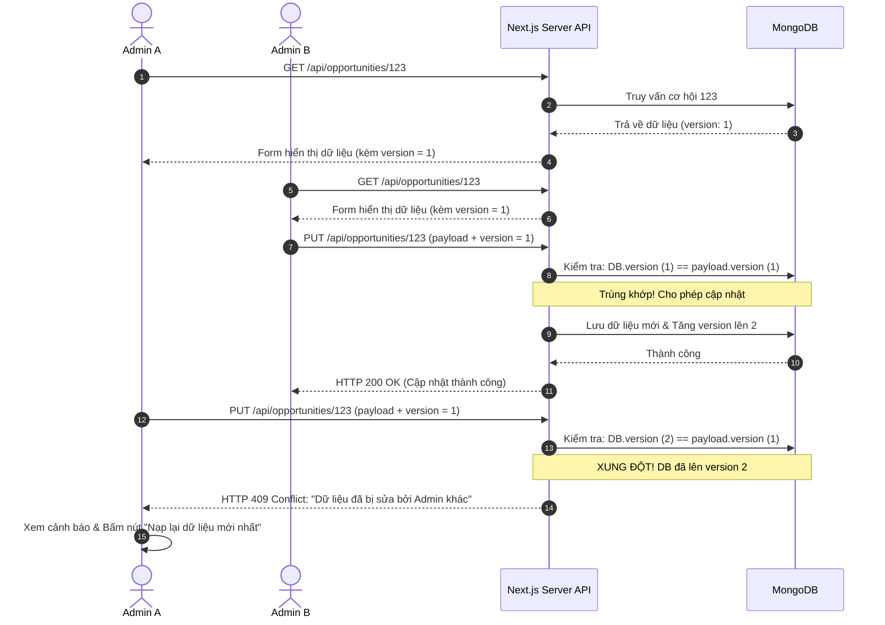

# Đặc Tả Tính Năng: Kiểm Soát Cập Nhật Đồng Thời (Optimistic Locking)

> **Mã tính năng:** `FR-EXP-14`, `FR-EXP-15`, `FR-ADM-16`, `FR-ADM-17`, `FR-ADM-18`, `FR-ADM-19`  
> **Thuộc cụm:** `05_06_EXPLORE_AND_SEARCH`  
> **Tác nhân:** Quản trị viên (Admin), Hệ thống (System)  
> **Mức độ ưu tiên:** Bắt buộc (P0 - Crucial Invariant)  
> **Trạng thái:** Confirmed Requirement  

---

## 1. Bối Cảnh & Vấn Đề Nghiệp Vụ

Hệ thống UNERA hỗ trợ nhiều tài khoản Admin cùng quản trị dữ liệu đồng thời. Khi hai Admin (Admin A và Admin B) cùng mở form chỉnh sửa một Cơ hội tại cùng một thời điểm:
- Nếu Admin B lưu trước, phiên bản trong CSDL đã thay đổi.
- Nếu không có cơ chế bảo vệ, khi Admin A bấm lưu sau đó, dữ liệu của Admin A (vốn dựa trên dữ liệu cũ) sẽ **âm thầm ghi đè và làm mất sạch các sửa đổi của Admin B** (Lost Update Problem).
- Yêu cầu đặt ra: Hệ thống phải phát hiện xung đột phiên bản, từ chối việc ghi đè ngầm và cảnh báo Admin A.

---

## 2. Quy Trình Khóa Lạc Quan (Optimistic Locking Workflow)



---

## 3. Đặc Tả Kỹ Thuật Chi Tiết

1. **Trường dữ liệu trong Schema:**
   - Trường `version: { type: Number, default: 1, required: true }`.
2. **Xác thực Request phía Server (Zod):**
   ```typescript
   export const updateOpportunitySchema = z.object({
     title: z.string().optional(),
     // ...
     version: z.number({ required_error: "Bắt buộc gửi kèm version của bản ghi" }),
   });
   ```
3. **Mã phản hồi xung đột (HTTP 409 Conflict):**
   ```json
   {
     "error": "Xung đột cập nhật đồng thời! Bản ghi này đã được Admin khác cập nhật trước đó.",
     "conflict": true,
     "currentVersion": 2,
     "updatedAt": "2026-11-10T14:30:00Z"
   }
   ```
4. **Phản hồi giao diện (UI Action):**
   - Hiển thị hộp thoại cảnh báo: *"Cơ hội này vừa được cập nhật bởi một Admin khác vào lúc 14:30. Để tránh làm mất thông tin mới, vui lòng nạp lại dữ liệu."*
   - Cung cấp nút bấm **"Nạp lại dữ liệu mới nhất" (Reload)** để Admin A đồng bộ dữ liệu mới nhất vào form trước khi tiếp tục chỉnh sửa.

---

## 4. Tiêu Chí Chấp Thuận

- **AC-01:** Admin gửi request sửa cơ hội với `version` cũ hơn `version` hiện hành trong DB bị chặn lại với HTTP `409 Conflict`.
- **AC-02:** Sau khi lưu thành công, trường `version` trong CSDL tự động tăng lên 1 đơn vị.
