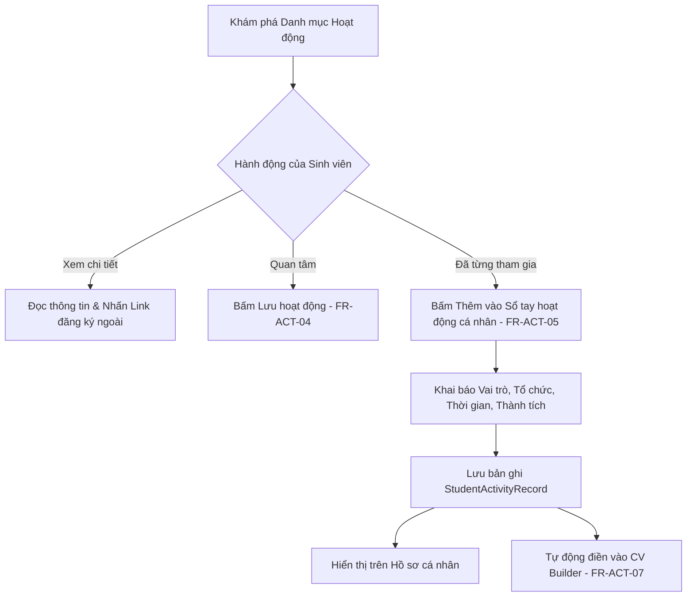

# Đặc Tả Tính Năng: Hoạt Động Ngoại Khóa & Sổ Tay Hoạt Động Sinh Viên

> **Mã tính năng:** `FR-ACT-01` đến `FR-ACT-07`  
> **Thuộc cụm:** Cụm 12 - Chứng Chỉ & Hoạt Động Sinh Viên  
> **Tác nhân:** Sinh viên (Student), Quản trị viên (Admin)

---

## 1. Mục Tiêu & Mô Tả Nghiệp Vụ

### 1.1 Danh mục hoạt động sinh viên (Activity Catalog - FR-ACT-01, 02, 03)
Hệ thống cung cấp danh mục tập hợp các hoạt động sinh viên đa dạng, gồm 5 phân nhóm chính:
- **Nghiên cứu khoa học (NCKH - Scientific Activities):** Các đề tài NCKH cấp Khoa/Trường/Bộ GD&ĐT, hội nghị sinh viên nghiên cứu khoa học.
- **Câu lạc bộ & Đội nhóm (Clubs & Societies):** Tuyển thành viên các CLB tiếng Anh, nghệ thuật, khởi nghiệp, tình nguyện viên.
- **Chiến dịch tình nguyện & Cộng đồng (Volunteering):** Tiếp sức mùa thi, Mùa hè xanh, hiến máu nhân đạo, hỗ trợ trẻ em vùng cao.
- **Cuộc thi học thuật & Kỹ năng (Competitions):** Cuộc thi khởi nghiệp sinh viên, giải Case Study kinh doanh, Hackathon công nghệ.
- **Hội thảo & Khóa đào tạo ngắn hạn (Events & Workshops):** Các buổi tọa đàm định hướng nghề nghiệp, kỹ năng đàm phán, giao lưu doanh nghiệp.

Mỗi hoạt động cung cấp thông tin chi tiết (`FR-ACT-02`): Tiêu đề, Đơn vị tổ chức, Mục tiêu hoạt động, Đối tượng tham gia (Eligibility), Thời gian & Địa điểm (Online/Trực tiếp), Quyền lợi (Giấy chứng nhận tham gia, Điểm rèn luyện).

> **Ranh giới quan trọng (`FR-ACT-03`):** Nền tảng hiển thị hướng dẫn đăng ký hoặc liên kết ngoài (Google Form, website BTC). Không triển khai cổng tiếp nhận đơn đăng ký trực tiếp trên nền tảng UNERA trong phạm vi phiên bản 1.0.

### 1.2 Lưu hoạt động quan tâm (Save Activity - FR-ACT-04)
- Sinh viên có thể bấm biểu tượng Bookmark để lưu lại các hoạt động đang mở đăng ký nhằm theo dõi thời gian tổ chức.
- Hoạt động đã lưu được tập hợp tại mục "Hoạt động đã lưu" và tích hợp danh sách nhắc hạn nếu sinh viên bấm "Thêm vào lịch".

### 1.3 Sổ tay hoạt động cá nhân & Tích hợp Hồ sơ/CV (FR-ACT-05, 07)
- **Sổ tay hoạt động (Personal Activity History - `FR-ACT-05`):** Sinh viên chủ động ghi chép các hoạt động đã và đang tham gia. Thông tin ghi nhận gồm:
  - Tên hoạt động (tự nhập hoặc chọn từ Danh mục hoạt động).
  - Loại hoạt động (`NCKH`, `CLB`, `VOLUNTEER`, `COMPETITION`, `WORKSHOP`).
  - Tổ chức/CLB đảm nhận.
  - Vai trò đảm nhiệm: *Trưởng ban tổ chức, Phó chủ nhiệm CLB, Trưởng nhóm đề tài, Tình nguyện viên nòng cốt, Thành viên ban nội dung...*
  - Thời gian tham gia: Tháng/Năm bắt đầu đến Tháng/Năm kết thúc (hoặc đang tham gia).
  - Thành tích / Đóng góp nổi bật: Giải thưởng đạt được, số lượng người tham gia điều phối, công trình được nghiệm thu.
- **Tích hợp Hồ sơ & CV (`FR-ACT-07`):** Toàn bộ lịch sử hoạt động được đồng bộ hiển thị trên trang Hồ sơ cá nhân (`StudentProfile`) và sẵn sàng trích xuất thành mục "Hoạt động ngoại khóa" trong Trình tạo CV (`CV Builder`).

### 1.4 Quản trị của Admin (FR-ACT-06)
- Admin thực hiện tạo mới, duyệt bài đăng hoạt động, chỉnh sửa nội dung, ghim hoạt động nổi bật, hoặc ẩn/lưu trữ các hoạt động đã kết thúc.

---

## 2. Luồng Nghiệp Vụ (Activity Business Flows)



---

## 3. Cấu Trúc Dữ Liệu (Data Schemas)

### 3.1 `ActivityCatalog` (Mục hoạt động trong danh mục chung)
```typescript
interface IActivityCatalog {
  _id: Types.ObjectId;
  title: string;
  category: 'NCKH' | 'CLB' | 'VOLUNTEER' | 'COMPETITION' | 'WORKSHOP';
  organizer: string; // VD: "Đoàn Thanh niên Trường ĐH Ngoại ngữ - ĐHQGHN"
  coverImage?: string;
  description: string;
  eligibility: string; // "Sinh viên năm 1, 2, 3 toàn quốc"
  benefits: string[]; // ["Giấy chứng nhận tham gia", "+5 điểm rèn luyện"]
  eventDate: {
    start: Date;
    end: Date;
  };
  registrationDeadline: Date;
  registrationUrl: string; // Link ngoài (Google Form / landing page)
  status: 'DRAFT' | 'PUBLISHED' | 'HIDDEN' | 'ARCHIVED';
  featured: boolean;
  createdAt: Date;
  updatedAt: Date;
}
```

### 3.2 `StudentActivityRecord` (Bản ghi hoạt động cá nhân của sinh viên)
```typescript
interface IStudentActivityRecord {
  _id: Types.ObjectId;
  studentId: Types.ObjectId;
  activityCatalogId?: Types.ObjectId; // Ref nếu liên kết với hoạt động có sẵn
  activityName: string; // Tên hoạt động
  role: string; // "Trưởng ban Đối ngoại", "Thành viên ban Truyền thông"
  organization: string; // "CLB Tiếng Anh Dynamic ULIS"
  startDate: Date;
  endDate?: Date; // Nếu null => "Đang tham gia"
  isCurrent: boolean;
  description?: string; // Tóm tắt nhiệm vụ
  achievements?: string; // "Giải Nhất Cuộc thi Hùng biện 2025"
  createdAt: Date;
  updatedAt: Date;
}
```

---

## 4. Đặc Tả Giao Diện (UI/UX Specification)

- **Trang Danh mục Hoạt động ngoại khóa (`/activities`):**
  - Thanh tab danh mục: `Tất cả`, `NCKH`, `CLB & Đội nhóm`, `Tình nguyện`, `Cuộc thi`, `Workshop`.
  - Khung thẻ hoạt động bo góc `rounded-2xl`, hiển thị ảnh banner, tên đơn vị tổ chức, ngày đóng đơn đăng ký, nút "Lưu" (Bookmark) và nút "Đăng ký tham gia $\nearrow$" dẫn tới link ngoài trong tab mới (`target="_blank" rel="noopener noreferrer"`).
- **Trang Sổ tay hoạt động sinh viên (`/profile/activities`):**
  - Dạng dòng thời gian (Timeline) thể hiện các hoạt động từ gần nhất đến xa nhất.
  - Mỗi thẻ hiển thị vai trò nổi bật, huy hiệu tổ chức, thời lượng tham gia (VD: *09/2024 - Hiện tại (6 tháng)*).
  - Nút thêm mới hiển thị Modal với trường nhập trực quan, có gợi ý tìm kiếm từ danh mục hoạt động sẵn có.

---

## 5. Đặc Tả API (API Specifications)

### 5.1 Lấy danh sách hoạt động ngoại khóa
- **Endpoint:** `GET /api/activities`
- **Method:** `GET`
- **Query:** `category`, `page=1`, `limit=12`, `status=PUBLISHED`
- **Response `200 OK`:** Trả về danh sách hoạt động kèm thông tin phân trang.

### 5.2 Lưu / Bỏ lưu hoạt động quan tâm
- **Endpoint:** `POST /api/activities/:id/save`
- **Quyền:** Sinh viên (`STUDENT`)
- **Response `200 OK`:** `{ "success": true, "saved": true }`

### 5.3 Thêm bản ghi hoạt động cá nhân vào Sổ tay
- **Endpoint:** `POST /api/profile/activities`
- **Method:** `POST`
- **Body:**
```json
{
  "activityName": "Đề tài NCKH Cấp Trường: Ứng dụng AI trong học dịch thuật",
  "role": "Trưởng nhóm nghiên cứu",
  "organization": "Khoa Sư phạm Tiếng Anh - ULIS",
  "startDate": "2024-10-01",
  "endDate": "2025-05-30",
  "isCurrent": false,
  "achievements": "Đạt giải Nhì NCKH cấp Trường năm học 2024-2025"
}
```
- **Response `201 Created`:** Bản ghi mới được tạo và tự động xuất hiện trên CV.

---

## 6. Tiêu Chí Nghiệm Thu (Acceptance Criteria)

```gherkin
Scenario: Sinh viên bấm liên kết đăng ký hoạt động ngoại khóa
  Given Sinh viên đang xem chi tiết hoạt động "Cuộc thi Sáng tạo Ý tưởng Khởi nghiệp 2026"
  When Sinh viên bấm nút "Đăng ký tại trang BTC"
  Then Hệ thống mở đường dẫn đăng ký ngoài trong một tab mới an toàn với rel="noopener noreferrer"
  And Hệ thống không yêu cầu sinh viên gửi hồ sơ dự thi qua UNERA

Scenario: Bản ghi hoạt động được đồng bộ sang Trình tạo CV
  Given Sinh viên đã lưu bản ghi hoạt động "Chủ nhiệm CLB Sách ULIS" trong Sổ tay hoạt động
  When Sinh viên truy cập vào Trình tạo CV (CV Builder - FR-TOOL-01)
  Then Hệ thống tự động gợi ý và hiển thị hoạt động "Chủ nhiệm CLB Sách ULIS" trong mục Kinh nghiệm / Hoạt động
  And Sinh viên có thể chọn đưa mục này vào bản xuất PDF CV
```

