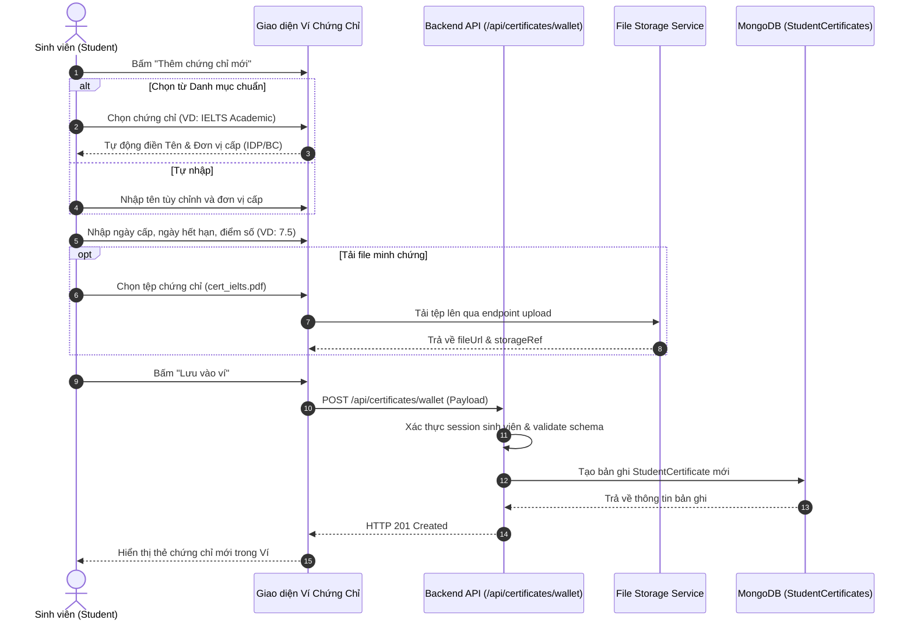

# Đặc Tả Tính Năng: Quản Lý Danh Mục Chứng Chỉ & Ví Chứng Chỉ Cá Nhân

> **Mã tính năng:** `FR-CERT-01` đến `FR-CERT-06`  
> **Thuộc cụm:** Cụm 12 - Chứng Chỉ & Hoạt Động Sinh Viên  
> **Tác nhân:** Sinh viên (Student), Quản trị viên (Admin)

---

## 1. Mục Tiêu & Mô Tả Nghiệp Vụ

### 1.1 Danh mục chứng chỉ chuẩn (Certificate Catalog - FR-CERT-01, 02, 03)
Hệ thống cung cấp danh mục chứng chỉ được phân loại chuẩn hóa theo lĩnh vực chuyên môn:
- **Ngoại ngữ (Foreign Languages):** IELTS, TOEFL iBT, TOEIC, HSK, HSKK, Topik, JLPT, DELF/DALF, TestDaF...
- **Công nghệ thông tin & Dữ liệu (IT & Tech):** AWS Certified, Google Cloud Certified, Cisco CCNA, Microsoft Certified, CompTIA Security+...
- **Kinh tế - Tài chính - Quản trị (Finance & Management):** CFA, ACCA, CMA, PMP, CAPM, Google Project Management...
- **Tin học ứng dụng & Đồ họa (Office & Design):** MOS (Microsoft Office Specialist), IC3, Adobe Certified Professional...

Mỗi chứng chỉ cung cấp thông tin chi tiết: Tên chứng chỉ, Đơn vị khảo thí/cấp chứng chỉ (Provider), Mô tả giá trị học thuật/nghề nghiệp, Thang điểm chuẩn, và **Thư viện tài nguyên ôn thi (`FR-CERT-03`)** gồm liên kết trang chủ đăng ký thi, giáo trình đề xuất, website luyện thi uy tín, bộ đề thi mẫu.

### 1.2 Ví chứng chỉ cá nhân của sinh viên (Personal Certificate Wallet - FR-CERT-04, 05)
- Sinh viên có một không gian số hóa quản lý toàn bộ văn bằng, chứng chỉ đã đạt được.
- Có thể thêm chứng chỉ bằng cách chọn từ Danh mục chuẩn (tự động điền tên, đơn vị cấp) hoặc tự khai báo chứng chỉ ngoài danh mục.
- Khai báo thông tin: Tên chứng chỉ, Đơn vị cấp, Ngày cấp (`issueDate`), Ngày hết hạn (`expiryDate` - nếu có), Điểm số hoặc Xếp loại (`scoreOrGrade`).
- **Đính kèm minh chứng (`FR-CERT-05`):** Cho phép tải tệp scan/ảnh chứng chỉ (PDF, JPG, PNG $\le$ 10MB tuân thủ `FR-FILE-01..05`) hoặc dẫn đường link tra cứu online (Credly, IDP, British Council verify link).
- Hỗ trợ xem danh sách thẻ chứng chỉ trực quan, chỉnh sửa thông tin, và xóa chứng chỉ khi không còn nhu cầu lưu trữ.

### 1.3 Quản trị Danh mục của Admin (FR-CERT-06)
- Admin có quyền tạo mới, chỉnh sửa, chuyển trạng thái hiển thị (`PUBLISHED` hoặc `HIDDEN`) cho các mục trong danh mục chứng chỉ chung.
- Quản trị viên không can thiệp hay sửa đổi trực tiếp dữ liệu ví cá nhân của sinh viên trừ trường hợp tiếp nhận báo cáo vi phạm hoặc hỗ trợ kỹ thuật.

---

## 2. Quy Trình Nghiệp Vụ (Business Flows)

### 2.1 Luồng Sinh Viên Thêm Chứng Chỉ Vào Ví Cá Nhân


---

## 3. Cấu Trúc Dữ Liệu (Data Schemas)

### 3.1 `CertificateCatalog` (Danh mục chứng chỉ chung của hệ thống)
```typescript
interface ICertificateCatalog {
  _id: Types.ObjectId;
  name: string; // VD: "IELTS Academic"
  code: string; // Mã viết tắt unique: "IELTS_ACADEMIC"
  provider: string; // VD: "IDP & British Council & Cambridge Assessment English"
  category: 'FOREIGN_LANG' | 'TECH' | 'FINANCE' | 'OFFICE' | 'PEDAGOGY' | 'OTHER';
  description: string;
  validityYears?: number; // Thời hạn hiệu lực (VD: 2 năm)
  gradingScale?: string; // VD: "0.0 - 9.0"
  resources: Array<{
    title: string; // "Trang đăng ký thi chính thức IDP"
    url: string;
    type: 'REGISTRATION' | 'OFFICIAL_SITE' | 'PRACTICE' | 'DOCUMENT';
  }>;
  status: 'PUBLISHED' | 'HIDDEN';
  createdAt: Date;
  updatedAt: Date;
}
```

### 3.2 `StudentCertificate` (Chứng chỉ trong ví của sinh viên)
```typescript
interface IStudentCertificate {
  _id: Types.ObjectId;
  studentId: Types.ObjectId; // Ref User/StudentProfile
  catalogRefId?: Types.ObjectId; // Ref CertificateCatalog (nếu chọn từ danh mục chuẩn)
  certificateName: string; // VD: "IELTS Academic"
  issuingOrganization: string; // "IDP Education"
  issueDate: Date;
  expiryDate?: Date; // Tùy chọn (đối với chứng chỉ có thời hạn)
  scoreOrGrade?: string; // "7.5 (L: 8.0, R: 8.0, W: 6.5, S: 7.0)"
  credentialId?: string; // Số hiệu chứng chỉ / Mã tra cứu
  evidenceFileUrl?: string; // URL tải file scan (an toàn)
  evidenceLink?: string; // Link verify ngoài (Credly, trang web trường)
  createdAt: Date;
  updatedAt: Date;
}
```

---

## 4. Đặc Tả Giao Diện (UI/UX Specification)

1. **Trang Thư viện Chứng chỉ (`/certificates`):**
   - Bộ lọc nhóm chứng chỉ (Tabs: Ngoại ngữ, Công nghệ, Tài chính, Tin học).
   - Thanh tìm kiếm theo tên hoặc nhà cung cấp.
   - Mỗi thẻ chứng chỉ hiển thị: Logo/Biểu tượng tổ chức, Tên chứng chỉ, Đơn vị cấp, Nhãn thời hạn (VD: "Có hạn 2 năm" hoặc "Vô thời hạn"). Nút "Xem chi tiết" mở Modal chứa mô tả và các nút tài nguyên ôn thi.
   - Nút hành động nhanh: "Thêm vào Ví của tôi".
2. **Trang Ví Chứng chỉ Cá nhân (`/profile/certificates` hoặc tab trong Hồ sơ):**
   - Danh sách thẻ chứng chỉ trực quan, sắp xếp theo thời gian cấp mới nhất.
   - Badge trạng thái thời hạn:
     - Xanh lá: `Đang hiệu lực`
     - Vàng: `Sắp hết hạn` (còn dưới 60 ngày)
     - Xám: `Đã hết hạn`
   - Nút "Xem minh chứng" mở modal xem tệp PDF hoặc ảnh scan.
   - Menu hành động (3 chấm): "Chỉnh sửa", "Tải xuống minh chứng", "Xóa khỏi ví".

---

## 5. Đặc Tả API (API Specifications)

### 5.1 Lấy danh mục chứng chỉ chuẩn
- **Endpoint:** `GET /api/certificates/catalog`
- **Quyền:** Mọi người dùng đã đăng nhập hoặc khách công khai
- **Query Params:** `category`, `search`, `page`, `limit`
- **Response `200 OK`:**
```json
{
  "success": true,
  "data": [
    {
      "id": "673000000000000000000010",
      "name": "IELTS Academic",
      "provider": "IDP & British Council",
      "category": "FOREIGN_LANG",
      "description": "Chứng chỉ đánh giá năng lực tiếng Anh học thuật quốc tế hàng đầu.",
      "validityYears": 2,
      "gradingScale": "0.0 - 9.0",
      "resources": [
        {
          "title": "Cổng thông tin IDP Việt Nam",
          "url": "https://www.idp.com/vietnam/ielts/",
          "type": "REGISTRATION"
        }
      ]
    }
  ]
}
```

### 5.2 Thêm chứng chỉ vào ví sinh viên
- **Endpoint:** `POST /api/certificates/wallet`
- **Quyền:** Sinh viên đã đăng nhập (`STUDENT`)
- **Request Body:**
```json
{
  "catalogRefId": "673000000000000000000010",
  "certificateName": "IELTS Academic",
  "issuingOrganization": "IDP Education",
  "issueDate": "2025-08-15",
  "expiryDate": "2027-08-15",
  "scoreOrGrade": "8.0",
  "credentialId": "VN00123456789",
  "evidenceFileUrl": "/uploads/certificates/user_123_cert.pdf",
  "evidenceLink": ""
}
```
- **Response `201 Created`:** Trả về đối tượng chứng chỉ vừa tạo kèm ID.

---

## 6. Tiêu Chí Nghiệm Thu (Acceptance Criteria)

```gherkin
Scenario: Sinh viên thêm chứng chỉ IELTS vào ví cá nhân thành công
  Given Sinh viên đã đăng nhập vào hệ thống UNERA
  When Sinh viên vào trang "Ví chứng chỉ" và nhấn "Thêm chứng chỉ"
  And Sinh viên chọn "IELTS Academic" từ danh mục chuẩn
  And Sinh viên điền điểm "7.5", ngày cấp "15/05/2025", ngày hết hạn "15/05/2027"
  And Sinh viên đính kèm tệp PDF scan bảng điểm dung lượng 2MB
  And Sinh viên nhấn nút "Lưu vào ví"
  Then Hệ thống lưu bản ghi vào cơ sở dữ liệu và trả về mã HTTP 201
  And Thẻ chứng chỉ IELTS 7.5 xuất hiện trong danh sách ví với nhãn "Đang hiệu lực"

Scenario: Tải tệp minh chứng chứng chỉ vượt quá dung lượng 10MB
  Given Sinh viên thực hiện thêm chứng chỉ vào ví
  When Sinh viên chọn tải lên tệp "bang_diem_nang.pdf" có kích thước 12MB
  Then Hệ thống từ chối tải tệp và hiển thị thông báo lỗi "Kích thước tệp không được vượt quá 10MB" theo chuẩn FR-FILE-02
  And Không có dữ liệu rác nào được lưu vào hệ thống
```

