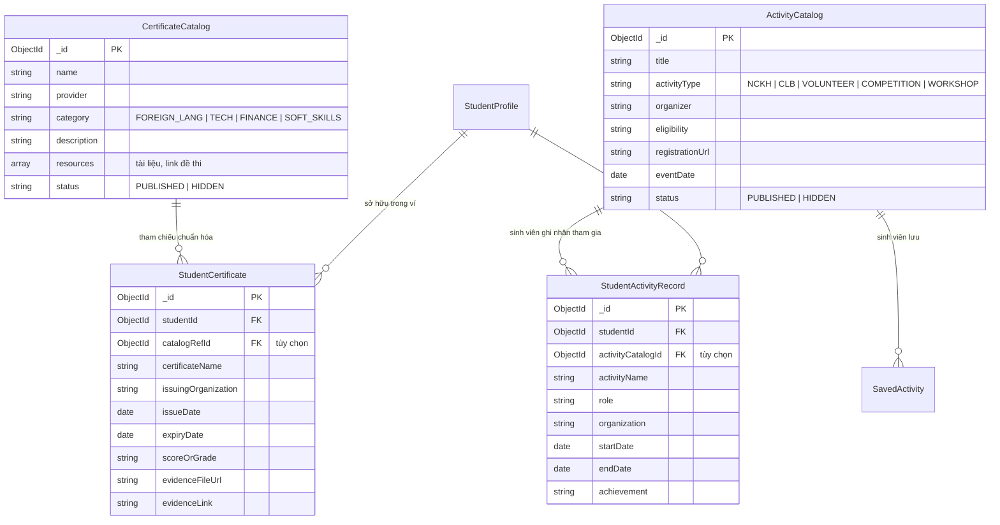

# Cụm Tính Năng 12: Chứng Chỉ & Hoạt Động Sinh Viên (Certificates & Student Activities)

> **Mã Module:** `CERT_ACT`  
> **Căn cứ SRS:** Mục 4.12 (FR-CERT-01 đến FR-CERT-06, FR-ACT-01 đến FR-ACT-07)  
> **Tác nhân:** Sinh viên (Student), Quản trị viên (Admin)  
> **Mục tiêu:** Cung cấp danh mục chứng chỉ chuẩn hóa (ngoại ngữ, tin học, chuyên môn) và danh mục hoạt động sinh viên (NCKH, CLB, tình nguyện, cuộc thi, hội thảo). Đồng thời cung cấp Ví chứng chỉ cá nhân và Lịch sử hoạt động để sinh viên lưu trữ bằng chứng, tích hợp trực tiếp vào hồ sơ và CV Builder.

---

## 1. Tổng Quan Nghiệp Vụ Cụm Tính Năng

Cụm tính năng được chia thành hai mảng song song mật thiết với nhau:

### 1.1 Quản lý Chứng chỉ (Certificates - FR-CERT-01 đến 06)
1. **Danh mục chứng chỉ chung (Certificate Catalog):**
   - Admin quản trị danh mục chứng chỉ uy tín (IELTS, TOEIC, JLPT, HSK, MOS, Google/AWS Cloud, CFA, PMP...).
   - Phân loại theo nhóm ngành/lĩnh vực (Ngoại ngữ, Tin học ứng dụng, Công nghệ - Kỹ thuật, Kinh tế - Tài chính, Sư phạm...).
   - Cung cấp tài liệu ôn tập, giáo trình tham khảo, đề thi mẫu và đường dẫn đăng ký thi chính thức.
2. **Ví chứng chỉ cá nhân (Personal Certificate Wallet):**
   - Sinh viên tự do lưu trữ hồ sơ chứng chỉ đã đạt được (chọn từ danh mục chuẩn hoặc tự nhập chứng chỉ khác).
   - Đính kèm tệp minh chứng (PDF, ảnh JPG/PNG $\le$ 10MB) hoặc đường link xác thực (Credly, trang tra cứu văn bằng).
   - Quản lý ngày cấp, ngày hết hạn và nhận thông báo nhắc gia hạn khi chứng chỉ sắp hết hiệu lực.

### 1.2 Quản lý Hoạt động Sinh viên (Activities - FR-ACT-01 đến 07)
1. **Danh mục hoạt động sinh viên (Activity Catalog):**
   - Admin đăng tải các hoạt động chính thức: Nghiên cứu khoa học (NCKH), CLB đội nhóm, Chiến dịch tình nguyện, Cuộc thi học thuật, Hội thảo/Workshop nâng cao năng lực.
   - Hiển thị tiêu chuẩn tham gia, thời gian, địa điểm, quyền lợi (điểm rèn luyện, giấy chứng nhận).
   - Hướng dẫn đăng ký hoặc liên kết ngoài (External Registration URL) đến đơn vị tổ chức (không tích hợp cổng đăng ký trực tiếp trong phạm vi SRS 1.0).
2. **Lưu & Sổ tay hoạt động cá nhân (Activity History & Profile Integration):**
   - Sinh viên bấm "Lưu hoạt động" quan tâm để theo dõi.
   - Ghi nhận lịch sử các hoạt động đã tham gia kèm vai trò (Trưởng ban, Thành viên, Tình nguyện viên, Tác giả chính), đơn vị tổ chức, thời gian và thành tích.
   - Dữ liệu hoạt động được tự động liên kết hiển thị trên Hồ sơ cá nhân (`StudentProfile`) và đồng bộ sang Trình tạo CV (`CV Builder - FR-TOOL-01`).

---

## 2. Danh Mục Các Tính Năng Chi Tiết

| Mã Tính Năng | Tên Tính Năng | Tác Nhân | File Đặc Tả |
|---|---|---|---|
| **FR-CERT-01 đến 06** | Danh mục chứng chỉ chuẩn, Tài liệu ôn tập, Ví chứng chỉ cá nhân & Quản trị Admin | Student, Admin | [`FR-CERT-01_06_CERTIFICATES.md`](./FR-CERT-01_06_CERTIFICATES.md) |
| **FR-ACT-01 đến 07** | Danh mục hoạt động ngoại khóa, Lưu hoạt động, Sổ tay tham gia & Tích hợp hồ sơ/CV | Student, Admin | [`FR-ACT-01_07_STUDENT_ACTIVITIES.md`](./FR-ACT-01_07_STUDENT_ACTIVITIES.md) |

---

## 3. Kiến Trúc Dữ Liệu Liên Quan

---

## 4. Nguyên Tắc & Ranh Giới Thiết Kế (Scope Boundaries)

1. **Không có hệ thống thi trực tuyến hay cấp chứng chỉ tại chỗ:** Nền tảng UNERA không tổ chức thi hay cấp chứng chỉ điện tử. UNERA đóng vai trò là thư viện thông tin định hướng và ví quản lý minh chứng cá nhân.
2. **Không có cổng nộp đơn trực tiếp cho hoạt động ngoại khóa (No In-Platform Activity Application):** Đối với các chương trình NCKH, cuộc thi hoặc sự kiện CLB, hệ thống cung cấp thông tin chi tiết và nút dẫn ra liên kết đăng ký của BTC (Google Form, landing page đối tác).
3. **Quyền riêng tư minh chứng:** Tệp chứng chỉ tải lên (chứa thông tin CCCD/Hộ chiếu, họ tên) thuộc quyền sở hữu riêng tư của sinh viên, chỉ sinh viên đó và Admin có thẩm quyền mới được truy cập theo chính sách bảo mật tệp (`FR-FILE-06`, `FR-FILE-10`).

