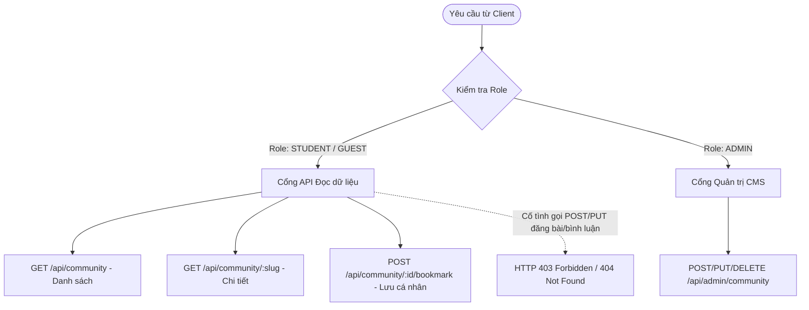

# Đặc Tả Tính Năng: Nội Dung Cộng Đồng Định Hướng & Cơ Chế Chỉ Đọc (Read-Only)

> **Mã tính năng:** `FR-COM-01` đến `FR-COM-06`  
> **Thuộc cụm:** Cụm 13 & 14 - Cộng Đồng Định Hướng & Tin Tức - Bài Viết  
> **Tác nhân:** Sinh viên (Student - Đọc), Quản trị viên (Admin - Quản lý)

---

## 1. Mục Tiêu & Mô Tả Nghiệp Vụ

### 1.1 Khái niệm & Mục tiêu nội dung Cộng đồng (FR-COM-01, 02, 03)
Trong hệ thống UNERA phiên bản 1.0, không gian "Cộng đồng" được thiết kế như một **Kho nội dung tri thức định hướng mở rộng**, chia sẻ các góc nhìn thực tế, câu chuyện truyền cảm hứng, và tài liệu học tập được giám sát chặt chẽ:
- **Tập hợp chủ đề chuyên sâu (`FR-COM-03`):**
  - *Kinh nghiệm du học & Săn học bổng:* Các bài viết chia sẻ về việc chuẩn bị hồ sơ du học, viết luận, phỏng vấn visa từ các cựu sinh viên đi trước.
  - *Giải mã ngành nghề & Thị trường lao động:* Bức tranh thực tế về công việc ngành Ngôn ngữ, Sư phạm, Biên phiên dịch, Truyền thông, Công nghệ số.
  - *Kỹ năng sinh viên đại học:* Phương pháp tự học, quản lý thời gian, cân bằng giữa học tập và hoạt động ngoại khóa.
- **Chi tiết bài viết (`FR-COM-02`):** Trình bày với cấu trúc biên tập chuyên nghiệp, hình ảnh minh họa chất lượng cao, hộp thông tin tác giả, mục lục điều hướng nhanh (Table of Contents), và danh sách bài viết liên quan.

### 1.2 Cơ chế Chỉ Đọc & Ranh giới nghiêm ngặt (Strict Read-Only Policy - FR-COM-05, 06)
- **Quyền hạn của Sinh viên (`FR-COM-05`):**
  - Sinh viên có toàn quyền xem danh sách, lọc theo danh mục, đọc toàn văn nội dung bài viết, và nhấn Bookmark để lưu lại bài viết yêu thích vào mục "Bài viết đã lưu".
- **Không cung cấp chức năng người dùng tự đăng bài/tương tác mở (`FR-COM-06`):**
  - Hệ thống **KHÔNG CUNG CẤP** bất kỳ giao diện hoặc API nào cho phép sinh viên:
    - Đăng bài viết cộng đồng (No Student Post Creation).
    - Tạo chủ đề thảo luận hoặc tạo nhóm riêng (No Groups/Threads).
    - Để lại bình luận dưới bài viết (No Comments/Discussion Board).
    - Nhắn tin trò chuyện trực tiếp giữa các sinh viên (No Direct Messaging).
  - *Lý do kiến trúc & vận hành:* Ngăn chặn tuyệt đối tình trạng lan truyền tin giả mạo, nội dung quảng cáo rác (spam), công kích cá nhân, đồng thời giúp đội ngũ vận hành tập trung tối đa vào việc sản xuất nội dung định hướng đạt chuẩn mực học thuật cao nhất.

### 1.3 Quản trị của Admin (FR-COM-04)
- Chỉ tài khoản có vai trò `ADMIN` mới có quyền truy cập module biên tập CMS.
- Hỗ trợ công cụ soạn thảo Rich Text (hỗ trợ Markdown, chèn ảnh, bảng biểu, trích dẫn).
- Quản lý trạng thái bài viết: `DRAFT` (Bản nháp), `PUBLISHED` (Đã phát hành), `HIDDEN` (Tạm ẩn), `ARCHIVED` (Lưu trữ).

---

## 2. Kiến Trúc Phân Quyền & Kiểm Soát Truy Cập



---

## 3. Cấu Trúc Dữ Liệu (Data Schemas)

### 3.1 Model `CommunityArticle`
```typescript
interface ICommunityArticle {
  _id: Types.ObjectId;
  title: string;
  slug: string; // URL thân thiện SEO: "bi-quyet-chuan-bi-ho-so-du-hoc-my"
  summary: string; // Đoạn trích dẫn ngắn
  content: string; // Nội dung Markdown hoặc HTML an toàn
  coverImage: string;
  category: 'STUDY_ABROAD' | 'CAREER_ORIENTATION' | 'SKILLS' | 'ALUMNI_STORY' | 'ACADEMIC';
  readingTimeMinutes: number; // Ước tính thời gian đọc (VD: 6)
  author: {
    name: string; // "Ban biên tập Unera" hoặc tên cựu sinh viên khách mời
    role: string; // "Cựu SV K54 ULIS, Thạc sĩ ĐH Melbourne"
    avatarUrl?: string;
  };
  tags: string[]; // ["Du học", "Học bổng", "Australia"]
  status: 'DRAFT' | 'PUBLISHED' | 'HIDDEN' | 'ARCHIVED';
  publishedAt?: Date;
  viewCount: number;
  bookmarkCount: number;
  createdBy: Types.ObjectId; // Ref User (Admin)
  createdAt: Date;
  updatedAt: Date;
}
```

---

## 4. Đặc Tả Giao Diện (UI/UX Specification)

- **Trang Danh sách Bài viết Cộng đồng (`/community` hoặc `/news`):**
  - Thanh Tabs chủ đề: `Tất cả`, `Định hướng`, `Du học`, `Khối ngành`, `Sau đại học`, `Kỹ năng & CV`, `Học bổng`.
  - Ô tìm kiếm nhanh với placeholder: *"Tìm trong thư viện bài viết..."*.
  - Thẻ bài viết dạng card hiện đại:
    - Huy hiệu phân loại góc trên bên trái (VD: `DU HỌC` nền xanh pastel, `KHỐI NGÀNH` nền tím nhạt).
    - Biểu tượng nút Bookmark góc trên bên phải để lưu nhanh.
    - Tiêu đề đậm (`font-semibold text-slate-900 line-clamp-2`), trích dẫn ngắn (`text-sm text-slate-500 line-clamp-2`).
    - Dưới cùng: Tác giả, Thời gian đọc, và mũi tên liên kết `->`.
- **Trang Đọc Bài viết Chi tiết (`/community/[slug]`):**
  - Trình bày dạng typography thông thoáng, cỡ chữ 16px - 18px dễ đọc, khoảng cách dòng `leading-relaxed`.
  - Sidebar cố định bên phải: Mục lục bài viết, Thẻ thông tin tác giả, Nút chia sẻ liên kết, Nút Lưu bài viết.
  - **Hoàn toàn không có khung nhập bình luận (No Comment Box) ở chân trang.** Thay vào đó là mục "Bài viết liên quan cùng chủ đề".

---

## 5. Đặc Tả API (API Specifications)

### 5.1 Lấy danh sách bài viết cộng đồng (Công khai / Sinh viên)
- **Endpoint:** `GET /api/community`
- **Quyền:** Tất cả người dùng
- **Query Params:** `category`, `search`, `page=1`, `limit=9`
- **Response `200 OK`:**
```json
{
  "success": true,
  "data": [
    {
      "id": "673000000000000000000050",
      "title": "Du học không bắt đầu từ một bộ hồ sơ",
      "slug": "du-hoc-khong-bat-dau-tu-mot-bo-ho-so",
      "summary": "Cách xác định mục tiêu, chọn điểm đến và chuẩn bị nguồn lực trước khi nộp đơn.",
      "category": "STUDY_ABROAD",
      "readingTimeMinutes": 8,
      "author": {
        "name": "Ban biên tập Unera",
        "role": "Đồng hành cùng sinh viên"
      },
      "publishedAt": "2026-11-01T08:00:00.000Z"
    }
  ],
  "pagination": { "page": 1, "limit": 9, "total": 24, "totalPages": 3 }
}
```

### 5.2 Ngăn chặn hành vi cố tình đăng bài hoặc bình luận từ Client sinh viên
- Mọi request `POST /api/community/posts` hoặc `POST /api/community/:id/comments` nếu được gửi đến server sẽ nhận ngay:
  - **Mã HTTP:** `404 Not Found` hoặc `403 Forbidden`
  - **Body phản hồi:**
  ```json
  {
    "success": false,
    "error": {
      "code": "FEATURE_NOT_SUPPORTED",
      "message": "Nền tảng UNERA hiện không hỗ trợ chức năng đăng bài hoặc bình luận của người dùng."
    }
  }
  ```

---

## 6. Tiêu Chí Nghiệm Thu (Acceptance Criteria)

```gherkin
Scenario: Sinh viên đọc bài viết định hướng cộng đồng
  Given Sinh viên đã đăng nhập vào hệ thống
  When Sinh viên chọn bài viết "Du học không bắt đầu từ một bộ hồ sơ"
  Then Hệ thống hiển thị toàn văn nội dung bài viết với định dạng thẩm mỹ
  And Không có ô nhập bình luận hoặc nút phản hồi nào xuất hiện ở cuối trang

Scenario: Kiểm tra bảo mật từ chối API đăng bài của sinh viên
  Given Kẻ xấu gửi HTTP POST tới endpoint "/api/community/posts" kèm token của tài khoản Sinh viên
  When Backend tiếp nhận request
  Then Backend trả về mã lỗi HTTP 404 hoặc 403 từ chối xử lý
  And Không có dữ liệu bài viết mới nào được tạo trong cơ sở dữ liệu
```
