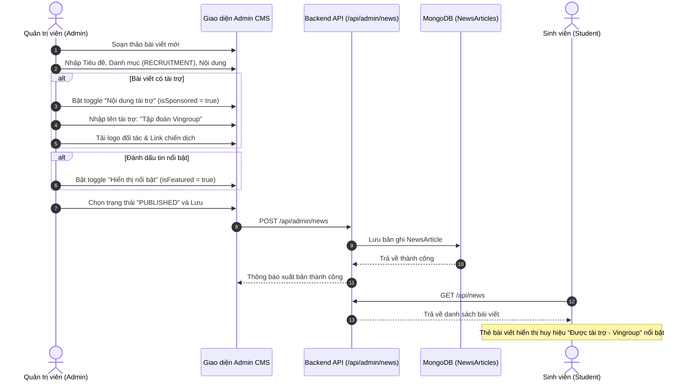

# Đặc Tả Tính Năng: Thư Viện Tin Tức Sự Kiện & Quản Lý Nội Dung Tài Trợ

> **Mã tính năng:** `FR-NEWS-01` đến `FR-NEWS-07`  
> **Thuộc cụm:** Cụm 13 & 14 - Cộng Đồng Định Hướng & Tin Tức - Bài Viết  
> **Tác nhân:** Sinh viên (Student - Xem), Quản trị viên (Admin - Quản lý)

---

## 1. Mục Tiêu & Mô Tả Nghiệp Vụ

### 1.1 Thư viện tin tức chính thức (News Listing & Details - FR-NEWS-01, 02, 03)
Hệ thống cung cấp chuyên trang Tin tức & Sự kiện cập nhật kịp thời các thông tin học thuật và cơ hội nghề nghiệp quan trọng:
- **Phân loại danh mục tin tức chuẩn hóa (`FR-NEWS-02`):**
  1. `EVENTS`: Sự kiện ngày hội việc làm (Job Fair), workshop giao lưu văn hóa, tọa đàm hướng nghiệp.
  2. `SCHOLARSHIPS`: Thông báo học bổng chính phủ (Chevening, Fulbright, MEXT, Erasmus+), học bổng doanh nghiệp.
  3. `RECRUITMENT`: Thông tin đợt tuyển dụng Management Trainee (MT), thực tập sinh tài năng của các tập đoàn lớn.
  4. `COMPETITIONS`: Phát động các cuộc thi học thuật, khởi nghiệp, giải thưởng sinh viên nghiên cứu.
  5. `EDUCATION`: Thông báo tuyển sinh đào tạo thạc sĩ, chương trình trao đổi sinh viên quốc tế (Exchange programs).
  6. `CAREER_DEV`: Tin tức xu hướng thị trường lao động, báo cáo kỹ năng thế kỷ 21.

- **Trang chi tiết tin tức (`FR-NEWS-03`):** Bao gồm tiêu đề, tóm tắt, ảnh bìa, ngày đăng tải, nội dung chi tiết (Rich text), đơn vị phát hành/nguồn tin, tệp đính kèm văn bản thông báo chính thức (nếu có), và liên kết website đơn vị tổ chức.

### 1.2 Nội dung nổi bật (Featured Content - FR-NEWS-05)
- Admin có thể đánh dấu thuộc tính `isFeatured: true` cho tối đa 5 tin tức/bài viết quan trọng nhất tại mỗi thời điểm.
- Tin tức nổi bật được bố trí hiển thị tại các vị trí trang trọng:
  - Vị trí Hero Banner tại Trang chủ Dashboard sinh viên (`/`).
  - Khối thẻ lớn "Ban biên tập đề xuất" đầu trang Thư viện tin tức (`/news`).

### 1.3 Minh bạch Nội dung Tài trợ (Sponsored Content Labeling - FR-NEWS-06, 07)
Nhằm bảo vệ tính khách quan và uy tín học thuật của nền tảng UNERA, mọi nội dung có tính chất thương mại hoặc hợp tác truyền thông với đối tác ngoài đều phải tuân thủ nghiêm ngặt:
- **Hiển thị nhãn tài trợ (`FR-NEWS-06`):**
  - Mọi bài viết tài trợ bắt buộc phải hiển thị nhãn `"Được tài trợ"` (Sponsored) hoặc `"Đối tác đồng hành"` (Partner) tại mọi vị trí hiển thị (danh sách thẻ, trang chi tiết, kết quả tìm kiếm).
  - Nhãn được thiết kế rõ ràng với màu sắc quy chuẩn (nhãn viền vàng/xanh kèm biểu tượng nhận diện) để người đọc phân biệt ngay lập tức với các bài viết phi lợi nhuận của Nhà trường.
- **Quản lý của Admin (`FR-NEWS-07`):**
  - Admin quản trị việc gắn cờ bài viết tài trợ, tên nhà tài trợ, logo đối tác và liên kết chiến dịch.
  - **Ranh giới:** Hệ thống tự động tính biểu giá quảng cáo, hợp đồng điện tử và cổng thanh toán hợp tác thương mại nằm ngoài phạm vi SRS 1.0 (thuộc diện xử lý thủ công ngoài hệ thống).

---

## 2. Quy Trình Vận Hành Nội Dung & Gắn Nhãn Tài Trợ



---

## 3. Cấu Trúc Dữ Liệu (Data Schemas)

### 3.1 Model `NewsArticle`
```typescript
interface INewsArticle {
  _id: Types.ObjectId;
  title: string;
  slug: string; // "hoc-bong-toan-phan-chinh-phu-ireland-2026"
  summary: string;
  content: string; // Nội dung bài viết định dạng HTML/Markdown
  coverImage: string;
  category: 'EVENTS' | 'SCHOLARSHIPS' | 'RECRUITMENT' | 'COMPETITIONS' | 'EDUCATION' | 'CAREER_DEV';
  source?: {
    name: string; // "Đại sứ quán Ireland tại Việt Nam"
    url?: string;
  };
  attachments?: Array<{
    name: string; // "Thong_bao_tuyen_sinh_2026.pdf"
    fileUrl: string;
    fileSize: number;
  }>;
  isFeatured: boolean; // Tin nổi bật xuất hiện trên Hero Banner
  isSponsored: boolean; // Cờ nội dung tài trợ (FR-NEWS-06)
  sponsorInfo?: {
    sponsorName: string; // Tên đối tác: "Unilever Vietnam"
    sponsorLogoUrl?: string;
    targetUrl?: string; // Link chiến dịch tuyển dụng ngoài
  };
  status: 'DRAFT' | 'PUBLISHED' | 'HIDDEN' | 'ARCHIVED';
  publishedAt?: Date;
  viewCount: number;
  createdBy: Types.ObjectId; // Ref User (Admin)
  createdAt: Date;
  updatedAt: Date;
}
```

---

## 4. Đặc Tả Giao Diện (UI/UX Specification)

1. **Hiển thị Tin tức Nổi bật (Hero Section):**
   - Vùng Banner nền xanh pastel dịu nhẹ (`bg-[#eef4ff]`) với bo góc `rounded-2xl` hoặc `rounded-3xl`.
   - Tiêu đề tin tức nổi bật hiển thị với cỡ chữ `text-2xl sm:text-3xl font-bold text-slate-900`.
   - Nút kêu gọi hành động (CTA): `"Đọc bài viết ->"` màu xanh hoàng gia (`bg-[#2b6cb0] hover:bg-[#205288] text-white`).
2. **Hiển thị Thẻ bài viết tài trợ (Sponsored Card Styling):**
   - Góc trên thẻ bài viết gắn badge phân biệt:
     - Nền vàng nhạt / viền hổ phách: `bg-amber-50 text-amber-700 border-amber-200`.
     - Chữ hiển thị: `⚡ ĐỐI TÁC TÀI TRỢ` hoặc `ĐƯỢC TÀI TRỢ BỞI [TÊN DOANH NGHIỆP]`.
   - Giúp người học tiếp nhận thông tin với tâm thế minh bạch, không gây hiểu lầm là thông cáo đào tạo của Nhà trường.

---

## 5. Đặc Tả API (API Specifications)

### 5.1 Danh sách Tin tức cho Sinh viên
- **Endpoint:** `GET /api/news`
- **Method:** `GET`
- **Query Params:**
  - `category`: Lọc theo danh mục (`EVENTS`, `SCHOLARSHIPS`...)
  - `featured`: `true` | `false`
  - `page`: Trang hiện tại (Mặc định 1)
  - `limit`: Số bài trên trang (Mặc định 6 hoặc 9)
- **Response `200 OK`:**
```json
{
  "success": true,
  "data": [
    {
      "id": "673000000000000000000088",
      "title": "Chương trình Quản trị viên Tập sự Unilever Future Leaders 2026",
      "slug": "unilever-future-leaders-programme-2026",
      "summary": "Cơ hội trở thành nhà lãnh đạo tương lai tại Unilever sau 3 năm đào tạo chuyên sâu.",
      "category": "RECRUITMENT",
      "isFeatured": true,
      "isSponsored": true,
      "sponsorInfo": {
        "sponsorName": "Unilever Việt Nam",
        "sponsorLogoUrl": "/images/partners/unilever.svg"
      },
      "publishedAt": "2026-11-05T09:00:00.000Z"
    }
  ],
  "pagination": { "page": 1, "limit": 6, "total": 18, "totalPages": 3 }
}
```

### 5.2 Quản trị Tin tức của Admin
- **Endpoint:** `POST /api/admin/news` (Tạo tin mới)
- **Endpoint:** `PUT /api/admin/news/:id` (Cập nhật tin tức)
- **Endpoint:** `PATCH /api/admin/news/:id/status` (Đổi trạng thái DRAFT/PUBLISHED/ARCHIVED)
- **Quyền:** Bắt buộc session có quyền `role: "ADMIN"`. Ghi nhận lịch sử kiểm toán (`FR-ADM-14`, `20`).

---

## 6. Tiêu Chí Nghiệm Thu (Acceptance Criteria)

```gherkin
Scenario: Hiển thị minh bạch nhãn tài trợ cho bài viết doanh nghiệp
  Given Một bài viết tin tức có trường "isSponsored" = true và "sponsorName" = "FPT Software"
  When Sinh viên xem bài viết trong danh sách Thư viện tin tức
  Then Thẻ bài viết hiển thị huy hiệu "Được tài trợ bởi FPT Software" rõ ràng
  And Khi nhấp vào đọc chi tiết, đầu bài viết ghi nhận thông tin bài viết do đối tác tài trợ

Scenario: Admin xuất bản tin tức nổi bật trên Dashboard
  Given Admin chọn một tin thông báo học bổng chính phủ và bật cờ "isFeatured = true"
  When Admin nhấn "Xuất bản bài viết"
  Then Bài viết được cập nhật trạng thái "PUBLISHED"
  And Banner trang chủ Dashboard của toàn bộ sinh viên hiển thị bài viết nổi bật này
```

