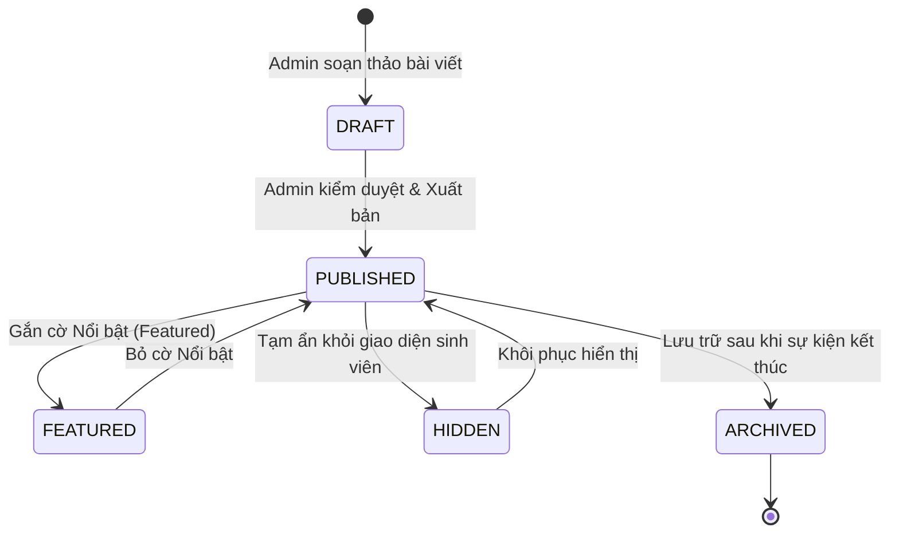

# Cụm Tính Năng 13 & 14: Cộng Đồng Định Hướng & Tin Tức - Bài Viết (Community & News)

> **Mã Module:** `COM_NEWS`  
> **Căn cứ SRS:** Mục 4.13 (FR-COM-01 đến 06) và Mục 4.14 (FR-NEWS-01 đến 07)  
> **Tác nhân:** Sinh viên (Student - Đọc nội dung), Quản trị viên (Admin - Biên tập & Xuất bản)  
> **Mục tiêu:** Cung cấp kênh thông tin chính thống từ ban biên tập UNERA và Nhà trường bao gồm các bài viết cẩm nang định hướng, phân tích khối ngành, tin tức học bổng, sự kiện học thuật, thông báo tuyển dụng và bài viết tài trợ minh bạch.

---

## 1. Tổng Quan Nghiệp Vụ Cụm Tính Năng

Cụm tính năng được xây dựng nhằm cung cấp nguồn tri thức chuẩn xác, hỗ trợ sinh viên mở rộng tầm nhìn nghề nghiệp và nắm bắt kịp thời các cơ hội học thuật:

### 1.1 Nội dung Cộng đồng Định hướng (Community Content - FR-COM-01 đến 06)
- **Kênh thông tin biên tập chuyên sâu:** Tổng hợp các bài viết hướng dẫn chọn ngành, cẩm nang du học, bài phỏng vấn cựu sinh viên tiêu biểu, chia sẻ kinh nghiệm săn học bổng và bí quyết vượt qua kỳ thực tập.
- **Tổ chức theo chuyên đề (Categories):** *Định hướng năm nhất, Bí quyết du học, Khối ngành Kinh tế - Công nghệ - Ngôn ngữ, Kỹ năng viết CV, Lộ trình học Thạc sĩ...*
- **Quy tắc cốt lõi về quyền truy cập (Read-Only Policy - `FR-COM-05`, `FR-COM-06`):**
  - Toàn bộ nội dung cộng đồng do **Ban biên tập Admin kiểm duyệt và xuất bản**.
  - Sinh viên có quyền truy cập **ĐỌC (Read-Only)**, lưu bài viết vào danh sách quan tâm.
  - **TUYỆT ĐỐI KHÔNG CUNG CẤP** tính năng cho sinh viên đăng bài tự do, tạo nhóm thảo luận, bình luận (comments), hay nhắn tin trực tiếp (direct messaging) trong phạm vi phiên bản 1.0. Điều này nhằm đảm bảo chất lượng học thuật, tránh spam và tối ưu tài nguyên kiểm duyệt.

### 1.2 Tin tức, Sự kiện & Bài viết Tài trợ (News & Sponsored - FR-NEWS-01 đến 07)
- **Thư viện tin tức chính thống:** Cập nhật tin tức học thuật, ngày hội việc làm, hội thảo tuyển dụng, thông báo mở đơn học bổng chính phủ.
- **Nội dung nổi bật (Featured Content - `FR-NEWS-05`):** Được ưu tiên hiển thị tại Banner đầu trang chủ Dashboard và đầu Thư viện tin tức (như giao diện Screenshot 1).
- **Minh bạch nội dung tài trợ (Sponsored Content Label - `FR-NEWS-06`, `07`):** Các bài viết do doanh nghiệp đối tác tài trợ hoặc liên kết tuyển sinh bắt buộc phải gắn huy hiệu `"Được tài trợ"` hoặc `"Đối tác đồng hành"` rõ ràng, phân biệt rạch ròi với bài viết chuyên môn độc lập của ban biên tập.

---

## 2. Danh Mục Các Tính Năng Chi Tiết

| Mã Tính Năng | Tên Tính Năng | Tác Nhân | File Đặc Tả |
|---|---|---|---|
| **FR-COM-01 đến 06** | Bài viết cộng đồng định hướng, Phân loại chuyên đề & Cơ chế Chỉ đọc (Read-Only) | Student, Admin | [`FR-COM-01_06_COMMUNITY_READ_ONLY.md`](./FR-COM-01_06_COMMUNITY_READ_ONLY.md) |
| **FR-NEWS-01 đến 07** | Thư viện tin tức sự kiện, Tin tức nổi bật & Nhãn tài trợ minh bạch | Student, Admin | [`FR-NEWS-01_07_NEWS_AND_SPONSORED.md`](./FR-NEWS-01_07_NEWS_AND_SPONSORED.md) |

---

## 3. Kiến Trúc Vòng Đời Nội Dung (Content Lifecycle)

---

## 4. Tích Hợp UI/UX Đồng Nhất Với Thiết Kế Đã Thống Nhất

- Bố cục trang Tin tức kế thừa 100% giao diện đã xây dựng tại `src/app/news/page.tsx` (tương ứng với Screenshot 1):
  - Banner bài viết đề xuất (Hero Featured Article) với nền xanh pastel dịu mắt (`bg-[#eef4ff]`).
  - Lộ trình 3 bước cho tân sinh viên (*01. Hiểu mình trước khi chọn ngành*, *02. Tìm hiểu ngành học và cơ hội*, *03. Lên kế hoạch cho bước tiếp theo*).
  - Bộ lọc danh mục dạng thanh pills pill-shaped (`rounded-full`).
  - Lưới bài viết 3 cột với thẻ card bo góc `rounded-2xl`, nút Lưu bài viết (Bookmark), nhãn thời gian đọc ước tính (*8 phút đọc*), nhãn tác giả (*Ban biên tập Polaris / Unera*).
