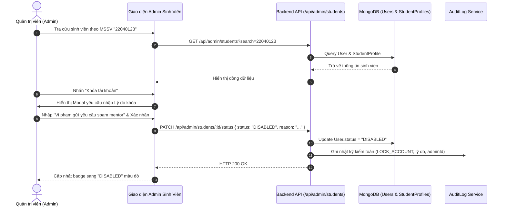

# Đặc Tả Tính Năng: Bảng Điều Khiển Quản Trị & Quản Lý Tài Khoản Sinh Viên

> **Mã tính năng:** `FR-ADM-01` & `FR-ADM-02`  
> **Thuộc cụm:** Cụm 15 - Quản Trị Hệ Thống, CMS & Nhật Ký Kiểm Toán  
> **Tác nhân:** Quản trị viên (Admin)

---

## 1. Mục Tiêu & Mô Tả Nghiệp Vụ

### 1.1 Bảng điều khiển Quản trị (Admin Dashboard - FR-ADM-01)
Bảng điều khiển là trang đích đầu tiên khi Admin đăng nhập vào cổng quản trị (`/admin`), cung cấp bức tranh toàn cảnh về tình hình vận hành của nền tảng:
- **Thống kê tổng quan (Metrics Cards):**
  - Tổng số sinh viên đăng ký, số lượng tài khoản mới trong tuần.
  - Tỷ lệ sinh viên đã hoàn thành Onboarding Quiz & có Lộ trình cá nhân hoạt động (`Active Roadmaps`).
  - Số lượng Cơ hội đang mở (`OPEN_OPPORTUNITIES`), phân bổ theo danh mục (Việc làm, Học bổng, Du học...).
  - Số lượng yêu cầu kết nối Mentor đang chờ xếp lịch (`PENDING_BOOKINGS`).
  - Số lượt đặt lịch hẹn nhắc deadline trong tháng (`ACTIVE_CALENDAR_REMINDERS`).
- **Biểu đồ trực quan:**
  - Biểu đồ tăng trưởng người dùng theo tuần/tháng.
  - Phân bổ mối quan tâm định hướng của sinh viên (Khối ngành, Nhu cầu du học).
  - Tỷ lệ hoàn thành trung bình các giai đoạn lộ trình.
- **Danh sách cảnh báo & Tác vụ cần xử lý gấp:**
  - Yêu cầu tư vấn Mentor sắp đến hạn 48 giờ chưa được duyệt.
  - Các cơ hội tuyển dụng sắp hết hạn nộp đơn cần gia hạn hoặc chuyển sang trạng thái đóng.
  - Nhật ký ghi nhận xung đột cập nhật đồng thời gần nhất.

### 1.2 Quản trị Tài khoản Sinh viên (Student Management - FR-ADM-02)
- **Danh sách & Tra cứu tài khoản sinh viên:**
  - Hiển thị danh sách phân trang (20 sinh viên/trang).
  - Bộ lọc nâng cao: Theo Trạng thái tài khoản (`ACTIVE`, `DISABLED`), Theo Khóa sinh viên (K55, K56, K57, K58), Theo Khoa/Ngành (Ngôn ngữ Anh, Kinh tế quốc tế...).
  - Tìm kiếm thời gian thực theo: Họ tên, Mã số sinh viên, Email, Số điện thoại.
- **Xem chi tiết hồ sơ sinh viên:**
  - Thông tin học thuật: Trường, Khoa, Ngành, GPA tích lũy.
  - Lộ trình hiện tại và tiến độ hoàn thành các bước.
  - Danh sách cơ hội đã thêm vào lịch, danh sách chứng chỉ trong ví.
  - Lịch sử các buổi tư vấn Mentor đã đăng ký.
- **Quản lý trạng thái tài khoản sinh viên:**
  - Chuyển đổi trạng thái giữa `ACTIVE` (Hoạt động bình thường) và `DISABLED` (Khóa tài khoản tạm thời khi phát hiện hành vi spam, vi phạm quy định học thuật).
  - Khi tài khoản bị `DISABLED`: Phiên đăng nhập bị hủy bỏ ngay lập tức, sinh viên không thể đăng nhập hoặc gọi bất kỳ API nào, hiển thị thông báo liên hệ phòng Đào tạo/Admin để được hỗ trợ.
  - Mọi thao tác khóa/mở khóa tài khoản bắt buộc phải nhập lý do và được ghi lại trong `AuditLog` (`FR-ADM-14`).
  - **Quy tắc bất biến:** Không cung cấp tính năng xóa vĩnh viễn tài khoản sinh viên nhằm đảm bảo tính toàn vẹn của dữ liệu báo cáo và lịch sử tương tác.

---

## 2. Quy Trình Vận Hành Quản Trị Tài Khoản



---

## 3. Cấu Trúc Dữ Liệu (Data Schemas)

```typescript
// Trạng thái tài khoản người dùng
type UserStatus = 'ACTIVE' | 'DISABLED';

// DTO phản hồi chi tiết sinh viên trong trang quản trị
interface IAdminStudentDetailDTO {
  id: string;
  fullName: string;
  studentIdNumber: string; // MSSV
  email: string;
  phone?: string;
  faculty: string;
  major: string;
  currentYear: number;
  status: UserStatus;
  statusReason?: string;
  activeRoadmapTitle?: string;
  roadmapProgressPercent?: number;
  totalCertificatesInWallet: number;
  totalSavedOpportunities: number;
  totalMentorBookings: number;
  createdAt: string;
  lastLoginAt?: string;
}
```

---

## 4. Đặc Tả Giao Diện (UI/UX Specification)

- **Admin Sidebar:**
  - Logo Unera Admin kèm huy hiệu Quản trị.
  - Menu điều hướng: `Tổng quan`, `Sinh viên`, `Cơ hội tuyển dụng`, `Tin tức & Bài viết`, `Cố vấn & Đặt lịch`, `Chứng chỉ & Hoạt động`, `Định hướng & Lộ trình`, `Nhật ký kiểm toán`.
- **Trang Danh sách Sinh viên (`/admin/students`):**
  - Thanh công cụ trên cùng: Ô tìm kiếm đa năng, Bộ lọc Khóa/Khoa, Bộ lọc Trạng thái.
  - Bảng dữ liệu (Data Table) chuẩn mực: Cột Checkbox, Họ và tên (kèm ảnh đại diện), MSSV, Email, Ngành học, Tiến độ lộ trình (Thanh progress bar nhỏ), Trạng thái (Badge Xanh/Đỏ), Cột Thao tác.
  - Modal xem chi tiết sinh viên (Drawer trượt từ cạnh phải màn hình) hiển thị toàn bộ lịch sử học tập.
  - Modal xác nhận Khóa tài khoản: Trường Textarea bắt buộc nhập lý do, nút bấm đỏ `"Xác nhận khóa tài khoản"`.

---

## 5. Đặc Tả API (API Specifications)

### 5.1 Lấy số liệu thống kê Dashboard
- **Endpoint:** `GET /api/admin/dashboard/stats`
- **Quyền:** `ADMIN`
- **Response `200 OK`:**
```json
{
  "success": true,
  "data": {
    "totalStudents": 1250,
    "activeStudentsThisWeek": 840,
    "activeRoadmaps": 980,
    "avgRoadmapProgress": 42.5,
    "openOpportunities": 45,
    "pendingMentorBookings": 8,
    "activeCalendarReminders": 1120
  }
}
```

### 5.2 Cập nhật trạng thái tài khoản sinh viên
- **Endpoint:** `PATCH /api/admin/students/:id/status`
- **Quyền:** `ADMIN`
- **Request Body:**
```json
{
  "status": "DISABLED",
  "reason": "Phát hiện hành vi gian lận thông tin minh chứng chứng chỉ."
}
```
- **Response `200 OK`:**
```json
{
  "success": true,
  "message": "Trạng thái tài khoản đã được chuyển sang DISABLED.",
  "data": { "id": "673000000000000000000099", "status": "DISABLED" }
}
```

---

## 6. Tiêu Chí Nghiệm Thu (Acceptance Criteria)

```gherkin
Scenario: Admin khóa tài khoản sinh viên vi phạm
  Given Admin đăng nhập vào trang Quản trị sinh viên
  When Admin tìm kiếm sinh viên theo MSSV "22041234"
  And Admin chọn "Khóa tài khoản", nhập lý do "Spam yêu cầu đặt lịch mentor" và bấm xác nhận
  Then Trạng thái tài khoản chuyển thành "DISABLED"
  And Hệ thống ghi lại một bản ghi trong bảng AuditLog với đầy đủ adminId, action "LOCK_ACCOUNT", và lý do
  And Sinh viên "22041234" bị đăng xuất ngay lập tức và không thể truy cập tài nguyên bảo vệ
```

