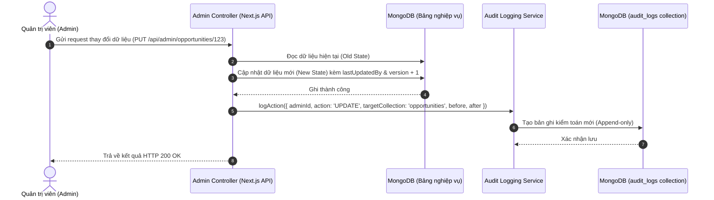

# Đặc Tả Tính Năng: Nhật Ký Kiểm Toán (Audit Trail) & Quản Lý Metadata Quản Trị

> **Mã tính năng:** `FR-ADM-14`, `FR-ADM-15`, `FR-ADM-20`  
> **Thuộc cụm:** Cụm 15 - Quản Trị Hệ Thống, CMS & Nhật Ký Kiểm Toán  
> **Tác nhân:** Quản trị viên (Admin), Chuyên viên Bảo mật Hệ thống

---

## 1. Mục Tiêu & Mô Tả Nghiệp Vụ

### 1.1 Khái niệm & Mục tiêu của Nhật ký kiểm toán (FR-ADM-14)
Hệ thống UNERA được vận hành bởi nhiều cán bộ quản lý và chuyên viên đào tạo dùng chung tài khoản quản trị theo cơ chế truy cập đồng cấp (`FR-ADM-15 - Shared Admin Access`). Do đó, tính minh bạch, trách nhiệm giải trình và khả năng truy vết lịch sử là yêu cầu bắt buộc:
- Bất kỳ thao tác nào làm biến đổi dữ liệu hệ thống (Tạo mới, Chỉnh sửa nội dung, Thay đổi trạng thái, Khóa tài khoản người dùng, Xếp lịch hẹn cố vấn) đều phải được hệ thống tự động ghi lại dưới dạng bản ghi kiểm toán không thể xóa sửa (**Append-Only Audit Trail**).
- Ghi nhận đầy đủ thông tin: Danh tính quản trị viên (`adminId`, `adminEmail`), Loại hành động (`action`), Phân hệ bị tác động (`targetCollection`), ID đối tượng (`targetId`), Địa chỉ IP gửi yêu cầu (`ipAddress`), Tác nhân trình duyệt (`userAgent`), và Dấu thời gian chính xác theo chuẩn ISO 8601 (`timestamp`).
- Đối với các thay đổi nhạy cảm (như thay đổi hạn nộp hồ sơ cơ hội, cập nhật trạng thái phê duyệt lịch hẹn mentor, thay đổi trạng thái sinh viên), hệ thống phải ghi lại ảnh chụp dữ liệu trước khi sửa (`changesBefore`) và sau khi sửa (`changesAfter`) để đối chiếu khi có khiếu nại.

### 1.2 Quyền truy cập quản trị đồng cấp (Shared Admin Access - FR-ADM-15)
- Tất cả các cán bộ có vai trò `ADMIN` đều có quyền hạn truy cập đồng đều vào các chức năng quản trị chung của hệ thống (Cơ hội, Tin tức, Cố vấn, Chứng chỉ, Lộ trình mẫu).
- Không chia nhỏ ma trận quyền hạn phức tạp trong phiên bản 1.0; thay vào đó, toàn bộ việc giám sát tuân thủ được đảm bảo thông qua Nhật ký kiểm toán minh bạch.

### 1.3 Quản lý Metadata cập nhật nội dung (Admin Audit Metadata - FR-ADM-20)
- Mọi tài liệu nghiệp vụ quan trọng trong cơ sở dữ liệu (`Opportunity`, `NewsArticle`, `MentorProfile`, `RoadmapTemplate`) phải luôn lưu trữ hai trường metadata:
  - `lastUpdatedBy`: Mã ID của Admin thực hiện lần cập nhật gần nhất.
  - `updatedAt`: Thời điểm chính xác của lần cập nhật đó.
- Thông tin này được hiển thị công khai trong giao diện quản trị (ví dụ: *"Cập nhật lần cuối bởi admin_huongnt lúc 14:32 ngày 10/11/2026"*), giúp các Admin khác dễ dàng phối hợp công việc.

---

## 2. Quy Trình Ghi Nhận & Truy Vết Kiểm Toán



---

## 3. Cấu Trúc Dữ Liệu (Data Schemas)

### 3.1 Model `AuditLog`
```typescript
interface IAuditLog {
  _id: Types.ObjectId;
  adminId: Types.ObjectId; // Ref User (người thực hiện)
  adminEmail: string; // Lưu dự phòng đề phòng User bị thay đổi email
  adminName: string;
  action: 
    | 'CREATE' 
    | 'UPDATE' 
    | 'DELETE' 
    | 'STATUS_CHANGE' 
    | 'LOCK_ACCOUNT' 
    | 'UNLOCK_ACCOUNT' 
    | 'RESOLVE_CONFLICT';
  targetCollection: 'opportunities' | 'users' | 'news' | 'mentors' | 'bookings' | 'certificates' | 'activities';
  targetId: Types.ObjectId;
  targetTitle?: string; // Tên ngắn gọn của đối tượng (VD: "Thực tập sinh UX/UI")
  targetVersion?: number; // Phiên bản dữ liệu tại thời điểm sửa
  changesBefore?: Record<string, any>; // Ảnh chụp trường cũ
  changesAfter?: Record<string, any>; // Ảnh chụp trường mới
  ipAddress: string;
  userAgent?: string;
  timestamp: Date;
}
```

---

## 4. Đặc Tả Giao Diện (UI/UX Specification)

- **Trang Tra cứu Nhật ký Kiểm toán (`/admin/audit-logs`):**
  - Bảng dòng sự kiện trực quan, sắp xếp theo thời gian mới nhất lên đầu.
  - Bộ lọc sự kiện:
    - Theo Quản trị viên (Dropdown danh sách Admin).
    - Theo Loại hành động (`CREATE`, `UPDATE`, `STATUS_CHANGE`...).
    - Theo Phân hệ (`Cơ hội`, `Tin tức`, `Sinh viên`...).
    - Khoảng ngày diễn ra thao tác (Date Range Picker).
  - Cột bảng: Thời gian, Quản trị viên, Hành động (Badge màu sắc), Phân hệ, Đối tượng, IP truy cập, Nút xem chi tiết.
  - **Modal So sánh Chi tiết (Diff Viewer):**
    - Hiển thị bảng so sánh 2 cột: `Dữ liệu trước thay đổi` (Nền đỏ nhạt) và `Dữ liệu sau thay đổi` (Nền xanh lá nhạt).
    - Giúp người giám sát dễ dàng phát hiện các trường bị chỉnh sửa (ví dụ: ngày hết hạn bị đổi từ 15/11 sang 30/11).

---

## 5. Đặc Tả API (API Specifications)

### 5.1 Tra cứu danh sách nhật ký kiểm toán
- **Endpoint:** `GET /api/admin/audit-logs`
- **Quyền:** `ADMIN`
- **Query Params:** `adminId`, `action`, `targetCollection`, `startDate`, `endDate`, `page=1`, `limit=20`
- **Response `200 OK`:**
```json
{
  "success": true,
  "data": [
    {
      "id": "673000000000000000000210",
      "adminEmail": "admin_lan@ulis.edu.vn",
      "adminName": "Nguyễn Hoàng Lan",
      "action": "STATUS_CHANGE",
      "targetCollection": "opportunities",
      "targetId": "673000000000000000000015",
      "targetTitle": "Học bổng Erasmus Mundus 2026",
      "targetVersion": 4,
      "changesBefore": { "status": "DRAFT" },
      "changesAfter": { "status": "PUBLISHED" },
      "ipAddress": "14.161.32.10",
      "timestamp": "2026-11-10T14:30:00.000Z"
    }
  ],
  "pagination": { "page": 1, "limit": 20, "total": 1420 }
}
```

---

## 6. Tiêu Chí Nghiệm Thu (Acceptance Criteria)

```gherkin
Scenario: Tự động ghi nhật ký khi Admin thay đổi trạng thái Cơ hội
  Given Admin "admin_lan@ulis.edu.vn" đăng nhập vào trang quản trị
  When Admin chuyển trạng thái Cơ hội ID "673000000000000000000015" từ "DRAFT" sang "PUBLISHED"
  Then Cơ hội được cập nhật thành công trong cơ sở dữ liệu
  And Một bản ghi AuditLog mới được tạo ngay lập tức chứa adminEmail, action "STATUS_CHANGE", changesBefore và changesAfter
  And Quản trị viên khác truy cập trang Nhật ký kiểm toán có thể nhìn thấy dòng sự kiện này ngay lập tức
```

