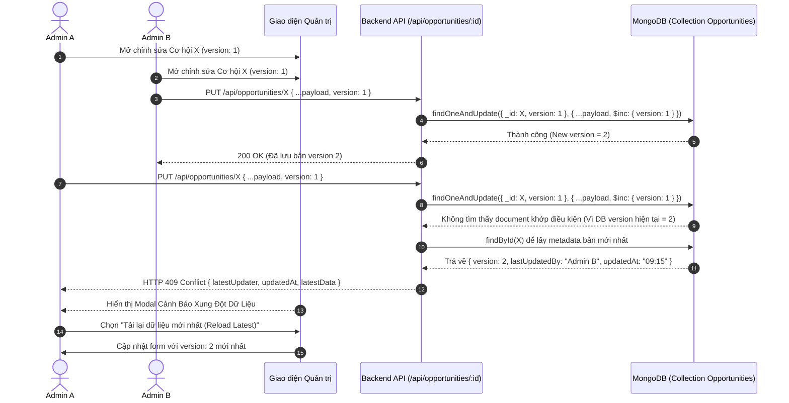

# Đặc Tả Tính Năng: Kiểm Soát Cập Nhật Đồng Thời (Optimistic Locking) & Giải Quyết Xung Đột Dữ Liệu

> **Mã tính năng:** `FR-ADM-16`, `FR-ADM-17`, `FR-ADM-18`, `FR-ADM-19`  
> **Thuộc cụm:** Cụm 15 - Quản Trị Hệ Thống, CMS & Nhật Ký Kiểm Toán  
> **Tác nhân:** Quản trị viên (Admin)

---

## 1. Mục Tiêu & Mô Tả Nghiệp Vụ

### 1.1 Vấn đề nghiệp vụ thực tế
Nền tảng UNERA cho phép nhiều cán bộ Admin cùng quản trị hệ thống dữ liệu Cơ hội tuyển dụng, học bổng (`Opportunity`). Do thời gian xem xét, biên tập văn bản hoặc trao đổi với doanh nghiệp có thể kéo dài hàng chục phút, tình huống sau đây thường xuyên xảy ra:
1. **Thời điểm $T_0$ (09:00):** Admin A mở form chỉnh sửa Cơ hội "Học bổng Fulbright 2026" (Phiên bản dữ liệu lúc này là `version: 1`).
2. **Thời điểm $T_1$ (09:15):** Admin B cũng mở cùng Cơ hội đó (đang là `version: 1`), sửa tiêu đề và hạn nộp đơn từ ngày 15/11 sang ngày 30/11. Admin B bấm **Lưu**. Hệ thống cập nhật thành công và nâng phiên bản lên `version: 2`.
3. **Thời điểm $T_2$ (09:30):** Admin A (sau khi tra cứu tài liệu) sửa phần mô tả học bổng trên màn hình của mình (màn hình vẫn giữ `version: 1` và ngày hạn cũ 15/11) và bấm **Lưu**.

> **Hậu quả nếu không có cơ chế bảo vệ:** Dữ liệu mới của Admin B (hạn 30/11) sẽ bị dữ liệu cũ của Admin A (hạn 15/11) ghi đè thầm lặng (**Silent Overwrite Data Loss**). Toàn bộ sinh viên sẽ nhìn thấy hạn nộp sai lệch mà không ai hay biết.

### 1.2 Giải pháp Khóa Lạc Quan (Optimistic Concurrency Control - OCC)
Hệ thống UNERA triển khai cơ chế Optimistic Locking triệt để đáp ứng 4 tiêu chuẩn bắt buộc:
1. **Phát hiện sửa đổi đồng thời (`FR-ADM-16`):**
   - Mọi bản ghi `Opportunity` đều mang trường số nguyên `version` (bắt đầu từ 1).
   - Khi Admin A mở form sửa, client lưu trữ `currentVersion = 1`. Khi gửi request cập nhật, client bắt buộc gửi kèm trường `version: 1`.
   - Backend thực hiện truy vấn so sánh điều kiện: `UPDATE WHERE _id = id AND version = 1`. Nếu phiên bản trong DB đã là 2, backend nhận diện ngay xung đột dữ liệu.
2. **Cảnh báo xung đột trực quan & cung cấp thông tin người sửa (`FR-ADM-17`):**
   - Thay vì thông báo lỗi chung chung khó hiểu, hệ thống hiển thị thông điệp cảnh báo rõ ràng:
     - *"Bản ghi này đã được cập nhật bởi Admin [Tên/Email Admin B] vào lúc [Thời điểm B lưu, vd: 09:15:22 10/11/2026]."*
3. **Ngăn chặn ghi đè thầm lặng (`FR-ADM-18`):**
   - Backend từ chối lưu thay đổi cũ, trả về mã HTTP `409 Conflict`.
   - Dữ liệu mới của Admin B trong database được bảo vệ 100% nguyên vẹn.
4. **Quy trình nạp lại dữ liệu & Dung hòa thay đổi (`FR-ADM-19`):**
   - Màn hình hiển thị Modal giải quyết xung đột với 2 lựa chọn rõ ràng:
     - **Tùy chọn A (Tải lại bản mới nhất - Reload Latest):** Nạp toàn bộ dữ liệu hiện tại của Admin B vào form, hủy bỏ các trường chưa lưu của Admin A.
     - **Tùy chọn B (So sánh & Giữ lại nội dung đang sửa):** Hiển thị màn hình so sánh 2 cột để Admin A copy phần mô tả mình vừa viết, sau đó nạp lại bản mới và dán bổ sung.

---

## 2. Quy Trình Kỹ Thuật Chi Tiết (OCC Workflow)



---

## 3. Cấu Trúc Dữ Liệu & Mã Nguồn Backend Chuẩn Hóa

### 3.1 Mongoose Schema cho Opportunity
```typescript
// Trích xuất từ src/models/Opportunity.ts đã hoàn thiện
const OpportunitySchema = new Schema<IOpportunity>({
  title: { type: String, required: true },
  description: { type: String, required: true },
  // ... các trường nghiệp vụ khác
  version: { type: Number, default: 1 }, // Optimistic Locking Counter
  lastUpdatedBy: { type: Schema.Types.ObjectId, ref: 'User' }
}, { timestamps: true });
```

### 3.2 Logic Xử lý tại Backend Controller (`PUT /api/opportunities/[id]`)
```typescript
export async function PUT(req: NextRequest, { params }: { params: { id: string } }) {
  const session = await auth();
  if (session?.user?.role !== 'ADMIN') {
    return NextResponse.json({ error: 'Unauthorized' }, { status: 401 });
  }

  const body = await req.json();
  const { version, ...updateData } = body;

  // 1. Kiểm tra sự tồn tại của trường version trong request
  if (typeof version !== 'number') {
    return NextResponse.json(
      { error: 'Trường version là bắt buộc để kiểm soát sửa đổi đồng thời.' },
      { status: 400 }
    );
  }

  // 2. Cố gắng cập nhật với điều kiện _id và version phải khớp chính xác
  const updatedDoc = await Opportunity.findOneAndUpdate(
    { _id: params.id, version: version },
    {
      $set: { ...updateData, lastUpdatedBy: session.user.id },
      $inc: { version: 1 } // Tăng version lên 1 khi thành công
    },
    { new: true }
  );

  // 3. Nếu không cập nhật được bản ghi nào => Xung đột phiên bản (Stale Update)
  if (!updatedDoc) {
    const currentLatest = await Opportunity.findById(params.id).populate('lastUpdatedBy', 'name email');
    
    return NextResponse.json(
      {
        success: false,
        code: 'CONCURRENT_UPDATE_CONFLICT',
        message: 'Dữ liệu này đã được chỉnh sửa bởi một quản trị viên khác trước bạn.',
        conflictDetails: {
          submittedVersion: version,
          currentVersion: currentLatest?.version,
          lastUpdatedBy: {
            name: currentLatest?.lastUpdatedBy?.name || 'Quản trị viên',
            email: currentLatest?.lastUpdatedBy?.email || 'N/A'
          },
          lastUpdatedAt: currentLatest?.updatedAt,
          latestDoc: currentLatest
        }
      },
      { status: 409 }
    );
  }

  return NextResponse.json({ success: true, data: updatedDoc });
}
```

---

## 4. Đặc Tả Giao Diện Modal Cảnh Báo Xung Đột

Khi API trả về HTTP `409 Conflict`, giao diện người dùng hiển thị một Dialog Modal nổi bật:
- **Tiêu đề:** `⚠️ CẢNH BÁO XUNG ĐỘT DỮ LIỆU ĐỒNG THỜI`
- **Màu sắc chủ đạo:** Vàng hổ phách kết hợp đỏ cảnh báo (`border-amber-400 bg-amber-50 text-amber-900`).
- **Nội dung hiển thị:**
  > *"Không thể lưu thay đổi! Bản ghi cơ hội này đã được chỉnh sửa và lưu bởi **Nguyễn Văn A (admin_a@ulis.edu.vn)** vào lúc **14:22:15 hôm nay (cách đây 8 phút)**.*  
  > *Để tránh việc bạn vô tình ghi đè và làm mất dữ liệu của đồng nghiệp, hệ thống đã tạm chặn thao tác lưu này."*
- **Các nút hành động:**
  1. **Nút "Tải lại dữ liệu mới nhất (Khuyên dùng)":** Tải ngay bản ghi `version` mới về form để tiếp tục chỉnh sửa trên nền dữ liệu mới nhất.
  2. **Nút "Xem lại thay đổi của tôi":** Đóng modal cảnh báo tạm thời nhưng giữ nguyên form cũ để Admin có thể copy nội dung mình vừa gõ sang Notepad, không bị mất công soạn thảo.

---

## 5. Tiêu Chí Nghiệm Thu (Acceptance Criteria)

```gherkin
Scenario: Phát hiện và chặn ghi đè dữ liệu cơ hội khi hai Admin cùng sửa đồng thời
  Given Admin A và Admin B cùng mở trang chỉnh sửa Cơ hội ID "673000000000000000000010" mang phiên bản version = 1
  When Admin B lưu thay đổi thành công, hệ thống nâng version lên 2
  And Sau đó Admin A nhấn nút "Lưu thay đổi" với dữ liệu vẫn mang version = 1
  Then Backend trả về mã lỗi HTTP 409 Conflict
  And Giao diện của Admin A hiển thị modal cảnh báo kèm tên của Admin B và thời gian Admin B đã lưu
  And Dữ liệu trong cơ sở dữ liệu giữ nguyên toàn bộ nội dung do Admin B đã lưu, không bị ghi đè bởi Admin A

Scenario: Admin nạp lại dữ liệu mới nhất sau khi nhận cảnh báo xung đột
  Given Admin A nhận được thông báo xung đột HTTP 409
  When Admin A nhấn nút "Tải lại dữ liệu mới nhất"
  Then Giao diện nạp lại toàn bộ dữ liệu mới nhất (version 2) từ server
  And Số phiên bản hiện tại trên form được nâng lên thành 2
  And Admin A có thể tiếp tục thực hiện chỉnh sửa bổ sung trên bản ghi này
```
