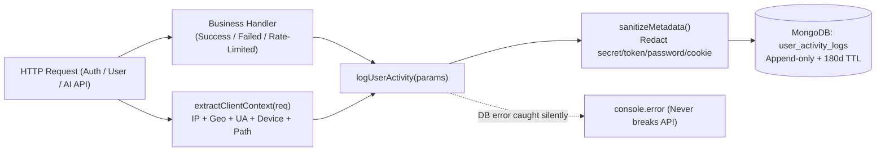

# FR-ADM-21: System User Activity & IP Audit Logging

> **Phân hệ:** `15_ADMIN_CMS_AND_AUDIT` — Quản trị Hệ thống & Nhật ký Kiểm toán
> **Phiên bản:** 1.0 | **Trạng thái:** Đã triển khai
> **Liên kết:** [FR-ADM-14..20: Admin CMS Audit Logging](./FR-ADM-14_20_AUDIT_LOGGING.md)

---

## 1. Mục tiêu & Phạm vi

Trong khi bảng `audit_logs` (`AuditLog`, FR-ADM-14) chỉ lưu vết các thao tác quản trị (CMS CRUD, phân quyền, khóa tài khoản) do `ADMIN` thực hiện kèm snapshot `before`/`after`, bảng **`user_activity_logs`** (`UserActivityLog`) được tách riêng hoàn toàn để ghi nhận **hoạt động của tất cả người dùng hệ thống** (`GUEST`, `STUDENT`, `MENTOR`, `ADMIN`) cùng **địa chỉ IP, vị trí địa lý (Vercel Geo headers), thiết bị/trình duyệt và kết quả thực thi**.

Việc tách riêng 2 collection đảm bảo:
1. **Hiệu năng & Lưu trữ (TTL):** Traffic user-activity lớn hơn nhiều so với admin governance logs; `user_activity_logs` áp dụng **TTL Index 180 ngày** tự động dọn dữ liệu cũ, còn `audit_logs` giữ lâu dài làm hồ sơ kiểm toán quản trị.
2. **An toàn Bảo mật & Truy vết Sự cố:** Theo dõi được cả **hành vi ẩn danh / thất bại** (sai mật khẩu, tài khoản bị vô hiệu hóa, vượt ngưỡng rate-limit `429`, reset mật khẩu thất bại) nơi chưa có `actorId` (`ObjectId`), đồng thời tự động **mask/loại bỏ thông tin nhạy cảm** (`password`, `token`, `secret`, `cookie`, `authorization`).
3. **High-Signal Instrumentation:** Chỉ log các hành động có giá trị nghiệp vụ hoặc bảo mật; **không** log các endpoint polling/nhiễu cao như `/api/auth/me`, `/api/notifications/unread-count`, `/api/assessments/draft`.

---

## 2. Kiến trúc & Luồng ghi nhận (Fail-Safe Non-Blocking)

---

## 3. Thiết kế Schema (`user_activity_logs`)

Model: `src/models/UserActivityLog.ts` — Collection: `user_activity_logs` (`timestamps: { createdAt: true, updatedAt: false }`, append-only).

| Trường | Kiểu dữ liệu | Bắt buộc | Mô tả |
| :--- | :--- | :---: | :--- |
| `actorId` | `ObjectId \| null` (ref `User`) | Không | ID tài khoản thực hiện (`null` nếu chưa đăng nhập / đăng nhập sai / ẩn danh) |
| `actorEmail` | `String` (lowercase, trimmed) | Không | Email liên quan đến hành động (kể cả email nhập sai khi login fail) |
| `actorName` | `String` | Không | Tên hiển thị tại thời điểm phát sinh sự kiện |
| `actorRole` | `GUEST \| STUDENT \| MENTOR \| ADMIN` | Có | Vai trò hiện tại hoặc `GUEST` cho truy cập chưa xác thực |
| `category` | Enum `UserActivityCategory` | Có | Nhóm sự kiện: `AUTH`, `PROFILE`, `ASSESSMENT`, `AI`, `CV`, `ACTIVITY`, `MENTOR`, `SYSTEM` |
| `action` | `String` (UPPER_SNAKE_CASE) | Có | Mã hành động cụ thể, ví dụ `LOGIN_SUCCESS`, `LOGIN_FAILED`, `AI_ROADMAP_GENERATE` |
| `description` | `String` | Có | Mô tả ngắn gọn bằng tiếng Việt để Admin đọc trực tiếp |
| `status` | `SUCCESS \| FAILED \| BLOCKED` | Có | Kết quả thực thi (`BLOCKED` khi 429 rate-limit hoặc tài khoản `DISABLED`) |
| `severity` | `INFO \| WARN \| HIGH` | Có | Mức độ cảnh báo an ninh (`HIGH` khi rate-limit/khóa tài khoản) |
| `statusCode` | `Number` | Không | HTTP status code trả về (ví dụ `200`, `201`, `401`, `403`, `429`, `502`) |
| `errorMessage` | `String` | Không | Lý do lỗi ngắn gọn khi `status !== SUCCESS` |
| `ipAddress` | `String` | Có | IP client đã chuẩn hóa (`x-vercel-forwarded-for`, `x-forwarded-for`, `x-real-ip`, bỏ prefix `::ffff:`) |
| `geo` | `{ country?: String, city?: String }` | Không | Quốc gia / thành phố đọc từ `x-vercel-ip-country`, `x-vercel-ip-city` |
| `userAgent` | `String` | Không | Chuỗi User-Agent gốc (cắt tối đa 512 ký tự) |
| `deviceSummary` | `String` | Không | Tóm tắt thiết bị + trình duyệt (ví dụ `"Chrome · Windows"`, `"Safari · iOS"`) |
| `requestPath` | `String` | Có | Đường dẫn API (ví dụ `/api/auth/login`) |
| `httpMethod` | `String` | Có | Phương thức HTTP (`GET`, `POST`, `PUT`, `PATCH`, `DELETE`) |
| `targetCollection` | `String` | Không | Tên collection đối tượng tác động (ví dụ `users`, `roadmaps`, `cvs`) |
| `targetId` | `String` | Không | ID đối tượng dưới dạng chuỗi (hỗ trợ cả slug hoặc non-ObjectId) |
| `targetTitle` | `String` | Không | Tên/nhãn đối tượng để hiển thị thân thiện |
| `metadata` | `Mixed` | Không | Payload ngữ cảnh bổ sung đã qua `sanitizeMetadata()` |
| `createdAt` | `Date` | Có | Thời điểm phát sinh (Index TTL `expireAfterSeconds: 15552000` = 180 ngày) |

### Indexes tối ưu truy vấn
1. `{ createdAt: 1 }` (`expireAfterSeconds: 15552000` — TTL 180 ngày)
2. `{ createdAt: -1 }`
3. `{ actorId: 1, createdAt: -1 }`
4. `{ ipAddress: 1, createdAt: -1 }`
5. `{ category: 1, status: 1, createdAt: -1 }`
6. `{ action: 1, createdAt: -1 }`

---

## 4. Danh mục sự kiện được ghi nhận (Phase 1 Instrumentation)

| Nhóm (`category`) | Mã hành động (`action`) | Endpoint / Module | Ghi chú |
| :--- | :--- | :--- | :--- |
| `AUTH` | `LOGIN_SUCCESS`, `LOGIN_FAILED`, `LOGIN_BLOCKED` | `POST /api/auth/login` | Ghi nhận cả 401 sai mật khẩu, 403 tài khoản khóa, 429 rate-limit |
| `AUTH` | `LOGIN_GOOGLE_SUCCESS`, `LOGIN_GOOGLE_BLOCKED` | `handleGoogleOAuthCallback` | Phân biệt đăng nhập mới (`isNewUser: true`) và tài khoản cũ |
| `AUTH` | `REGISTER_SUCCESS`, `REGISTER_FAILED`, `REGISTER_BLOCKED` | `POST /api/auth/register` | Ghi nhận đăng ký thành công, email trùng (409), rate-limit |
| `AUTH` | `LOGOUT` | `POST /api/auth/logout` | Đọc user hiện tại trước khi xóa cookie |
| `AUTH` | `PASSWORD_RESET_REQUEST`, `PASSWORD_RESET_BLOCKED` | `POST /api/auth/forgot-password` | Ghi nhận nội bộ `accountExists` trong log (không lộ ra HTTP response) |
| `AUTH` | `PASSWORD_RESET_COMPLETE`, `PASSWORD_RESET_FAILED`, `PASSWORD_RESET_BLOCKED` | `POST /api/auth/reset-password` | Theo dõi reset mật khẩu thành công / token hỏng |
| `PROFILE` | `PROFILE_COMPLETE` | `POST /api/auth/complete-profile` | Hoàn tất onboarding bước 2 |
| `PROFILE` | `PROFILE_UPDATE` | `PUT /api/profile` | Ghi danh sách tên trường thay đổi (không lưu giá trị nhạy cảm) |
| `ASSESSMENT` | `ASSESSMENT_SUBMIT` | `POST /api/assessments/submit` | Nộp bài trắc nghiệm nghề nghiệp / năng lực |
| `AI` | `AI_ORIENTATION_ANALYZE`, `AI_ORIENTATION_FAILED`, `AI_ORIENTATION_BLOCKED` | `POST /api/ai/orientation/analyze` | Phân tích định hướng AI |
| `AI` | `AI_ROADMAP_GENERATE`, `AI_ROADMAP_FAILED`, `AI_ROADMAP_BLOCKED` | `POST /api/roadmap/generate` | Tạo lộ trình AI 4 năm |
| `CV` | `CV_CREATE` | `POST /api/cv` | Tạo hồ sơ CV mới |
| `CV` | `CV_SHARE_TOGGLE` | `PATCH /api/cv/[id]/sharing` | Bật/tắt chia sẻ CV công khai |
| `ACTIVITY` | `ACTIVITY_FOLLOW` | `POST /api/activities/[idOrSlug]/follow` | Theo dõi hoạt động/sự kiện sinh viên |

---

## 5. Admin API & Giao diện Quản trị

- **API:** `GET /api/admin/user-activity-logs` (bảo vệ bởi `requireAdmin(req)`).
  - Query params: `page`, `limit` (max 100), `search` (khớp email, tên, IP, action, description, targetTitle bằng regex đã escape), `category`, `status`, `severity`, `actorRole`, `ipAddress`, `fromDate`, `toDate`.
  - Trả về `items`, `pagination`, và `summary24h` (`total24h`, `failedCount24h`, `blockedCount24h`, `uniqueIps24h`).
- **UI:** `/admin/user-logs` (`src/app/admin/user-logs/page.tsx`) với 4 thẻ thống kê 24h, bộ lọc đa tiêu chí, bảng hiển thị `Thời gian`, `Người dùng & Vai trò`, `Địa chỉ IP & Vị trí`, `Hành động & Thiết bị`, `Kết quả`, và modal xem chi tiết HTTP/User-Agent/Metadata.
- **Navigation:** Nhóm menu `Nhật ký Kiểm toán` trong `Sidebar.tsx` gồm 2 mục con: `Nhật ký Quản trị (Audit)` (`/admin/audit-logs`) và `Hoạt động Người dùng & IP` (`/admin/user-logs`).

