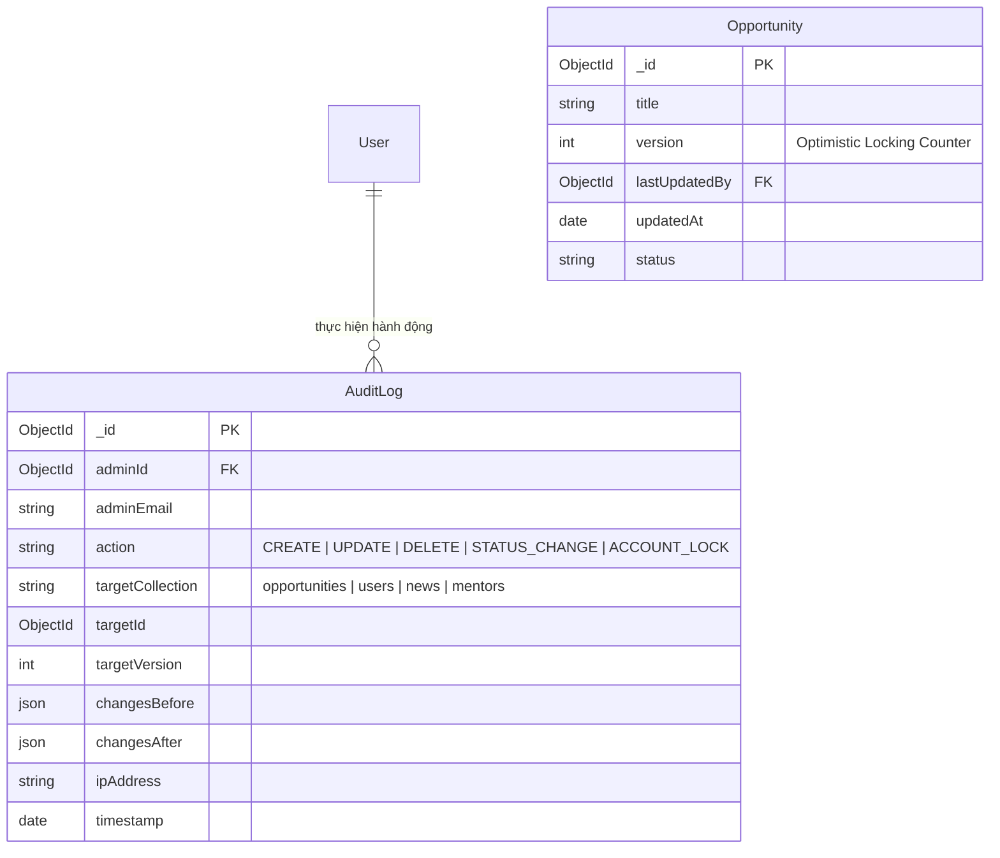

# Cụm Tính Năng 15: Quản Trị Hệ Thống, CMS & Nhật Ký Kiểm Toán (Admin CMS & Audit)

> **Mã Module:** `ADMIN`  
> **Căn cứ SRS:** Mục 4.15 (FR-ADM-01 đến FR-ADM-20)  
> **Tác nhân:** Quản trị viên (Admin)  
> **Mục tiêu:** Cung cấp trung tâm điều hành toàn diện cho đội ngũ quản trị: tổng quan số liệu hoạt động của nền tảng, quản lý tài khoản sinh viên, quản trị vòng đời nội dung (Cơ hội, Tin tức, Cố vấn, Chứng chỉ, Hoạt động, Quiz, Roadmap), cơ chế kiểm soát chỉnh sửa đồng thời (Optimistic Locking & Conflict Protection) và nhật ký kiểm toán bảo mật (Audit Trail).

---

## 1. Tổng Quan Nghiệp Vụ Cụm Tính Năng

Cụm tính năng Quản trị được thiết kế là xương sống vận hành của UNERA, phân bổ thành 4 mảng nghiệp vụ chính:

### 1.1 Bảng điều khiển Quản trị & Quản lý Tài khoản Sinh viên (FR-ADM-01, 02)
- **Admin Dashboard (`FR-ADM-01`):** Trung tâm báo cáo hiển thị các chỉ số đo lường hiệu quả (KPIs):
  - Tổng số sinh viên đăng ký, số tài khoản hoạt động trong tuần.
  - Số lượng lộ trình đang kích hoạt (Active Roadmaps), tỷ lệ hoàn thành lộ trình trung bình.
  - Số lượng cơ hội đang mở tuyển dụng, số lượt lưu cơ hội và số lịch hẹn nhắc nhở đã kích hoạt.
  - Số lượng yêu cầu kết nối Mentor đang chờ xử lý (`PENDING`).
- **Quản lý Sinh viên (`FR-ADM-02`):**
  - Tra cứu, tìm kiếm tài khoản sinh viên theo Họ tên, Mã sinh viên, Email, Khóa, Khoa/Ngành.
  - Xem chi tiết hồ sơ học tập và hoạt động.
  - Quản lý trạng thái tài khoản: Kích hoạt (`ACTIVE`) hoặc Khóa tạm thời/Vô hiệu hóa (`DISABLED`).
  - *Lưu ý quan trọng:* Admin có quyền khóa tài khoản vi phạm, nhưng theo quy tắc `FR-AUTH-11`, hệ thống không cung cấp nút xóa tự do dữ liệu người dùng để bảo toàn tính toàn vẹn dữ liệu thống kê.

### 1.2 Quản trị Vòng đời Toàn bộ Nội dung Nền tảng (FR-ADM-03 đến 13)
- Admin dùng chung mô hình quyền hạn đồng cấp (Shared Admin Access - `FR-ADM-15`), quản lý toàn bộ các phân hệ nội dung:
  - Cơ hội du học & việc làm (`FR-ADM-03`).
  - Tin tức & Bài viết (`FR-ADM-04`).
  - Hồ sơ Cố vấn & Yêu cầu tư vấn (`FR-ADM-05, 06`).
  - Danh mục Chứng chỉ & Hoạt động ngoại khóa (`FR-ADM-07, 08`).
  - Nội dung Cộng đồng định hướng (`FR-ADM-09`).
  - Bộ câu hỏi Trắc nghiệm Onboarding & Công thức chấm điểm (`FR-ADM-10`).
  - Thư viện Mẫu lộ trình phát triển (`FR-ADM-11`).
  - Quản lý nội dung tài trợ & đối tác (`FR-ADM-12`).
- Chuẩn hóa vòng đời trạng thái nội dung (`FR-ADM-13`): `DRAFT` (Nháp) $\rightarrow$ `PUBLISHED` (Đã xuất bản) $\rightarrow$ `HIDDEN` (Ẩn) $\rightarrow$ `CLOSED` (Đóng đơn) $\rightarrow$ `ARCHIVED` (Lưu trữ).

### 1.3 Kiểm soát Chỉnh sửa Đồng thời & Ngăn Ghi đè Dữ liệu (FR-ADM-16 đến 19)
- **Vấn đề thực tế:** Nhiều Admin cùng làm việc trong một ca trực, có thể cùng mở một bản ghi Cơ hội (`Opportunity`) để cập nhật thông tin. Nếu Admin A lưu lúc 10:00, sau đó Admin B (đang giữ giao diện cũ từ 09:55) lưu lúc 10:01, dữ liệu sửa đổi của Admin A sẽ bị ghi đè thầm lặng (Silent Overwrite).
- **Giải pháp kỹ thuật:** Ứng dụng mô hình **Khóa Lạc Quan (Optimistic Locking)** với trường `version`:
  - Phát hiện xung đột (`FR-ADM-16`).
  - Cảnh báo trực quan hiển thị rõ ai là người vừa sửa đổi và thời điểm (`FR-ADM-17`).
  - Chặn ghi đè dữ liệu cũ, từ chối lưu (`FR-ADM-18`).
  - Cung cấp nút xem bản mới nhất hoặc nạp lại dữ liệu (Reload Latest) trước khi tiếp tục (`FR-ADM-19`).

### 1.4 Nhật Ký Kiểm Toán Toàn Diện (Audit Trail & Metadata - FR-ADM-14, 20)
- Tự động ghi nhận mọi thao tác mang tính thay đổi trạng thái hoặc chỉnh sửa dữ liệu quan trọng của Admin vào bảng `AuditLog`.
- Lưu trữ đầy đủ: Danh tính Admin, Hành vi (`CREATE`, `UPDATE`, `STATUS_CHANGE`, `LOCK_STUDENT`), Đối tượng bị tác động, Địa chỉ IP, Thời điểm, và dữ liệu so sánh trước/sau (`diffBeforeAfter`).

---

## 2. Danh Mục Các Tính Năng Chi Tiết

| Mã Tính Năng | Tên Tính Năng | Tác Nhân | File Đặc Tả |
|---|---|---|---|
| **FR-ADM-01 & 02** | Bảng điều khiển vận hành & Quản trị tài khoản sinh viên | Admin | [`FR-ADM-01_02_STUDENT_MGMT.md`](./FR-ADM-01_02_STUDENT_MGMT.md) |
| **FR-ADM-14 & 20** | Nhật ký kiểm toán bảo mật (Audit Trail) & Quản lý Metadata | Admin | [`FR-ADM-14_20_AUDIT_LOGGING.md`](./FR-ADM-14_20_AUDIT_LOGGING.md) |
| **FR-ADM-16 đến 19** | Kiểm soát cập nhật đồng thời (Optimistic Locking) & Giải quyết xung đột | Admin | [`FR-ADM-16_19_CONCURRENT_RESOLUTION.md`](./FR-ADM-16_19_CONCURRENT_RESOLUTION.md) |

---

## 3. Kiến Trúc Dữ Liệu Quản Trị Hệ Thống

