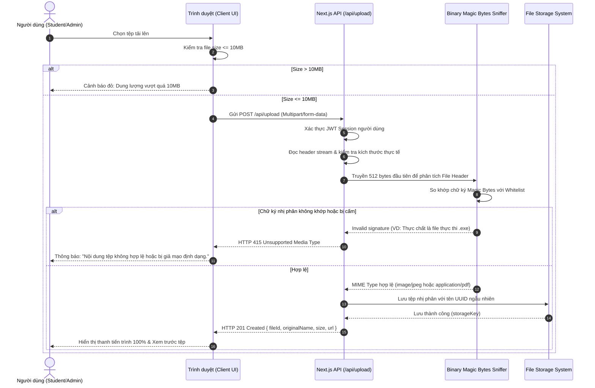

# Đặc Tả Tính Năng: Quy Chuẩn Tải Tệp, Giới Hạn 10MB & Kiểm Tra Nội Dung Nhị Phân

> **Mã tính năng:** `FR-FILE-01` đến `FR-FILE-05`  
> **Thuộc cụm:** Cụm 16 - Tải Tệp, Xác Thực Định Dạng & Lưu Trữ An Toàn  
> **Tác nhân:** Sinh viên (Student), Quản trị viên (Admin), Máy chủ Xử lý Tệp

---

## 1. Mục Tiêu & Mô Tả Nghiệp Vụ

### 1.1 Khả năng tiếp nhận tệp tải lên (Upload Capability - FR-FILE-01)
Hệ thống UNERA hỗ trợ tải tệp cho các luồng nghiệp vụ sau:
- **Hồ sơ sinh viên:** Ảnh đại diện (Avatar).
- **Trình quản lý CV:** Tải lên bản CV cá nhân sẵn có (PDF hoặc Word).
- **Ví chứng chỉ:** Tải lên tệp scan bảng điểm, chứng chỉ ngoại ngữ, chứng chỉ nghề nghiệp.
- **Quản trị Admin:** Đính kèm văn bản thông báo học bổng chính thức, thể lệ cuộc thi, banner hình ảnh bài viết.

### 1.2 Giới hạn dung lượng tối đa 10 MB (FR-FILE-02 & FR-FILE-05)
- **Giới hạn quy định:** Kích thước tệp tối đa cho phép là **10 MB** (tương đương $10 \times 1,024 \times 1,024 = 10,485,760$ bytes).
- **Kiểm tra hai lớp (Two-Layer Validation - `FR-FILE-05`):**
  - **Lớp 1 (Phía Client):** Khi người dùng chọn tệp qua thẻ `<input type="file">` hoặc Drag & Drop, JavaScript đọc thuộc tính `file.size`. Nếu `size > 10,485,760`, giao diện lập tức chặn quá trình gửi và hiển thị thông báo lỗi: *"Kích thước tệp đã chọn ([X] MB) vượt quá giới hạn tối đa 10MB. Vui lòng nén hoặc chọn tệp nhỏ hơn."*
  - **Lớp 2 (Bắt buộc phía Server):** Máy chủ Next.js API Route thiết lập cấu hình giới hạn body request và đo kích thước stream tệp nhị phân nhận được. Nếu vượt quá 10MB, hủy stream ngay lập tức, trả về mã HTTP `413 Payload Too Large` kèm mã lỗi chuẩn. Không phụ thuộc vào kiểm tra client (đề phòng trường hợp gọi API trực tiếp qua Postman/Curl).

### 1.3 Định dạng cho phép (Allowed Formats - FR-FILE-03)
Hệ thống áp dụng chính sách Whitelist nghiêm ngặt, chỉ chấp nhận các định dạng sau:
1. **Tài liệu PDF:** Phần mở rộng `.pdf`, MIME type `application/pdf`.
2. **Tài liệu Microsoft Word:**
   - Phần mở rộng `.docx`, MIME type `application/vnd.openxmlformats-officedocument.wordprocessingml.document`.
   - Phần mở rộng `.doc`, MIME type `application/msword`.
3. **Hình ảnh:**
   - Phần mở rộng `.jpg`, `.jpeg`, MIME type `image/jpeg`.
   - Phần mở rộng `.png`, MIME type `image/png`.

> **Các định dạng bị cấm tuyệt đối:** Không cho phép `.exe`, `.bat`, `.sh`, `.php`, `.zip`, `.rar`, `.7z`, `.html`, `.js`, và đặc biệt `.svg` (để triệt tiêu nguy cơ nhúng mã độc JavaScript / Stored XSS trong thuộc tính SVG).

### 1.4 Kiểm tra Phần mở rộng kết hợp Nội dung Nhị phân (Content Validation - FR-FILE-04)
Kẻ xấu có thể đổi tên một tệp mã độc nguy hiểm (ví dụ `trojan.exe` thành `my_cv.pdf`) để đánh lừa hệ thống. Để ngăn chặn triệt để:
- Hệ thống thực hiện kiểm tra 2 bước:
  1. Kiểm tra phần mở rộng tệp (File Extension Match): Đuôi tệp phải nằm trong whitelist.
  2. **Kiểm tra Chữ ký Nhị phân (Magic Bytes / File Signature Inspection):** Đọc các bytes đầu tiên của tệp (File Header) để xác định định dạng thực tế:
     - **PDF:** Bắt đầu bằng 4 bytes hex `%PDF` (`25 50 44 46`).
     - **PNG:** Bắt đầu bằng 8 bytes hex `89 50 4E 47 0D 0A 1A 0A`.
     - **JPEG:** Bắt đầu bằng 3 bytes hex `FF D8 FF`.
     - **DOCX (ZIP Container):** Bắt đầu bằng `50 4B 03 04`.
     - **DOC (Compound File Binary):** Bắt đầu bằng `D0 CF 11 E0 A1 B1 1A E1`.
- Nếu phát hiện phần mở rộng là `.pdf` nhưng nội dung nhị phân không bắt đầu bằng `%PDF`, hệ thống từ chối ngay lập tức và ghi nhận cảnh báo bảo mật.

---

## 2. Quy Trình Kiểm Tra & Tiếp Nhận Tệp



---

## 3. Mã Nguồn Tham Khảo Kiểm Tra Magic Bytes (Backend)

```typescript
// src/lib/fileValidator.ts
const MAGIC_NUMBERS: Record<string, number[]> = {
  pdf: [0x25, 0x50, 0x44, 0x46], // %PDF
  png: [0x89, 0x50, 0x4E, 0x47, 0x0D, 0x0A, 0x1A, 0x0A],
  jpg: [0xFF, 0xD8, 0xFF],
  docx: [0x50, 0x4B, 0x03, 0x04], // PK..
  doc: [0xD0, 0xCF, 0x11, 0xE0, 0xA1, 0xB1, 0x1A, 0xE1]
};

export function validateMagicBytes(buffer: Buffer, extension: string): boolean {
  const magic = MAGIC_NUMBERS[extension.toLowerCase()];
  if (!magic) return false;

  for (let i = 0; i < magic.length; i++) {
    if (buffer[i] !== magic[i]) {
      return false; // Header không khớp chữ ký ma thuật
    }
  }
  return true;
}
```

---

## 4. Tiêu Chí Nghiệm Thu (Acceptance Criteria)

```gherkin
Scenario: Tải tệp PDF chứng chỉ hợp lệ dưới 10MB thành công
  Given Sinh viên đã đăng nhập và chọn tệp "bang_diem_ielts.pdf" dung lượng 2.4MB
  When Sinh viên gửi yêu cầu tải tệp lên hệ thống
  Then Phía Client xác nhận kích thước hợp lệ
  And Phía Server xác nhận kích thước 2.4MB <= 10MB và chữ ký nhị phân khớp chuẩn PDF (%PDF)
  And Tệp được lưu thành công, trả về mã HTTP 201 Created kèm mã tham chiếu

Scenario: Từ chối tệp vượt quá 10MB tại cả Client và Server
  Given Sinh viên cố gắng tải tệp "video_gioi_thieu.mp4" dung lượng 25MB
  When Sinh viên kéo thả tệp vào ô tải
  Then Giao diện chặn ngay lập tức và báo "Kích thước tệp vượt quá giới hạn 10MB"
  And Không có yêu cầu mạng nào được gửi lên server

Scenario: Phát hiện và chặn tệp giả mạo phần mở rộng (Renamed Executable)
  Given Một người dùng đổi tên tệp mã độc "virus.exe" thành "cv_ung_tuyen.pdf"
  When Người dùng gửi tệp lên API qua công cụ trực tiếp
  Then Máy chủ đọc các bytes đầu tiên và nhận diện chữ ký MZ (0x4D, 0x5A) của tệp thực thi
  And Máy chủ từ chối tiếp nhận với mã HTTP 415 Unsupported Media Type
  And Ghi nhận cảnh báo an ninh về hành vi tải tệp giả mạo
```
