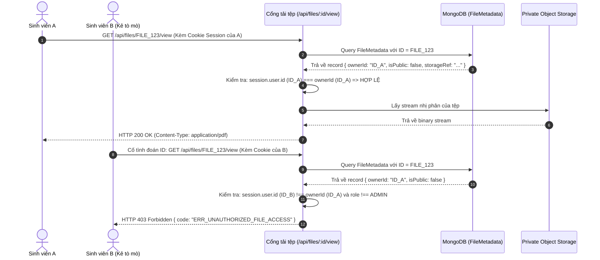

# Đặc Tả Tính Năng: Phân Tách Lưu Trữ, Quyền Sở Hữu & Bảo Mật Truy Cập Tệp Riêng Tư

> **Mã tính năng:** `FR-FILE-06` đến `FR-FILE-10`  
> **Thuộc cụm:** Cụm 16 - Tải Tệp, Xác Thực Định Dạng & Lưu Trữ An Toàn  
> **Tác nhân:** Sinh viên (Student), Quản trị viên (Admin), Máy chủ Xử lý Tệp

---

## 1. Mục Tiêu & Mô Tả Nghiệp Vụ

### 1.1 Phân tách Lưu trữ Nhị phân và Metadata MongoDB (FR-FILE-07, 09)
- **Quy tắc thiết kế cốt lõi (`FR-FILE-07`):**
  - **TUYỆT ĐỐI KHÔNG LƯU TRỮ dữ liệu nhị phân (Binary BLOBs / Base64)** trực tiếp vào trong tài liệu MongoDB (như trong trường của `User` hay `StudentProfile`). Việc lưu trữ file nhị phân trong MongoDB sẽ làm phình to RAM working set, làm chậm chỉ mục và phá vỡ giới hạn 16MB/document của BSON.
  - Tệp vật lý được lưu trữ riêng biệt tại hệ thống lưu trữ đối tượng (Object Storage như AWS S3, Google Cloud Storage, hoặc Local Disk Storage có phân quyền thư mục trong môi trường dev).
- **Lưu trữ Metadata trong MongoDB (`FR-FILE-09`):**
  - MongoDB quản trị bảng `FileMetadata` lưu vết toàn bộ thông tin của tệp:
    - `ownerId`: ID người dùng sở hữu tệp.
    - `originalFilename`: Tên tệp gốc do người dùng đặt (VD: `CV_NguyenVanA_2026.pdf`).
    - `storedFilename`: Tên tệp ngẫu nhiên trên đĩa/bucket (VD: `uuidv4.pdf`) để chống trùng lặp tên và chống Path Traversal.
    - `mimeType`: Loại nội dung đã được xác thực (VD: `application/pdf`).
    - `sizeBytes`: Dung lượng tệp chính xác tính theo byte.
    - `isPublic`: Cờ phân biệt tệp công khai (như banner sự kiện) hay tệp riêng tư (CV, minh chứng điểm số).
    - `storageRef`: Định danh đường dẫn lưu trữ nội bộ.
    - `createdAt`: Dấu thời gian tải lên.

### 1.2 Quyền Sở Hữu & Bảo Vệ Tệp Riêng Tư (FR-FILE-06, 10)
- **Quy tắc sở hữu (`FR-FILE-06`):**
  - Mỗi tệp tải lên gắn liền với `ownerId`.
  - Sinh viên chỉ được phép xem, tải xuống, thay thế hoặc xóa các tệp do chính tài khoản của mình tạo ra.
  - Quản trị viên (`ADMIN`) có quyền xem và tải tệp của sinh viên trong phạm vi xét duyệt học bổng hoặc xử lý khiếu nại.
- **Bảo mật truy cập tệp riêng tư (`FR-FILE-10`):**
  - Tuyệt đối không dùng URL tĩnh, công khai hoặc có thể đoán trước (như `https://unera.edu.vn/uploads/cv_123.pdf`).
  - Tất cả yêu cầu truy cập tệp riêng tư bắt buộc phải qua cơ chế xác thực:
    - **Phương án 1 (Protected Proxy Stream Route):** Truy cập qua endpoint `/api/files/:fileId/download`. Endpoint này kiểm tra JWT session, so khớp `session.user.id === fileDoc.ownerId || session.user.role === 'ADMIN'`. Nếu hợp lệ mới stream dữ liệu nhị phân về trình duyệt.
    - **Phương án 2 (Signed URLs):** Tạo đường dẫn có chữ ký thời hạn (Time-limited Pre-signed URL) có hiệu lực trong tối đa 15 phút.
  - Ngăn chặn hoàn toàn việc người dùng A có thể đổi ID trên thanh địa chỉ để tải lén CV của người dùng B (IDOR - Insecure Direct Object References).

### 1.3 Phản hồi Lỗi Tải Tệp Thân Thiện (FR-FILE-08)
Hệ thống chuẩn hóa các mã lỗi và thông báo phản hồi rõ ràng:
- `ERR_FILE_TOO_LARGE`: *"Tệp tải lên vượt quá kích thước tối đa cho phép (10MB)."* (HTTP 413)
- `ERR_INVALID_FILE_TYPE`: *"Định dạng tệp không được hỗ trợ. Vui lòng chỉ tải lên PDF, Word (.doc, .docx), hoặc Ảnh (.jpg, .png)."* (HTTP 415)
- `ERR_MAGIC_BYTE_MISMATCH`: *"Nội dung tệp không khớp với phần mở rộng. Tệp có dấu hiệu bị giả mạo hoặc hư hỏng."* (HTTP 415)
- `ERR_UNAUTHORIZED_FILE_ACCESS`: *"Bạn không có quyền truy cập hoặc tải về tệp tin này."* (HTTP 403)
- `ERR_STORAGE_FAILURE`: *"Hệ thống lưu trữ đang bận hoặc gặp sự cố tạm thời. Vui lòng thử lại sau ít phút."* (HTTP 500)

---

## 2. Quy Trình Truy Cập Tệp Riêng Tư An Toàn (IDOR Protection)



---

## 3. Cấu Trúc Dữ Liệu `FileMetadata` trong MongoDB

```typescript
import mongoose, { Schema, Document, Types } from 'mongoose';

export interface IFileMetadata extends Document {
  ownerId: Types.ObjectId; // Ref User sở hữu tệp
  originalFilename: string; // "CV_NguyenVanA_2026.pdf"
  storedFilename: string; // "b6a7c8d9-e1f2-4a5b-9c8d-7e6f5a4b3c2d.pdf"
  storagePath: string; // Đường dẫn vật lý hoặc S3 key
  mimeType: string; // "application/pdf"
  sizeBytes: number; // 2450123 (bytes)
  isPublic: boolean; // false đối với CV/chứng chỉ cá nhân
  filePurpose: 'AVATAR' | 'CV' | 'CERTIFICATE_EVIDENCE' | 'NEWS_ATTACHMENT' | 'OTHER';
  createdAt: Date;
  updatedAt: Date;
}

const FileMetadataSchema = new Schema<IFileMetadata>({
  ownerId: { type: Schema.Types.ObjectId, ref: 'User', required: true, index: true },
  originalFilename: { type: String, required: true },
  storedFilename: { type: String, required: true, unique: true },
  storagePath: { type: String, required: true },
  mimeType: { type: String, required: true },
  sizeBytes: { type: Number, required: true },
  isPublic: { type: Boolean, default: false },
  filePurpose: { 
    type: String, 
    enum: ['AVATAR', 'CV', 'CERTIFICATE_EVIDENCE', 'NEWS_ATTACHMENT', 'OTHER'], 
    required: true 
  }
}, { timestamps: true });

export const FileMetadata = mongoose.models.FileMetadata || mongoose.model<IFileMetadata>('FileMetadata', FileMetadataSchema);
```

---

## 4. Đặc Tả API Tiếp Nhận & Tải Tệp

### 4.1 Endpoint Tải Tệp Lên (Upload)
- **Endpoint:** `POST /api/upload`
- **Quyền:** Đã đăng nhập (`STUDENT` hoặc `ADMIN`)
- **Headers:** `Content-Type: multipart/form-data`
- **Body:** Trường `file` (Binary) và trường `purpose` (string)
- **Response `201 Created`:**
```json
{
  "success": true,
  "data": {
    "fileId": "673000000000000000000301",
    "originalFilename": "IELTS_Certificate_Scan.pdf",
    "sizeBytes": 1845120,
    "mimeType": "application/pdf",
    "viewUrl": "/api/files/673000000000000000000301/view",
    "downloadUrl": "/api/files/673000000000000000000301/download"
  }
}
```

### 4.2 Endpoint Truy Cập Tệp An Toàn (Secure Stream View/Download)
- **Endpoint:** `GET /api/files/:fileId/view` hoặc `GET /api/files/:fileId/download`
- **Quyền:** Chủ sở hữu tệp (`ownerId`) hoặc Quản trị viên (`ADMIN`)
- **Headers trả về:**
  - `Content-Type: application/pdf`
  - `Content-Disposition: inline; filename="IELTS_Certificate_Scan.pdf"` (cho view)
  - `Content-Disposition: attachment; filename="IELTS_Certificate_Scan.pdf"` (cho download)
  - `Cache-Control: private, max-age=3600`

---

## 5. Tiêu Chí Nghiệm Thu (Acceptance Criteria)

```gherkin
Scenario: Phân tách lưu trữ và bảo mật quyền truy cập tệp riêng tư
  Given Sinh viên A tải lên tệp minh chứng chứng chỉ IELTS của mình
  When Hệ thống xử lý lưu trữ tệp
  Then Tệp nhị phân được lưu trữ an toàn ngoài MongoDB, MongoDB chỉ lưu bản ghi FileMetadata
  And Bản ghi FileMetadata có cờ isPublic = false và ownerId là ID của Sinh viên A

Scenario: Ngăn chặn sinh viên khác tải lén tệp riêng tư (Chống IDOR)
  Given Sinh viên B biết được fileId của tệp chứng chỉ của Sinh viên A
  When Sinh viên B gửi request GET tới "/api/files/{fileId_cua_A}/download"
  Then Hệ thống phát hiện session của Sinh viên B không phải là chủ sở hữu và không phải Admin
  And Hệ thống từ chối quyền truy cập với mã HTTP 403 Forbidden
  And Không có dữ liệu tệp nhị phân nào được gửi về cho Sinh viên B
```
