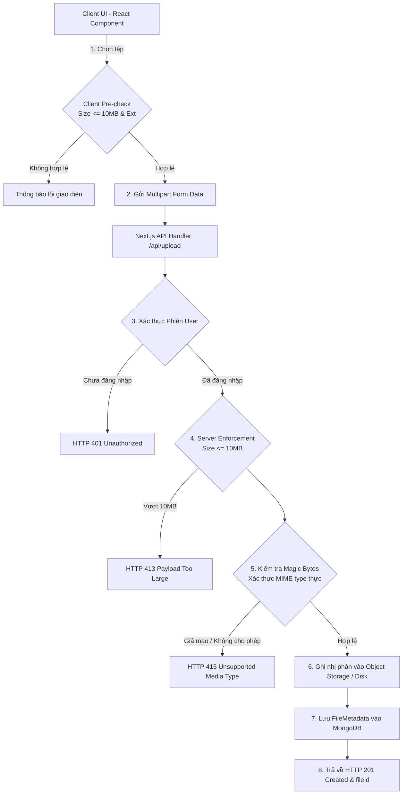

# Cụm Tính Năng 16: Tải Tệp, Xác Thực Định Dạng & Lưu Trữ An Toàn (File Upload & Storage)

> **Mã Module:** `FILE`  
> **Căn cứ SRS:** Mục 4.16 (FR-FILE-01 đến FR-FILE-10)  
> **Tác nhân:** Sinh viên (Student), Quản trị viên (Admin), Máy chủ Xử lý Tệp (File Service)  
> **Mục tiêu:** Cung cấp cơ chế tiếp nhận, kiểm tra an ninh (phần mở rộng, MIME type nhị phân, giới hạn 10MB), lưu trữ phân tách giữa tệp vật lý và metadata MongoDB, và kiểm soát quyền truy cập tệp riêng tư nghiêm ngặt cho hồ sơ sinh viên, CV, minh chứng chứng chỉ và văn bản đính kèm.

---

## 1. Tổng Quan Nghiệp Vụ Cụm Tính Năng

Cụm chức năng xử lý tệp là dịch vụ nền tảng (Platform Infrastructure Service) phục vụ đa dạng các quy trình nghiệp vụ:

### 1.1 Kiểm soát Định dạng, Kích thước & An ninh Tệp (FR-FILE-01 đến 05)
- **Các luồng nghiệp vụ hỗ trợ tải tệp (`FR-FILE-01`):**
  - Tải ảnh đại diện hồ sơ cá nhân (`StudentProfile.avatar`).
  - Tải tệp CV cá nhân sẵn có (PDF, Word).
  - Tải tệp minh chứng chứng chỉ ngoại ngữ / chuyên môn (`StudentCertificate.evidenceFileUrl`).
  - Tải tài liệu đính kèm cơ hội hoặc thông báo tuyển sinh của Admin.
- **Giới hạn dung lượng nghiêm ngặt 10MB (`FR-FILE-02`, `05`):**
  - Giới hạn cứng trên máy chủ (Server-side Enforcement) là **tối đa 10 MB** (10,485,760 bytes) cho mỗi tệp đơn lẻ. Mọi tệp vượt quá ngưỡng này đều bị hủy luồng nhận ngay lập tức.
  - Phía Client có bộ kiểm tra trước (Pre-flight check) để cảnh báo tức thì, tiết kiệm băng thông người dùng.
- **Danh sách định dạng cho phép (`FR-FILE-03`):**
  - Văn bản tài liệu: PDF (`.pdf`), Microsoft Word (`.doc`, `.docx`).
  - Hình ảnh: JPEG (`.jpg`, `.jpeg`), PNG (`.png`).
  - Tuyệt đối từ chối các định dạng thực thi hoặc nén nguy hiểm: `.exe`, `.bat`, `.sh`, `.zip`, `.rar`, `.js`, `.html`, `.svg` (đề phòng mã độc XSS nhúng trong thẻ SVG).
- **Kiểm tra phần mở rộng kết hợp MIME Type nhị phân (`FR-FILE-04`):**
  - Không chỉ tin tưởng đuôi tệp do người dùng đặt (chống tấn công đổi tên tệp: VD đổi `malware.exe` thành `cv.pdf`).
  - Máy chủ thực hiện kiểm tra chữ ký ma thuật nhị phân (Magic Bytes / Header sniffing) để xác thực MIME type thực sự trước khi cấp phép lưu trữ.

### 1.2 Phân tách Lưu trữ & Quyền Sở hữu Riêng tư (FR-FILE-06 đến 10)
- **Tách biệt dữ liệu tệp và Metadata MongoDB (`FR-FILE-07`, `09`):**
  - **Không lưu nhị phân (BLOB) trực tiếp vào tài liệu MongoDB.**
  - Dữ liệu nhị phân của tệp được lưu trữ tại dịch vụ lưu trữ đối tượng chuyên dụng (Local Storage an toàn trong môi trường phát triển hoặc Cloud Object Storage như AWS S3 / GCP Cloud Storage / Cloudinary trong môi trường phân tán).
  - MongoDB chỉ lưu trữ bảng Metadata (`FileMetadata`): ID tệp, chủ sở hữu (`ownerId`), tên tệp gốc, kích thước, MIME type thực tế, đường dẫn lưu trữ (`storageKey`), và ngày tải lên.
- **Phân quyền sở hữu & Bảo mật truy cập tệp riêng tư (`FR-FILE-06`, `10`):**
  - Tệp minh chứng chứng chỉ hoặc CV chứa thông tin nhạy cảm của sinh viên (CCCD, địa chỉ, số điện thoại, điểm số).
  - Không sử dụng URL công khai có thể đoán được (Guessable Public URLs).
  - Sinh viên chỉ được phép xem, tải về hoặc xóa tệp do chính mình sở hữu. Admin được cấp quyền đọc khi duyệt hồ sơ.
  - Cơ chế cấp quyền truy cập thông qua **Đường dẫn có chữ ký thời hạn (Pre-signed URL)** hoặc **Cổng API trung gian có xác thực phiên (Protected Proxy Stream Endpoint)**.
- **Thông báo lỗi chi tiết & Thân thiện (`FR-FILE-08`):** Trả về thông báo lỗi cụ thể và dễ hiểu đối với từng nguyên nhân (quá dung lượng, định dạng không hợp lệ, không có quyền).

---

## 2. Danh Mục Các Tính Năng Chi Tiết

| Mã Tính Năng | Tên Tính Năng | Tác Nhân | File Đặc Tả |
|---|---|---|---|
| **FR-FILE-01 đến 05** | Quy chuẩn tải tệp, Giới hạn dung lượng 10MB & Kiểm tra Magic Bytes nhị phân | Student, Admin | [`FR-FILE-01_05_SIZE_AND_FORMATS.md`](./FR-FILE-01_05_SIZE_AND_FORMATS.md) |
| **FR-FILE-06 đến 10** | Phân tách lưu trữ, Quyền sở hữu tệp riêng tư & Bảo vệ truy cập có chữ ký | Student, Admin, System | [`FR-FILE-06_10_STORAGE_AND_SECURITY.md`](./FR-FILE-06_10_STORAGE_AND_SECURITY.md) |

---

## 3. Kiến Trúc Xử Lý & Lưu Trữ Tệp (File Architecture)

