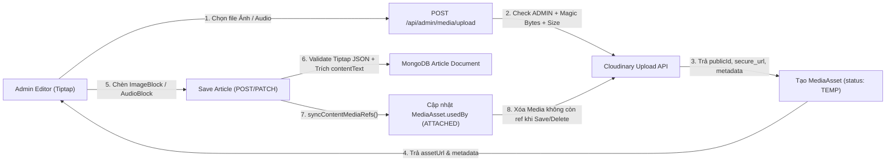

# Module 00: Content & Media Management (Base Rich-Text CMS — CM01 đến CM16)

> **Mã Module:** `CONTENT_MANAGEMENT`  
> **Vai trò kiến trúc:** **Nền tảng dùng chung (Base Layer)** cho mọi phân hệ cần soạn thảo, lưu trữ và hiển thị bài viết giàu định dạng trên hệ thống **UNERA**, bao gồm: [`03_ORIENTATION_EXPLORE`](../03_ORIENTATION_EXPLORE/MODULE_SPEC.md), [`04_STUDENT_ACTIVITIES`](../04_STUDENT_ACTIVITIES/MODULE_SPEC.md) và [`05_NEWS`](../05_NEWS/MODULE_SPEC.md).  
> **Nguyên tắc thiết kế (Clean-Slate):** Không duy trì lớp tương thích ngược với cơ chế Markdown / HTML thuần cũ; các module tiêu thụ sẽ thay thế hoàn toàn bằng bộ ba **Tiptap JSON + Cloudinary + MongoDB**.  
> **Tác nhân:** Admin (`ADMIN` — soạn thảo & quản lý media), Student / Visitor (xem nội dung qua Shared Renderer).

---

## 1. Kiến Trúc Tổng Thể (3 Thành Phần Cốt Lõi)

| Thành phần | Công nghệ | Trách nhiệm chính |
|---|---|---|
| **1. Rich Text / Block Editor** | **Tiptap** (ProseMirror Framework) | Giao diện Admin soạn thảo trực quan theo cấu trúc Block, mở rộng Custom Blocks (`Image`, `Audio`, `YouTube Embed`, `Callout`), xuất dữ liệu dạng **Tiptap JSON AST**. |
| **2. Media Storage & Management** | **Cloudinary** + Backend Gateway | Lưu trữ toàn bộ file nhị phân (ảnh, audio) trên CDN; Backend Next.js làm cổng kiểm duyệt quyền, MIME type, magic bytes & dung lượng trước khi upload. |
| **3. Content & Metadata Storage** | **MongoDB** (Mongoose) | Lưu cấu trúc bài viết dạng JSON (`contentJson`), bản trích xuất plain text (`contentText`) phục vụ search/đếm thời gian đọc, và bảng `MediaAsset` (`media_assets`) quản lý vòng đời tài nguyên Cloudinary. |

---

## 2. Luồng Kiến Trúc & Dọn Rác Media

---

## 3. Mô Hình Dữ Liệu Nền Tảng (MongoDB / Mongoose)

### 3.1 `media_assets` (`MediaAsset.ts`)
Collection trung tâm quản lý toàn bộ tài nguyên đã upload lên Cloudinary, giúp:
- Tránh lưu file nhị phân (binary / base64) trong MongoDB.
- Tái sử dụng media đã tải qua thư viện Media Library.
- Truy vết tài nguyên đang được gắn ở bài viết nào (`usedBy`) để **xóa đúng trên Cloudinary khi không còn nơi nào sử dụng**, tránh xóa nhầm ảnh dùng chung hoặc bỏ sót file mồ côi.

| Trường | Kiểu | Bắt buộc | Mô tả |
|---|---|---|---|
| `publicId` | `String` | Có | Cloudinary `public_id` (unique, index) |
| `url` | `String` | Có | `secure_url` HTTPS từ Cloudinary |
| `resourceType` | `Enum` | Có | `"image"` \| `"video"` *(Cloudinary lưu audio dưới `resource_type: "video"`)* |
| `mediaKind` | `Enum` | Có | `"IMAGE"` \| `"AUDIO"` |
| `folder` | `String` | Có | Thư mục phân nhóm trên Cloudinary (VD: `unera/orientation`, `unera/activities`, `unera/news`) |
| `originalFilename` | `String` | Có | Tên file gốc đã sanitize |
| `mimeType` | `String` | Có | MIME type thực xác thực từ magic bytes |
| `format` | `String` | Có | Đuôi định dạng (`webp`, `png`, `jpg`, `mp3`, `m4a`...) |
| `bytes` | `Number` | Có | Dung lượng file (bytes) |
| `width` | `Number` | Không | Chiều rộng ảnh (px) |
| `height` | `Number` | Không | Chiều cao ảnh (px) |
| `duration` | `Number` | Không | Thời lượng audio (giây) |
| `status` | `Enum` | Có | `"TEMP"` (mới upload chưa gắn bài) \| `"ATTACHED"` (đang gắn ít nhất 1 document) \| `"ORPHANED"` (đã gỡ khỏi tất cả bài) |
| `usedBy` | `Array` | Có | Danh sách `{ targetCollection: "orientation_articles" \| "student_activities" \| "news_articles", documentId: ObjectId, role: "COVER" \| "CONTENT" }` |
| `uploadedBy` | `ObjectId` | Có | Ref `users._id` (Admin thực hiện upload) |
| `createdAt`, `updatedAt` | `Date` | Có | Timestamps tự động |

### 3.2 Hợp Đồng Dữ Liệu Nội Dung Dùng Chung Trên Các Collection Bài Viết
Mọi collection bài viết (`orientation_articles`, `student_activities`, `news_articles`) thay thế trường `content` / `description` chuỗi cũ bằng cặp trường chuẩn hóa:

| Trường | Kiểu | Bắt buộc | Mô tả |
|---|---|---|---|
| `coverImage` | `String` | Không | URL ảnh bìa (từ Cloudinary hoặc URL ngoài hợp lệ; nếu thuộc Cloudinary sẽ được ghi nhận vào `MediaAsset.usedBy` với `role: "COVER"`) |
| `contentJson` | `Schema.Types.Mixed` | Có | Cấu trúc JSON AST chuẩn của Tiptap (`{ type: "doc", content: [...] }`) đã qua sanitize & schema validation phía Backend |
| `contentText` | `String` | Có | Chuỗi văn bản thuần trích xuất tự động từ `contentJson` phía server, dùng cho tìm kiếm `$regex` / text index và tính `readTimeMinutes` |

---

## 4. Danh Sách Đặc Tả Chi Tiết (`CM01`–`CM16`)

| Mã | Nhóm chức năng | Phạm vi Feature IDs | Tệp đặc tả |
|---|---|---|---|
| `CM-01` | Tiptap Block Editor, JSON Schema & Shared Renderer | `CM01`–`CM05` | [`01_TIPTAP_RICH_TEXT_EDITOR_AND_CONTENT_SCHEMA.md`](./01_TIPTAP_RICH_TEXT_EDITOR_AND_CONTENT_SCHEMA.md) |
| `CM-02` | Cloudinary Upload Gateway & Media Library | `CM06`–`CM10` | [`02_CLOUDINARY_MEDIA_UPLOAD_AND_MANAGEMENT.md`](./02_CLOUDINARY_MEDIA_UPLOAD_AND_MANAGEMENT.md) |
| `CM-03` | Audio Block, YouTube Video Embed & Custom Blocks | `CM11`–`CM13` | [`03_AUDIO_AND_YOUTUBE_MEDIA_BLOCKS.md`](./03_AUDIO_AND_YOUTUBE_MEDIA_BLOCKS.md) |
| `CM-04` | Vòng Đời Media, Orphan Cleanup & Tích Hợp Module | `CM14`–`CM16` | [`04_MEDIA_LIFECYCLE_AND_MODULE_INTEGRATION.md`](./04_MEDIA_LIFECYCLE_AND_MODULE_INTEGRATION.md) |

---

## 5. Ràng Buộc Bảo Mật & Vận Hành Bất Biến
1. **Không lưu binary vào MongoDB:** Mọi file upload và chuỗi `data:image/*;base64,...` trong JSON bài viết bị từ chối ở tầng API validation (`400 Bad Request`).
2. **Xác thực file thực tế:** Kiểm tra đồng thời `requireAdmin()`, dung lượng, phần mở rộng cho phép và **magic bytes** trên buffer trước khi gọi Cloudinary.
3. **Chống XSS ở tầng Schema & Renderer:** Backend lọc bỏ node/mark không nằm trong whitelist; Frontend render JSON sang React JSX component thuần, không sử dụng `dangerouslySetInnerHTML`.
4. **Cấu hình môi trường bắt buộc:** `CLOUDINARY_CLOUD_NAME`, `CLOUDINARY_API_KEY`, `CLOUDINARY_API_SECRET` trong `.env.local` (tách riêng module `src/lib/cloudinary.ts`, báo lỗi cấu hình rõ ràng `503 Service Unavailable` nếu thiếu biến môi trường khi upload).

