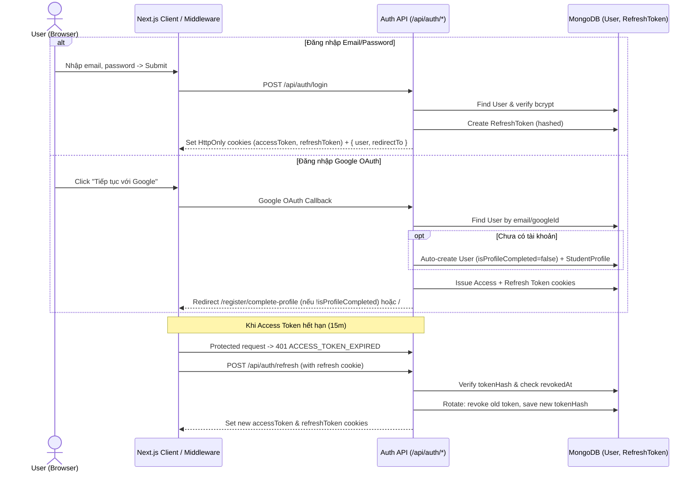

# AUTH-01: Đăng Nhập (JWT Access/Refresh Token & Google OAuth)

> **Module:** `01_AUTHENTICATION`  
> **Yêu cầu liên quan:** Login bằng JWT Access Token + Refresh Token, Email/Password, Google OAuth tự động đăng ký tài khoản mới nếu chưa có Gmail.  
> **Tác nhân:** Visitor, Student, Admin.

---

## 1. Mục Tiêu & Quy Tắc Nghiệp Vụ (Business Rules)

1. **Xác minh truy cập bằng Dual-Token JWT:**
   - Mọi request cần xác thực đều kiểm tra **Access Token** (JWT ký bằng `JWT_ACCESS_SECRET`, thời hạn `15 phút`).
   - Khi Access Token hết hạn (HTTP `401` hoặc kiểm tra trước khi gọi), client tự động gọi `/api/auth/refresh` dùng **Refresh Token** (thời hạn `7 ngày`, hoặc `30 ngày` nếu chọn *Ghi nhớ đăng nhập*) để cấp cặp Access Token + Refresh Token mới (**Refresh Token Rotation**).
   - **Lưu trữ an toàn trên trình duyệt:** Cả `unera_access_token` và `unera_refresh_token` được set qua `Set-Cookie` với `HttpOnly: true`, `SameSite: "Lax"`, `Secure: true` (production), `Path: "/"` (hoặc `Path: "/api/auth/refresh"` cho refresh token). Đồng thời API `/api/auth/login` và `/api/auth/refresh` có thể trả về metadata user (không trả raw refresh token ra JS nếu dùng cookie thuần; nếu hỗ trợ API client, dùng Bearer header cho Access Token).
2. **Kiểm tra trạng thái tài khoản & thu hồi token:**
   - Nếu `user.status === "DISABLED"`, chặn đăng nhập (`403`) và thu hồi mọi Refresh Token còn hiệu lực của user đó.
   - Khi phát hiện một Refresh Token đã bị thu hồi (`revokedAt !== null`) được gửi lại (**Token Reuse Detection**), thu hồi toàn bộ `familyId` đó để bảo vệ tài khoản.
3. **Đăng nhập bằng Email & Password:**
   - Chuẩn hóa email `toLowerCase().trim()`.
   - So sánh mật khẩu qua `bcrypt.compare`. Nếu tài khoản được tạo bằng Google và chưa từng đặt mật khẩu (`!user.password`), trả lỗi rõ ràng gợi ý đăng nhập Google hoặc dùng tính năng Quên mật khẩu để thiết lập mật khẩu.
4. **Đăng nhập bằng Google OAuth (Auto-Register):**
   - Người dùng bấm **"Tiếp tục với Google"**.
   - Nếu email Google **đã tồn tại** trong `users`:
     - Kiểm tra `status !== "DISABLED"`.
     - Liên kết `googleId` nếu chưa có và cập nhật `avatar` nếu trống.
     - Cấp cặp JWT Access Token + Refresh Token.
     - Kiểm tra `user.isProfileCompleted`: nếu `true` → chuyển về `callbackUrl` (hoặc `/`); nếu `false` → chuyển sang `/register/complete-profile` (Bước 2).
   - Nếu email Google **chưa tồn tại** trong `users`:
     - **Tự động đăng ký tài khoản luôn**: tạo `User` (`role: "STUDENT"`, `status: "ACTIVE"`, `isProfileCompleted: false`, `onboardingStep: "PROFILE"`, `authProviders: ["GOOGLE"]`) và tạo `StudentProfile` khởi tạo (`fullName` lấy từ Google name).
     - Cấp cặp JWT Access Token + Refresh Token.
     - **Điều hướng ngay sang Bước 2 của quy trình đăng ký** (`/register/complete-profile`) để sinh viên điền Họ tên, Năm sinh, Sinh viên năm mấy, Trường ĐH, Ngành học → sau đó sang Bước 3 (Quiz định hướng).

---

## 2. Luồng Tương Tác (Sequence Flow)



---

## 3. Đặc Tả API Contract

### 3.1 `POST /api/auth/login`
- **Zod Request Schema:**
  ```typescript
  const loginSchema = z.object({
    email: z.string().email("Email không hợp lệ"),
    password: z.string().min(1, "Vui lòng nhập mật khẩu"),
    rememberMe: z.boolean().optional().default(false),
  });
  ```
- **Response `200 OK`:**
  - Set Cookies: `unera_access_token` (15m), `unera_refresh_token` (7d hoặc 30d).
  - Body:
    ```json
    {
      "success": true,
      "user": {
        "id": "...",
        "name": "Nguyễn Văn A",
        "email": "sv@ulis.vnu.edu.vn",
        "role": "STUDENT",
        "isProfileCompleted": true,
        "onboardingStep": "COMPLETED"
      },
      "redirectTo": "/"
    }
    ```
- **Mã lỗi:** `400` (Validation lỗi), `401` (Sai email hoặc mật khẩu), `403` (Tài khoản `DISABLED`).

### 3.2 `POST /api/auth/refresh`
- **Input:** Cookie `unera_refresh_token` (hoặc `Authorization` / body `refreshToken` nếu API mode).
- **Xử lý:**
  1. Verify chữ ký JWT của Refresh Token bằng `JWT_REFRESH_SECRET`.
  2. Hash token bằng SHA-256, tìm bản ghi trong `refresh_tokens`.
  3. Nếu `revokedAt` khác `null` → thu hồi toàn bộ `familyId` (`updateMany`), xóa cookie, trả `401 TOKEN_REUSE_DETECTED`.
  4. Kiểm tra `User` có tồn tại và `status === "ACTIVE"`.
  5. Đánh dấu token cũ `revokedAt = new Date()`, tạo `RefreshToken` mới cùng `familyId`, ký Access Token mới (`15m`) và Refresh Token mới.
- **Response `200 OK`:** Set lại cookies mới, trả `{ success: true }`.

### 3.3 `POST /api/auth/logout`
- **Xử lý:** Đọc cookie `unera_refresh_token`, tìm và đánh dấu `revokedAt = new Date()` trong `refresh_tokens`, xóa cả `unera_access_token` và `unera_refresh_token` cookies (`maxAge: 0`).
- **Response `200 OK`:** `{ success: true, message: "Đăng xuất thành công" }`.

### 3.4 `GET /api/auth/me`
- **Xử lý:** Đọc và verify `unera_access_token` (hỗ trợ auto-refresh trong Server Helper / Middleware), trả thông tin `user` hiện tại (`id, name, email, role, status, isProfileCompleted, onboardingStep, avatar`).

---

## 4. Thay Đổi Tệp Nguồn & Middleware/Proxy

- Tạo `src/lib/jwt.ts`: Ký & xác thực Access Token (`15m`) và Refresh Token (`7d`/`30d`) bằng `jose` (tương thích Edge Runtime).
- Tạo `src/models/RefreshToken.ts`: Mongoose schema cho `refresh_tokens`.
- Cập nhật `src/lib/auth.ts` (Google OAuth callback): Khi callback Google hoàn tất, gọi service cấp cặp Access Token + Refresh Token vào cookie và điều hướng `/register/complete-profile` nếu `!dbUser.isProfileCompleted`.
- Cập nhật `src/lib/session.ts`: `getCurrentUser()` đọc Access Token từ cookie (hoặc `Authorization: Bearer <token>`), kiểm tra DB `status === "ACTIVE"`.
- Cập nhật `src/middleware.ts` (hoặc `src/proxy.ts` theo Next.js 16):
  - Nếu user có token hợp lệ nhưng `isProfileCompleted === false` và truy cập các route cần profile (`/roadmap`, `/profile`, `/activities`...), redirect sang `/register/complete-profile` (cho phép truy cập API `/api/auth/*`, `/api/universities`).
  - Bảo vệ `/admin/*` yêu cầu `role === "ADMIN"`.

---

## 5. Tiêu Chí Chấp Thuận (Acceptance Criteria)

- **AC-01 (Login Email/Password + JWT):**
  - *Given* tài khoản sinh viên `ACTIVE` đã đăng ký, *When* đăng nhập đúng email & mật khẩu tại `/login`, *Then* server cấp cookie `unera_access_token` (15 phút) và `unera_refresh_token` (7/30 ngày), lưu hash refresh token vào DB, và chuyển hướng đúng theo `onboardingStep`.
- **AC-02 (Refresh Token Rotation):**
  - *Given* `unera_access_token` đã hết hạn nhưng `unera_refresh_token` còn hạn và chưa bị thu hồi, *When* client gọi `POST /api/auth/refresh`, *Then* token cũ bị đánh dấu `revokedAt`, cặp Access + Refresh Token mới được cấp thành công.
- **AC-03 (Chống tái sử dụng Refresh Token):**
  - *Given* một Refresh Token đã được rotated trước đó, *When* có request gửi lại token cũ đó, *Then* hệ thống thu hồi toàn bộ chuỗi `familyId` của phiên đăng nhập đó và trả về `401`.
- **AC-04 (Google OAuth Auto-Register):**
  - *Given* người dùng dùng tài khoản Gmail chưa từng đăng ký trên UNERA, *When* đăng nhập bằng Google OAuth thành công, *Then* hệ thống tự tạo `User` + `StudentProfile`, cấp JWT Access/Refresh tokens, và điều hướng ngay tới bước hoàn thiện hồ sơ `/register/complete-profile`.
- **AC-05 (Account Disabled):**
  - *Given* tài khoản có `status === "DISABLED"`, *When* đăng nhập hoặc refresh token, *Then* bị từ chối với HTTP `403` và mọi refresh token bị thu hồi.

