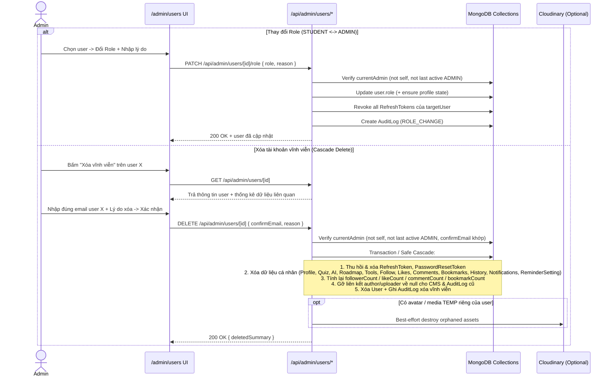

# AUTH-04: Quản Lý Người Dùng, Phân Quyền Role & Xóa Tài Khoản Toàn Diện (Admin)

> **Module:** `01_AUTHENTICATION`  
> **Yêu cầu liên quan:** Admin quản lý toàn bộ người dùng trong hệ thống (không chỉ sinh viên), xem & thay đổi vai trò (`STUDENT` ↔ `ADMIN`), tạo/khóa/mở khóa tài khoản, và có nút **Xóa tài khoản vĩnh viễn** (xóa bỏ toàn bộ dữ liệu liên quan đến user).  
> **Tác nhân:** Admin (`role === "ADMIN"`, `status === "ACTIVE"`).  
> **Tệp nguồn hiện trạng liên quan:** [`src/app/admin/students/page.tsx`](file:///c:/Users/AD/OneDrive/Desktop/Project/ULIS_DMST_2026/src/app/admin/students/page.tsx), [`src/app/api/admin/students/route.ts`](file:///c:/Users/AD/OneDrive/Desktop/Project/ULIS_DMST_2026/src/app/api/admin/students/route.ts), [`src/app/api/admin/students/[id]/status/route.ts`](file:///c:/Users/AD/OneDrive/Desktop/Project/ULIS_DMST_2026/src/app/api/admin/students/[id]/status/route.ts), [`src/models/User.ts`](file:///c:/Users/AD/OneDrive/Desktop/Project/ULIS_DMST_2026/src/models/User.ts), [`src/lib/session.ts`](file:///c:/Users/AD/OneDrive/Desktop/Project/ULIS_DMST_2026/src/lib/session.ts), [`src/lib/audit.ts`](file:///c:/Users/AD/OneDrive/Desktop/Project/ULIS_DMST_2026/src/lib/audit.ts).

---

## 1. Phân Tích Hiện Trạng & Mục Tiêu Nâng Cấp

Hiện tại, mã nguồn mới chỉ có trang `/admin/students` và API `/api/admin/students` với phạm vi hạn chế:
- Lọc cứng `{ role: "STUDENT" }`, khiến Admin không thể xem danh sách các tài khoản `ADMIN` khác trên giao diện web.
- Chỉ hỗ trợ thao tác Khóa/Mở khóa (`ACTIVE` ↔ `DISABLED`); chưa có API hoặc UI **chuyển đổi Role (`STUDENT` ↔ `ADMIN`)** hay **tạo tài khoản/cấp quyền mới**.
- Chưa có chức năng **Xóa tài khoản vĩnh viễn (Hard Cascade Delete)** để dọn sạch toàn bộ dữ liệu liên quan tới user trên tất cả các phân hệ.

**Mục tiêu nâng cấp (`AUTH-04`):**
1. Hợp nhất quản lý thành phân hệ **Quản lý Người dùng & Phân quyền (`/admin/users`)** hỗ trợ cả `STUDENT` và `ADMIN` *(giữ `/admin/students` chuyển hướng về `/admin/users` để tương thích liên kết cũ)*.
2. Cho phép Admin **quản lý Role** (`STUDENT` ↔ `ADMIN`) với kiểm tra bảo vệ an toàn (Safety Guards) và hiệu lực phiên tức thì.
3. Bổ sung **nút Xóa tài khoản** dành riêng cho Admin, đi kèm cơ chế xác nhận 2 lớp và **Cascade Delete** xóa sạch 100% dữ liệu cá nhân/tương tác của user đó, đồng thời bảo toàn nội dung CMS chung và tính toàn vẹn AuditLog.

---

## 2. Quy Tắc Nghiệp Vụ & Bảo Mật (Business & Safety Rules)

### 2.1 Phân quyền & Vai trò hệ thống
1. **Mô hình 2 Role đồng đẳng trong cấp quản trị:**
   - Hệ thống sử dụng 2 vai trò chính thức trong `USER_ROLES`: `"STUDENT"` và `"ADMIN"`.
   - Mọi tài khoản có `role === "ADMIN"` và `status === "ACTIVE"` đều có quyền ngang nhau (Admin đồng đẳng) để quản lý người dùng và phân quyền.
2. **Kiểm tra danh tính & hiệu lực Role thời gian thực (Realtime AuthZ):**
   - Ở các hàm bảo vệ phía Server (`requireAdmin()`, `getCurrentUser()` trong `src/lib/session.ts`), hệ thống phải đối chiếu `role` và `status` trực tiếp từ bản ghi `User` mới nhất trong MongoDB (hoặc thu hồi session ngay khi thay đổi), đảm bảo nếu một `ADMIN` vừa bị hạ xuống `STUDENT` hoặc bị khóa (`DISABLED`), mọi request tiếp theo vào `/api/admin/*` hoặc `/admin/*` bị từ chối ngay (`403 Forbidden`) mà không phải chờ Access Token 15 phút tự hết hạn.
3. **Thay đổi Role (`STUDENT` ↔ `ADMIN`):**
   - Bắt buộc nhập **lý do thay đổi** (tối thiểu 5 ký tự) để lưu vào `AuditLog`.
   - Khi thao tác thành công:
     - Thu hồi toàn bộ `RefreshToken` đang hoạt động của user mục tiêu (`revokeAllUserRefreshTokens`).
     - Nếu nâng từ `STUDENT` → `ADMIN`: tự động đảm bảo `user.isProfileCompleted = true` (tránh bị middleware chặn bởi bước hoàn thiện hồ sơ sinh viên khi Admin đăng nhập), giữ nguyên dữ liệu hồ sơ sinh viên cũ nếu có.
     - Nếu hạ từ `ADMIN` → `STUDENT`: kiểm tra và tạo sẵn `StudentProfile` mặc định nếu tài khoản Admin trước đó chưa từng có hồ sơ sinh viên (tôn trọng `isProfileCompleted` thực tế của user đó).
4. **Tạo tài khoản trực tiếp từ Admin (Khuyến nghị bổ sung):**
   - Admin có thể nhấn **"Thêm người dùng / Cấp tài khoản"** để tạo nhanh tài khoản `STUDENT` hoặc `ADMIN` (Email, Họ tên, Mật khẩu khởi tạo tối thiểu 8 ký tự, Role, tự động đánh dấu `isProfileCompleted = true` nếu là `ADMIN`), giúp không phụ thuộc vào script CLI khi cần bổ sung quản trị viên mới.

### 2.2 Quy tắc Bảo vệ An Toàn Bất Biến (Safety Guards)
Để tránh sự cố Admin tự khóa hệ thống hoặc mất toàn bộ quyền quản trị:
1. **Chống tự tác động lên chính mình (Self-Protection):**
   - Admin đang đăng nhập **không được phép** tự hạ role của chính mình (`ADMIN` → `STUDENT`), tự khóa tài khoản (`DISABLED`), hoặc tự xóa tài khoản chính mình → Trả lỗi HTTP `400 Bad Request` (`"Bạn không thể tự thay đổi quyền, tự khóa hoặc tự xóa tài khoản đang đăng nhập."`).
2. **Bảo vệ Admin hoạt động cuối cùng (Last Active Admin Protection):**
   - Trước khi **hạ role** (`ADMIN` → `STUDENT`), **khóa tài khoản** (`ACTIVE` → `DISABLED`), hoặc **xóa vĩnh viễn** một tài khoản đang có `role === "ADMIN"` và `status === "ACTIVE"`, hệ thống bắt buộc đếm số lượng Admin còn lại (`role: "ADMIN", status: "ACTIVE", _id: { $ne: targetUserId }`).
   - Nếu số lượng còn lại `< 1` → Chặn thao tác với HTTP `409 Conflict` (`"Không thể thực hiện vì đây là tài khoản Quản trị viên đang hoạt động cuối cùng trong hệ thống."`).

### 2.3 Quy tắc Nút Xóa Tài Khoản & Cascade Deletion Toàn Diện
1. **Phạm vi người được phép xóa:**
   - **Chỉ Admin** mới có nút **"Xóa tài khoản"** trên trang Quản lý người dùng (`/admin/users`). Không hỗ trợ tự xóa tài khoản ở phía giao diện sinh viên.
2. **Xác nhận an toàn 2 lớp (High-Friction Confirmation Modal):**
   - Trước khi xóa, Admin mở hộp thoại xem **báo cáo tóm tắt số lượng dữ liệu** sẽ bị xóa của user (số bài khảo sát, lộ trình, bình luận, lượt quan tâm, bookmark, kết quả công cụ, bài viết CMS từng đăng nếu là Admin...).
   - Admin bắt buộc phải:
     1. Nhập **chính xác email của tài khoản bị xóa** để xác nhận đúng đối tượng.
     2. Nhập **lý do xóa tài khoản** (tối thiểu 5 ký tự) phục vụ kiểm toán.
3. **Ma trận Xóa bỏ toàn bộ dữ liệu liên quan đến User (Cascade Delete Matrix):**

| Nhóm dữ liệu | Collection / Model thực tế trong `src/models/` | Trường liên kết | Hành động khi xóa User |
|---|---|---|---|
| **Tài khoản & Xác thực** | `users` (`User.ts`) | `_id` | **Xóa vĩnh viễn** bản ghi User |
| | `refreshtokens` (`RefreshToken.ts`) | `userId` | **Xóa vĩnh viễn** toàn bộ token phiên |
| | `passwordresettokens` (`PasswordResetToken.ts`) | `userId`, `email` | **Xóa vĩnh viễn** toàn bộ token khôi phục |
| **Hồ sơ & Cài đặt** | `studentprofiles` (`StudentProfile.ts`) | `userId` (`String`) | **Xóa vĩnh viễn** hồ sơ sinh viên |
| | `reminder_settings` (`ReminderSetting.ts`) | `userId` (`ObjectId`) | **Xóa vĩnh viễn** cấu hình nhắc nhở |
| **Định hướng AI & Lộ trình (M08)** | `assessment_submissions` (`AssessmentSubmission.ts`) | `studentId` | **Xóa vĩnh viễn** toàn bộ nháp & lịch sử làm bài |
| | `ai_orientation_analyses` (`AiOrientationAnalysis.ts`) | `studentId` | **Xóa vĩnh viễn** toàn bộ kết quả phân tích AI |
| | `roadmaps` (`Roadmap.ts`) | `studentId` | **Xóa vĩnh viễn** toàn bộ lộ trình (cả `ACTIVE` & `ARCHIVED`) |
| **Hoạt động & Thông báo (M04, M06)** | `activity_follows` (`ActivityFollow.ts`) | `studentId` | **Xóa vĩnh viễn** & giảm/tính lại `followerCount` ($\ge 0$) trên `student_activities` |
| | `notifications` (`Notification.ts`) | `recipientId` (`String`) | **Xóa vĩnh viễn** toàn bộ thông báo của user |
| **Khám phá & Tin tức (M03, M05)** | `article_likes` (`ArticleLike.ts`) | `userId` | **Xóa vĩnh viễn** & giảm/tính lại `likeCount` ($\ge 0$) trên `orientation_articles` |
| | `article_comments` (`ArticleComment.ts`) | `userId`, `parentCommentId` | **Xóa vĩnh viễn** comment của user (và comment trả lời thuộc nhánh con của nó), sau đó tính lại chính xác `commentCount` trên `orientation_articles` bị ảnh hưởng |
| | `news_bookmarks` (`NewsBookmark.ts`) | `userId` | **Xóa vĩnh viễn** & giảm/tính lại `bookmarkCount` ($\ge 0$) trên `news_articles` |
| | `news_reading_histories` (`NewsReadingHistory.ts`) | `userId` | **Xóa vĩnh viễn** toàn bộ lịch sử đọc |
| **Công cụ & Đặt lịch (M07 / Legacy)** | `tool_results` (`ToolResult.ts`) | `userId` | **Xóa vĩnh viễn** lịch sử MBTI, MI, Gross-Net, TNCN |
| | `bookingrequests` (`BookingRequest.ts`) | `studentId` (`String`) | **Xóa vĩnh viễn** các yêu cầu đặt lịch cũ của user (nếu collection có dữ liệu) |
| **Media tải lên (M00)** | `media_assets` (`MediaAsset.ts`) | `uploadedBy` | Với ảnh avatar riêng / media ở trạng thái `TEMP` (`usedBy` rỗng hoặc chỉ trỏ `users`/`studentprofiles` của user bị xóa): xóa bản ghi + thu dọn file trên Cloudinary (best-effort). Với media `ACTIVE` đang nhúng trong bài viết/hoạt động CMS chung: **giữ nguyên**, gán `uploadedBy = null`. |
| **Nội dung CMS chung *(nếu user từng là Admin)*** | `orientation_articles` (`OrientationArticle.ts`) | `createdByAdminId` | **Giữ nguyên bài viết** để không làm hỏng dữ liệu cộng đồng; gán `createdByAdminId = null` (giữ `authorName` hoặc fallback `"Ban biên tập Unera"`) |
| | `news_articles` (`NewsArticle.ts`) | `createdBy`, `updatedByAdminId` | **Giữ nguyên bài viết**; gán `createdBy = null`, `updatedByAdminId = null` |
| | `student_activities` (`StudentActivity.ts`) | `createdBy`, `updatedByAdminId` | **Giữ nguyên hoạt động**; gán `createdBy = null`, `updatedByAdminId = null` |
| | `questionnaires` (`Questionnaire.ts`) | `createdByAdminId` | **Giữ nguyên bộ câu hỏi**; gán `createdByAdminId = null` |
| | `system_prompts` (`SystemPrompt.ts`) | `updatedByAdminId` | **Giữ nguyên prompt**; gán `updatedByAdminId = null` |
| **Kiểm toán hệ thống** | `auditlogs` (`AuditLog.ts`) | `adminId` | **Bảo toàn bản ghi append-only**: nếu user bị xóa từng là Admin thực hiện thao tác trước đây, gán `adminId = null`, cập nhật `adminEmail = "deleted-user@system.local"`, `adminName = "Tài khoản đã xóa"`. Sau khi xóa user, **ghi 1 bản ghi `AuditLog` mới** ghi nhận hành động xóa vĩnh viễn của Admin hiện tại (`targetTitle` lưu tên + email để truy vết lý do xóa). |

---

## 3. Luồng Tương Tác (Sequence Flow)



---

## 4. Đặc Tả API Contract

Tất cả các endpoint dưới đây bắt buộc gọi `requireAdmin()` (xác thực Access Token + đối chiếu `role === "ADMIN"` và `status === "ACTIVE"` trong DB).

### 4.1 `GET /api/admin/users`
- **Query Params:**
  - `page` (default `1`), `limit` (default `15`, max `50`)
  - `search` (tìm theo `name`, `email`, không phân biệt hoa thường)
  - `role`: `ALL` | `STUDENT` | `ADMIN` (default `ALL`)
  - `status`: `ALL` | `ACTIVE` | `DISABLED` (default `ALL`)
  - `authProvider`: `ALL` | `CREDENTIALS` | `GOOGLE` (default `ALL`)
- **Response `200 OK`:**
  - `users`: Danh sách tài khoản (ẩn `password`), kèm `role`, `status`, `authProviders`, `isProfileCompleted`, `onboardingStep`, `lastLoginAt`, `createdAt`, và tóm tắt học vấn từ `StudentProfile` (`university`, `major`, `academicYear`).
  - `summary`: `{ totalUsers, totalStudents, totalAdmins, activeUsers, disabledUsers }`.
  - `pagination`: `{ page, limit, total, totalPages }`.

### 4.2 `POST /api/admin/users` (Tạo tài khoản từ Admin)
- **Zod Request Schema:**
  ```typescript
  const adminCreateUserSchema = z.object({
    name: z.string().trim().min(2).max(100),
    email: z.string().trim().email("Email không hợp lệ"),
    password: z.string().min(8, "Mật khẩu tối thiểu 8 ký tự").max(128),
    role: z.enum(["STUDENT", "ADMIN"]),
    status: z.enum(["ACTIVE", "DISABLED"]).optional().default("ACTIVE"),
    reason: z.string().trim().max(500).optional(),
  });
  ```
- **Xử lý:** Hash mật khẩu với bcrypt, kiểm tra trùng email (`409 Conflict`). Nếu `role === "ADMIN"` đặt `isProfileCompleted = true`, `onboardingStep = "COMPLETED"`; nếu `role === "STUDENT"` tạo kèm `StudentProfile` khởi tạo (`isProfileCompleted = false`, `onboardingStep = "PROFILE"`). Ghi `AuditLog` (`CREATE`).
- **Response `201 Created`:** Trả metadata user vừa tạo (không bao gồm `password`).

### 4.3 `GET /api/admin/users/[id]` (Chi tiết & Thống kê trước khi thao tác)
- **Xử lý:** Trả thông tin chi tiết `User`, `StudentProfile` (nếu có) và bộ đếm `relatedDataSummary` (`submissionsCount`, `aiAnalysesCount`, `roadmapsCount`, `commentsCount`, `likesCount`, `followsCount`, `bookmarksCount`, `toolResultsCount`, `notificationsCount`, `cmsContentCount` — số bài viết/hoạt động/bộ câu hỏi CMS do tài khoản này tạo để hiển thị rõ trước khi Admin xác nhận xóa).
- **Mã lỗi:** `400` (ObjectId không hợp lệ), `404` (Không tìm thấy user).

### 4.4 `PATCH /api/admin/users/[id]/role` (Thay đổi Role)
- **Zod Request Schema:**
  ```typescript
  const updateUserRoleSchema = z.object({
    role: z.enum(["STUDENT", "ADMIN"]),
    reason: z
      .string()
      .trim()
      .min(5, "Vui lòng nhập lý do thay đổi vai trò (tối thiểu 5 ký tự)")
      .max(500),
  });
  ```
- **Xử lý:**
  1. Kiểm tra không tự đổi role chính mình (`400`).
  2. Nếu chuyển `ADMIN` → `STUDENT` và user đang `ACTIVE`: kiểm tra còn ít nhất 1 `ADMIN` `ACTIVE` khác (`409` nếu không).
  3. Cập nhật `user.role`, xử lý `isProfileCompleted` / `StudentProfile` tương ứng, thu hồi toàn bộ `RefreshToken` của user (`revokeAllUserRefreshTokens`).
  4. Ghi `AuditLog` (`action: "ROLE_CHANGE"`, `changesBefore: { role: oldRole }`, `changesAfter: { role: newRole }`, `reason`).
- **Response `200 OK`:** `{ success: true, message, user }`.

### 4.5 `PATCH /api/admin/users/[id]/status` (Khóa / Mở khóa tài khoản)
- Kế thừa logic của `/api/admin/students/[id]/status` nhưng áp dụng chung cho mọi user (`STUDENT` và `ADMIN`):
  - Chặn Admin tự khóa chính mình (`400`).
  - Chặn khóa Admin `ACTIVE` cuối cùng (`409`).
  - Khi `DISABLED`: thu hồi toàn bộ `RefreshToken`. Ghi `AuditLog` (`LOCK_ACCOUNT` / `UNLOCK_ACCOUNT`).
  - *(Giữ `/api/admin/students` và `/api/admin/students/[id]/status` là alias tương thích hoặc trỏ về service dùng chung để không gãy các module khác nếu còn gọi).*

### 4.6 `DELETE /api/admin/users/[id]` (Xóa vĩnh viễn User & Cascade Delete)
- **Zod Request Schema:**
  ```typescript
  const deleteUserSchema = z.object({
    confirmEmail: z.string().trim().email("Vui lòng nhập đúng email xác nhận"),
    reason: z
      .string()
      .trim()
      .min(5, "Vui lòng nhập lý do xóa tài khoản (tối thiểu 5 ký tự)")
      .max(500),
  });
  ```
- **Xử lý:**
  1. Kiểm tra `id` hợp lệ, không phải `currentAdmin.id` (`400`).
  2. Tìm `targetUser` (`404` nếu không tồn tại).
  3. So sánh `confirmEmail.toLowerCase() === targetUser.email.toLowerCase()` (`400` nếu không khớp).
  4. Nếu `targetUser.role === "ADMIN"` && `targetUser.status === "ACTIVE"`: kiểm tra còn ít nhất 1 `ADMIN` `ACTIVE` khác (`409` nếu là Admin cuối cùng).
  5. Chạy `cascadeDeleteUser({ targetUserId: id, performedByAdmin: currentAdmin, reason, req })` trong transaction (hỗ trợ fallback an toàn cho MongoDB standalone qua `runWithOptionalTransaction`).
  6. Thực hiện đầy đủ bảng **Cascade Delete Matrix** ở mục 2.3 (xóa dữ liệu cá nhân, tính lại các counter trên bài viết/hoạt động, ẩn danh hóa CMS refs & `AuditLog` cũ, xóa bản ghi `User`, ghi `AuditLog` `action: "DELETE"`).
- **Response `200 OK`:**
  ```json
  {
    "success": true,
    "message": "Đã xóa vĩnh viễn tài khoản và toàn bộ dữ liệu liên quan của Nguyễn Văn A.",
    "deletedCounts": {
      "studentProfiles": 1,
      "refreshTokens": 2,
      "assessmentSubmissions": 1,
      "aiOrientationAnalyses": 1,
      "roadmaps": 2,
      "notifications": 5,
      "toolResults": 3,
      "commentsAndLikes": 4,
      "bookmarksAndHistory": 6,
      "activityFollows": 2
    }
  }
  ```
- **Mã lỗi:** `400` (Tự xóa / sai `confirmEmail` / thiếu lý do), `401`/`403` (Không có quyền Admin), `404` (Không tìm thấy), `409` (Admin hoạt động cuối cùng).

---

## 5. Đặc Tả Giao Diện UI/UX (`/admin/users`)

- **Sidebar Admin (`src/components/common/Sidebar.tsx`):**
  - Đổi mục `"Quản lý Sinh viên"` → **`"Quản lý Người dùng"`** trỏ tới `/admin/users` với các sub-items:
    - `Tất cả người dùng` (`/admin/users`)
    - `Sinh viên (STUDENT)` (`/admin/users?role=STUDENT`)
    - `Quản trị viên (ADMIN)` (`/admin/users?role=ADMIN`)
    - `Tài khoản bị khóa` (`/admin/users?status=DISABLED`)
- **Trang `/admin/users`:**
  - **KPI Summary Cards:** Tổng người dùng, Tổng Sinh viên, Tổng Admin, Tài khoản bị khóa.
  - **Thanh công cụ:** Tìm kiếm tên/email, Bộ lọc Role (`Tất cả`, `STUDENT`, `ADMIN`), Bộ lọc Trạng thái (`Tất cả`, `ACTIVE`, `DISABLED`), Bộ lọc Phương thức (`Tất cả`, `Credentials`, `Google`), và nút **"+ Tạo tài khoản"**.
  - **Bảng danh sách người dùng:** Hiển thị Avatar + Tên + Email (gắn badge `"Bạn"` cho tài khoản Admin đang đăng nhập), **Badge Role** (`ADMIN` tím/indigo, `STUDENT` xanh dương), **Badge Trạng thái** (`ACTIVE` xanh ngọc, `DISABLED` đỏ), Nguồn đăng nhập (`Google` / `Email`), Tiến độ Onboarding (`PROFILE` / `QUIZ` / `COMPLETED`), Lần đăng nhập gần nhất, và nhóm nút hành động:
    1. **Xem chi tiết** (Drawer/Modal hiển thị profile & thống kê dữ liệu sở hữu).
    2. **Đổi Role** (Mở Modal chọn `STUDENT` ↔ `ADMIN` + ô nhập lý do; vô hiệu hóa cho chính mình với tooltip giải thích).
    3. **Khóa / Mở khóa** (Mở Modal như hiện tại; vô hiệu hóa cho chính mình).
    4. **Xóa vĩnh viễn** (Nút đỏ trong vùng nguy hiểm; mở **Modal Xác nhận Xóa Toàn Diện** hiển thị thống kê bản ghi sẽ mất + ô nhập lại email xác nhận + ô nhập lý do; vô hiệu hóa cho chính mình).

---

## 6. Thay Đổi Tệp Nguồn Dự Kiến (Khi Implement)

1. **`src/lib/session.ts`:** Bổ sung đối chiếu `role` & `status` trực tiếp từ MongoDB `User` trong `getCurrentUser()` / `requireAdmin()` để việc hạ role, khóa hoặc xóa tài khoản có hiệu lực ngay lập tức trên mọi request.
2. **`src/models/AuditLog.ts` & `src/lib/audit.ts`:**
   - Thêm `"ROLE_CHANGE"` vào enum `action` của `AuditLog`.
   - Đổi `adminId` sang `required: false, default: null` để hỗ trợ ẩn danh hóa `AuditLog` lịch sử khi một tài khoản từng làm Admin bị xóa vĩnh viễn.
3. **`src/models/OrientationArticle.ts` & `src/models/MediaAsset.ts` (cùng kiểm tra `NewsArticle`, `StudentActivity`, `Questionnaire`, `SystemPrompt`):**
   - Nới `createdByAdminId` (`OrientationArticle`) và `uploadedBy` (`MediaAsset`) sang `required: false, default: null` để không lỗi schema khi xóa Admin tác giả mà vẫn giữ nguyên nội dung CMS.
4. **Tạo mới Service Cascade Delete & User Management:**
   - `src/lib/user-management.ts`: Hàm `deleteUserCascade(...)`, `updateUserRole(...)`, `countActiveAdminsExcluding(...)`.
   - `src/validations/user-admin.ts`: Các Zod schema cho list/create/role/status/delete.
5. **API Routes mới:**
   - `src/app/api/admin/users/route.ts` (`GET`, `POST`)
   - `src/app/api/admin/users/[id]/route.ts` (`GET`, `DELETE`)
   - `src/app/api/admin/users/[id]/role/route.ts` (`PATCH`)
   - `src/app/api/admin/users/[id]/status/route.ts` (`PATCH`)
   - Cập nhật `/api/admin/students` và `/api/admin/students/[id]/status` tái sử dụng logic mới hoặc giữ tương thích.
6. **Frontend & Điều hướng:**
   - Tạo `src/app/admin/users/page.tsx` (và điều hướng `/admin/students` → `/admin/users`).
   - Cập nhật `src/components/common/Sidebar.tsx`, `src/app/admin/page.tsx`, và `src/app/admin/audit-logs/page.tsx` (hiển thị badge action `"ROLE_CHANGE"` và xử lý fallback khi `adminId` là `null`).

---

## 7. Tiêu Chí Chấp Thuận (Acceptance Criteria)

- **AC-01 (Xem & Lọc toàn bộ User đa vai trò):** *Given* Admin truy cập `/admin/users`, *When* lọc theo Role `ADMIN`, `STUDENT` hoặc tìm kiếm email, *Then* hệ thống hiển thị chính xác cả tài khoản Admin lẫn Student kèm trạng thái, nguồn đăng nhập và thông tin hồ sơ.
- **AC-02 (Đổi Role & Hiệu lực tức thì):** *Given* Admin A chuyển Role của User B từ `STUDENT` → `ADMIN` (hoặc ngược lại `ADMIN` → `STUDENT`) kèm lý do hợp lệ, *When* lưu thay đổi, *Then* role trong DB được cập nhật, mọi `RefreshToken` của User B bị thu hồi, `AuditLog` ghi nhận `ROLE_CHANGE`, và quyền truy cập `/admin/*` của User B thay đổi ngay ở request kế tiếp.
- **AC-03 (Chống tự hạ quyền / tự khóa / tự xóa):** *Given* Admin A đang đăng nhập, *When* gửi request đổi role, khóa hoặc xóa chính ID của Admin A, *Then* API từ chối với HTTP `400 Bad Request`.
- **AC-04 (Bảo vệ Admin hoạt động cuối cùng):** *Given* hệ thống chỉ còn duy nhất 1 tài khoản `ADMIN` ở trạng thái `ACTIVE`, *When* cố tình gửi request hạ role, khóa hoặc xóa Admin đó, *Then* API từ chối với HTTP `409 Conflict`.
- **AC-05 (Xác nhận Email khi Xóa tài khoản):** *Given* Admin bấm Xóa tài khoản User B, *When* nhập sai `confirmEmail` hoặc lý do dưới 5 ký tự, *Then* API từ chối `400 Bad Request` và không xóa bất kỳ dữ liệu nào.
- **AC-06 (Cascade Delete toàn bộ dữ liệu cá nhân của User):** *Given* User B có dữ liệu trên Hồ sơ, Token, Khảo sát/AI, Lộ trình 4 năm, Quan tâm hoạt động, Like/Comment bài viết, Bookmark/Lịch sử đọc tin tức, Kết quả Tools, Thông báo và Cài đặt nhắc nhở, *When* Admin xác nhận xóa vĩnh viễn User B, *Then* toàn bộ bản ghi cá nhân của User B bị xóa sạch khỏi DB, các bộ đếm `followerCount` / `likeCount` / `commentCount` / `bookmarkCount` được đồng bộ chính xác, và User B không còn đăng nhập lại được bằng tài khoản hay token cũ.
- **AC-07 (Bảo toàn CMS & AuditLog khi xóa tài khoản từng là Admin):** *Given* User C từng có quyền Admin và đã đăng bài Tin tức / Bài viết định hướng / Hoạt động / Bộ câu hỏi, *When* User C bị Admin khác xóa vĩnh viễn, *Then* toàn bộ bài viết & hoạt động CMS vẫn hiển thị bình thường (trường tác giả nội bộ đặt về `null`), nhật ký `AuditLog` cũ được ẩn danh hóa an toàn, và có 1 bản ghi `AuditLog` mới lưu vết sự kiện xóa tài khoản User C.
