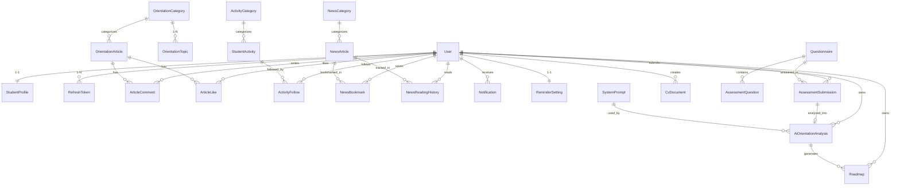

# UNERA — Đặc Tả Kỹ Thuật & Phân Tích Hệ Thống (Specifications v2.0)

> **Tài liệu này là nguồn sự thật kỹ thuật (Technical Source of Truth)** cho nền tảng **Content Management** (`00`) và toàn bộ 9 phân hệ tính năng cần triển khai trên nền tảng **UNERA**.
> Được xây dựng dựa trên rà soát trực tiếp mã nguồn hiện tại trong [`src/`](file:///c:/Users/AD/OneDrive/Desktop/Project/ULIS_DMST_2026/src), tiêu chuẩn giao diện [`UI_UX_DESIGN_SYSTEM.md`](file:///c:/Users/AD/OneDrive/Desktop/Project/ULIS_DMST_2026/UI_UX_DESIGN_SYSTEM.md) và toàn bộ yêu cầu nghiệp vụ mới nhất.

---

## 1. Phân Tích Tổng Quan & Khoảng Trống Hiện Trạng (Gap Analysis)

So với mã nguồn hiện tại (được xây dựng theo baseline cũ `SRS 1.0`), yêu cầu sản phẩm mới có những **chuyển dịch kiến trúc quan trọng (Architectural Shifts)** sau đây:

| STT | Phân hệ | Hiện trạng trong code (`src/`) | Yêu cầu mới cần triển khai | Mức độ thay đổi |
|---|---|---|---|---|
| **01** | **Authentication** | Dùng NextAuth v5 single-JWT cookie (`maxAge: 30d`). Google OAuth tự tạo `User` + `StudentProfile` rỗng rồi chuyển thẳng `/explore`. `forgot-password` mới dừng ở log console. `/admin/students` mới chỉ xem/khóa `STUDENT`, chưa quản lý `ADMIN`, chưa đổi Role và chưa có nút xóa tài khoản. | Bổ sung cơ chế **JWT Access Token + Refresh Token** (rotation + revocation trong DB). **Google OAuth** nếu chưa có tài khoản sẽ tự tạo user và **chuyển thẳng sang Bước 2 hoàn thiện hồ sơ** (`Họ tên, Năm sinh, Sinh viên năm mấy, Trường ĐH [list có sẵn], Ngành học [tự điền]`) → **Bước 3: Quiz định hướng**. Gửi email khôi phục mật khẩu thực tế. **Nâng cấp Quản trị User (`/admin/users`, `AUTH-04`)**: Admin xem/tạo/khóa user mọi vai trò, đổi Role `STUDENT` ↔ `ADMIN` an toàn, và **Xóa tài khoản vĩnh viễn** (Cascade Delete toàn bộ dữ liệu cá nhân, giữ CMS & AuditLog ẩn danh). | **Refactor lớn** |
| **02** | **Student Profile** | Đã có [`src/app/profile/page.tsx`](file:///c:/Users/AD/OneDrive/Desktop/Project/ULIS_DMST_2026/src/app/profile/page.tsx) với 4 tab (`Học vấn & Cá nhân`, `Mục tiêu phát triển`, `Kỹ năng`, `Bảng vàng thành tích`). `university` đang là text input tự do, chưa có `birthYear`, chưa có tab xem Lộ trình. | Giữ nguyên và nâng cấp tab **Kỹ năng chuyên môn & Kỹ năng mềm** + **Bảng thành tích** hiện có; chuẩn hóa **Trường Đại học (dropdown/combobox từ danh sách có sẵn)**; thêm **Năm sinh**; bổ sung tab **Lộ trình cá nhân** trực tiếp trong `/profile`. | **Nâng cấp vừa** |
| **03** | **Khám phá định hướng** | Route `/explore` hiện tại đang hiển thị danh sách **Cơ hội** (`Opportunity`). Chưa có bài viết định hướng theo ngành, chưa có Like/Comment, Sidebar đang hardcode sub-items. | Chuyển đổi hoàn toàn `/explore` thành **Thư viện Bài viết Khám phá định hướng theo ngành**. User xem danh sách/chi tiết, **Like**, **Comment**. Admin CRUD + Publish/Unpublish/Draft/Featured/Search/Filter + **Quản lý Category (đồng bộ động lên Sidebar)** & **Topic/Tag (danh mục con của Category)**. | **Tái kiến trúc / Xây mới** |
| **04** | **Hoạt động sinh viên** | Chưa có route `/activities`. Dữ liệu cơ hội nằm rải ở `Opportunity`, `SavedOpportunity`, `CalendarEntry` (nhắc hạn 7/3/1 ngày). | Xây dựng module `/activities` chuyên biệt cho **NCKH, Học bổng, Thực tập, Cuộc thi, Hội thảo...** (`SA01`–`SA19`). Có **Deadline**, **Event Date**, nút **Quan tâm / Hủy quan tâm**, tab **Cơ hội đã quan tâm**, thông báo mốc **1 tháng / 1 tuần / sắp diễn ra**, và Admin CMS + Statistics. | **Xây mới & Chuyển đổi** |
| **05** | **Tin tức** | Có [`src/app/news/page.tsx`](file:///c:/Users/AD/OneDrive/Desktop/Project/ULIS_DMST_2026/src/app/news/page.tsx) và [`NewsArticle`](file:///c:/Users/AD/OneDrive/Desktop/Project/ULIS_DMST_2026/src/models/NewsArticle.ts), nhưng Bookmark chỉ lưu tạm trên RAM (`useState`), nút Đã lưu chỉ hiện `alert()`, thiếu Sort phổ biến, Tag, Lịch sử đọc, Share, Scheduling, Analytics. | Triển khai đầy đủ `NEWS01`–`NEWS22`: Lưu bài viết thật xuống DB, danh sách bài viết đã lưu, lịch sử đọc, bài viết liên quan, sort phổ biến/mới nhất, chia sẻ link, Admin quản lý Category/Tag, hẹn giờ xuất bản (`SCHEDULED`), và thống kê analytics. | **Nâng cấp lớn** |
| **06** | **Notification** | Chỉ có model [`Notification.ts`](file:///c:/Users/AD/OneDrive/Desktop/Project/ULIS_DMST_2026/src/models/Notification.ts), chưa có UI `/notifications`, chưa có API, chưa có job nhắc hạn, mốc cũ là `[7, 3, 1]`. | Triển khai đầy đủ `OP09`–`OP14`: Engine nhắc nhở **1 tháng (30d), 1 tuần (7d), 1 ngày (1d)** cho cả **Deadline** và **Event Date**, In-app Notification Bell + Badge, Notification Center `/notifications`, Read/Unread status, và **Reminder Settings**. | **Xây mới** |
| **07** | **Công cụ** | Sidebar đã gắn link `/tools/mbti`, `/tools/mi`, `/tools/gross-net`, `/tools/tax`, nhưng thư mục `src/app/tools` chưa tồn tại. | Xây mới trọn bộ 4 công cụ chuẩn nghiệp vụ: **MBTI** (16 nhóm), **MI** (8 trí thông minh), **Tính lương Gross - Net** (2 chiều, BHXH/BHYT/BHTN theo vùng), **Tính Thuế TNCN** (lũy tiến 7 bậc). | **Xây mới** |
| **08** | **Trắc nghiệm, AI & Roadmap** | Quiz hiện tại chỉ hỗ trợ Single Choice, rule-based 5 hướng cố định, không có conditional logic, không có save progress. Roadmap dùng dữ liệu mẫu hardcoded, không có AI Gemini, chưa có edit/delete/reorder/restore goal. | Xây mới/Nâng cấp toàn diện: **Bộ câu hỏi động 4 loại + Conditional Logic + Save Progress (`PA01`–`PA25`)** → **Gemini AI Orientation Engine với JSON Schema Validation & System Prompt Management (`AI01`–`AI11`)** → **Lộ trình 4 năm AI + Quản lý mục tiêu + Lịch sử & Khôi phục (`RM01`–`RM14`)**. | **Tái kiến trúc / Xây mới** |
| **09** | **CV Builder** | Sidebar đã gắn sẵn mục `"CV chuẩn ATS"` trỏ tới `/tools/cv-builder`, nhưng chưa có trang, model `CvDocument`, thư viện mẫu CV, live preview hay cơ chế xuất PDF/chia sẻ. | Xây mới trọn bộ **CV Builder (`CV-01`–`CV-05`)**: **CV Management**, **CV Editor** (`React Hook Form` + `Zod` + `dnd-kit` + `React DayPicker` + `Lucide`), **CV Templates**, **Live Preview** (`Zustand`) và **Export PDF Vector (`@react-pdf/renderer`) + Public Sharing (`/cv/[shareSlug]`)**, hỗ trợ Pre-fill từ `StudentProfile`. | **Xây mới** |

---

## 2. Danh Mục Tài Liệu Đặc Tả Chi Tiết

| STT | Module | Phạm vi Yêu cầu | Thư mục Đặc tả |
|---|---|---|---|
| **00** | **Content & Media Management (Base)** | `CM01`–`CM16`: Tiptap Rich-Text Block Editor (JSON AST + Sanitizer + Shared Renderer), Cloudinary Upload Gateway (`Image` & `Audio`), YouTube Embed, `MediaAsset` Library & Orphan Cleanup — dùng chung làm base cho Module 03, 04, 05 | [`specification/00_CONTENT_MANAGEMENT/`](./00_CONTENT_MANAGEMENT/MODULE_SPEC.md) |
| **01** | **Authentication** | JWT Access/Refresh Token, Email/Password Login, Google OAuth auto-register, Multi-step Register (Profile + Quiz), Forgot/Reset Password, Admin User & Role Management + Cascade User Deletion (`AUTH-04`) | [`specification/01_AUTHENTICATION/`](./01_AUTHENTICATION/MODULE_SPEC.md) |
| **02** | **Student Profile** | View/Update Profile, Preset University list, BirthYear, Tab Kỹ năng (existing), Tab Bảng thành tích (existing), Tab Lộ trình cá nhân | [`specification/02_STUDENT_PROFILE/`](./02_STUDENT_PROFILE/MODULE_SPEC.md) |
| **03** | **Khám phá định hướng** | Orientation Articles (theo ngành), Dynamic Sidebar Categories & Topics/Tags, Like, Comment, Admin Article/Category/Topic/Featured CMS | [`specification/03_ORIENTATION_EXPLORE/`](./03_ORIENTATION_EXPLORE/MODULE_SPEC.md) |
| **04** | **Hoạt động sinh viên** | `SA01`–`SA19`: NCKH, Học bổng, Thực tập, Cuộc thi, Hội thảo; Deadline & Event Date; Follow/Unfollow; Tab Cơ hội đã quan tâm; Reminders; Admin CMS & Stats | [`specification/04_STUDENT_ACTIVITIES/`](./04_STUDENT_ACTIVITIES/MODULE_SPEC.md) |
| **05** | **Tin tức** | `NEWS01`–`NEWS22`: Listing, Navigation, Search/Filter/Sort, Detail, Bookmark, Saved, Related, Featured, Reading History, Share, Admin CMS, Scheduling, Analytics | [`specification/05_NEWS/`](./05_NEWS/MODULE_SPEC.md) |
| **06** | **Notification & Reminders** | `OP09`–`OP14`: Deadline Reminder (1 tháng, 1 tuần, 1 ngày), Event Reminder, In-app Notification, Notification Center, Read Status, Reminder Settings | [`specification/06_NOTIFICATIONS/`](./06_NOTIFICATIONS/MODULE_SPEC.md) |
| **07** | **Công cụ sinh viên** | Trắc nghiệm MBTI, Trắc nghiệm MI, Tính lương Gross - Net, Tính thuế Thu nhập cá nhân (TNCN) | [`specification/07_TOOLS/`](./07_TOOLS/MODULE_SPEC.md) |
| **08** | **Trắc nghiệm, AI & Roadmap** | `PA01`–`PA25` (Dynamic Questionnaire & Conditional Logic), `AI01`–`AI11` (Gemini AI Orientation & Prompt CMS), `RM01`–`RM14` (AI Roadmap & CRUD/History/Restore) | [`specification/08_PERSONAL_ORIENTATION_AI_ROADMAP/`](./08_PERSONAL_ORIENTATION_AI_ROADMAP/MODULE_SPEC.md) |
| **09** | **CV Builder** | `CV-01`–`CV-05`: CV Management, CV Editor (RHF + Zod + dnd-kit + DayPicker + Lucide), CV Templates, Live Preview (Zustand), PDF Export (`@react-pdf/renderer`) & Public Sharing | [`specification/09_CV_BUILDER/`](./09_CV_BUILDER/MODULE_SPEC.md) |

---

## 3. Kiến Trúc Kỹ Thuật & Quy Ước Chung

### 3.1 Tech Stack (Hiện tại & Bổ sung)
- **Framework:** Next.js `16.4.6` (App Router, React `19.3.0`, TypeScript `^5`).
  - *Lưu ý Next.js 16:* Route Handlers dynamic (`[id]`, `[slug]`) nhận `params` dạng `Promise<{ ... }>` và phải `await params`. File `src/middleware.ts` hiện tại có thể giữ hoặc chuyển sang `src/proxy.ts` theo chuẩn Next.js 16 (`node_modules/next/dist/docs/01-app/01-getting-started/16-proxy.md`).
- **Database:** MongoDB + Mongoose `9.12.1` (`src/lib/db.ts`).
- **Validation:** Zod `4.6.7` (`src/validations/`).
- **UI & Styling:** Tailwind CSS v4 (`@tailwindcss/turbopack`), Lucide React, tuân thủ token màu, typography và Fluid Edge-to-Edge App Shell của [`UI_UX_DESIGN_SYSTEM.md`](file:///c:/Users/AD/OneDrive/Desktop/Project/ULIS_DMST_2026/UI_UX_DESIGN_SYSTEM.md).
- **Auth & Token Signing:** NextAuth v5 (`next-auth`) cho Google OAuth flow + `jose` (Edge-compatible JWT HS256/RS256) cho cặp **Access Token (15 phút)** và **Refresh Token (7–30 ngày)** lưu hash SHA-256 trong MongoDB.
- **Email Service:** `nodemailer` hoặc `resend` (cấu hình qua `EMAIL_SERVER_*` hoặc `RESEND_API_KEY` trong `.env.local`).
- **Content & Media CMS (Base Layer `00`):** **Tiptap** (Rich-Text JSON Editor) + **Cloudinary** (`CLOUDINARY_CLOUD_NAME`, `CLOUDINARY_API_KEY`, `CLOUDINARY_API_SECRET`) + `MediaAsset` lifecycle management trong MongoDB.
- **AI Engine:** `@google/genai` (Google Gemini API) với `responseMimeType: "application/json"` và `responseSchema` + Zod validation tầng backend.
- **CV Builder Suite (Module 09):** `react-hook-form` + `@hookform/resolvers` (Form Builder), `zod` (Validation), `@dnd-kit/core` + `@dnd-kit/sortable` (Drag & Drop section/item), `zustand` (Editor & Live Preview State), `@react-pdf/renderer` (Vector PDF Export), `lucide-react` (Icons), `react-day-picker` + `date-fns` (Date Picker).

### 3.2 Sơ Đồ Quan Hệ Dữ Liệu Tổng Thể (ERD)

### 3.3 Quy Tắc Bảo Mật & Toàn Vẹn Bất Biến
1. **Server-side AuthZ:** Mọi API route đều phải kiểm tra danh tính từ Access Token hợp lệ (không tin `studentId`/`userId` từ body/query). Các API `/api/admin/*` bắt buộc kiểm tra `role === "ADMIN"` và `status === "ACTIVE"`.
2. **IDOR Prevention:** Sinh viên chỉ xem/sửa/xóa tài nguyên của chính mình (`userId === currentUser.id`).
3. **Audit Logging:** Mọi thao tác Admin (`CREATE`, `UPDATE`, `DELETE`, `PUBLISH`, `UNPUBLISH`, `ACTIVATE`, `DISABLE`, `ROLE_CHANGE`) ghi nhật ký append-only qua [`src/lib/audit.ts`](file:///c:/Users/AD/OneDrive/Desktop/Project/ULIS_DMST_2026/src/lib/audit.ts). Nếu một tài khoản từng là Admin bị xóa vĩnh viễn (`AUTH-04`), các log lịch sử được ẩn danh thay vì xóa bỏ.
4. **Data Preservation:** Không xóa làm mất dữ liệu lịch sử đã kích hoạt (ví dụ: không ghi đè cứng `Roadmap` khi tái tạo thất bại; không mất lịch sử `Notification` khi `Unfollow Activity`; không phá vỡ lịch sử `AssessmentSubmission` khi Admin chỉnh sửa `Questionnaire`). Ngoại lệ tường minh duy nhất là thao tác **Admin xóa vĩnh viễn tài khoản (`AUTH-04`)**, trong đó dữ liệu cá nhân của User bị xóa hoàn toàn nhưng bài viết/hoạt động CMS chung và `AuditLog` vẫn được bảo toàn.

